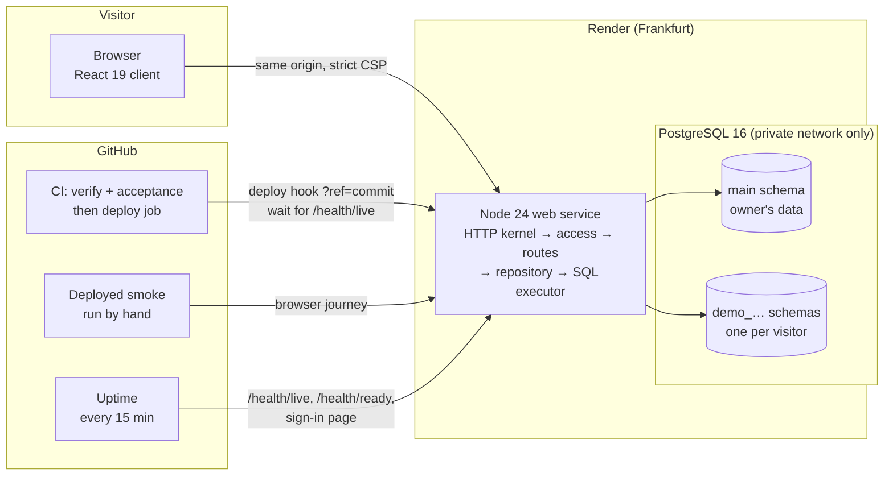
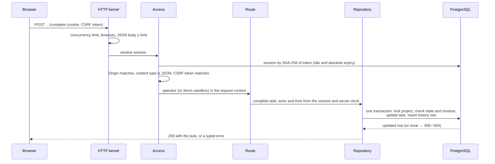
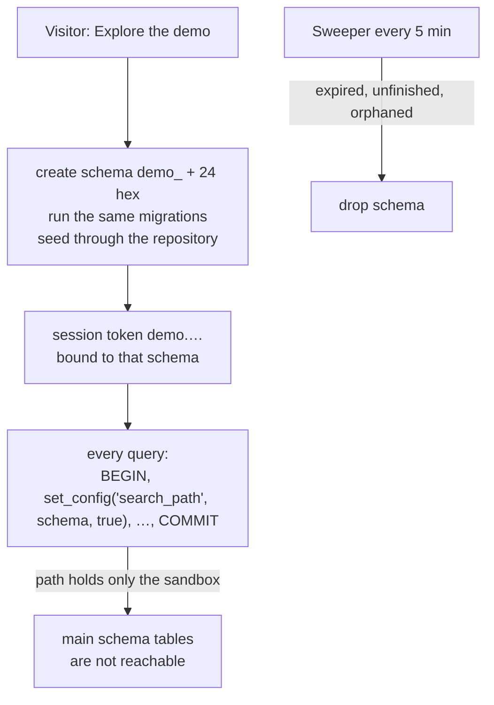
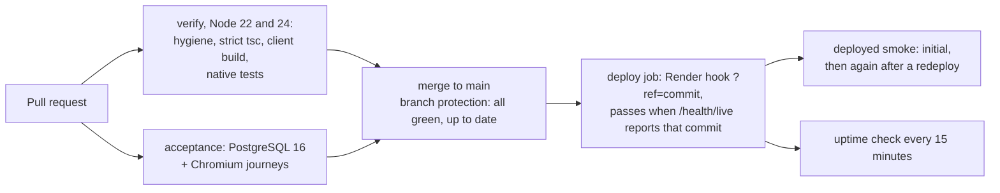

# How ProjectOps works

A tour of the system for a reviewer: what runs where, what happens to one request, how data stays correct, how the public demo is kept apart from real data, and how a change reaches production. Each section links to the code and the decision records behind it. The trade-offs at the end say what I would change at a larger scale, and why I have not yet.

## The system at a glance

- **One process serves everything.** The Node server answers the API and serves the built React client from the same origin, so the Content Security Policy can allow scripts, styles, fonts and API calls from this origin only ([ADR-002](decisions/ADR-002-react-client.md)).
- **One runtime dependency.** Production installs only `pg`. Routing, body parsing, timeouts, sessions, CSRF and logging are small modules in this repository ([ADR-000](decisions/ADR-000-monorepo-and-raw-primitives.md)), so every security-relevant line is readable and tested here.
- **The database is not reachable from the internet.** `render.yaml` gives it an empty IP allow list; only the web service connects, over Render's private network.

## One request, end to end

Take "complete this task" from the Plan tab: `POST /projectops/project-requests/:id/tasks/:taskId/complete` with `{ expectedRevision: 3 }`.

1. **The kernel** ([`apps/api/src/bootstrap/http-listener.ts`](../apps/api/src/bootstrap/http-listener.ts)) caps concurrent requests (`503 SERVER_BUSY`), applies request and idle timeouts, and parses a bounded JSON body. Pages and API answers get `Cache-Control: no-store` and `nosniff` (the client's hashed assets are cached for a year instead), and HSTS on HTTPS.
2. **Access** ([`apps/api/src/projectops/access.ts`](../apps/api/src/projectops/access.ts)) looks the session up by the SHA-256 of its token, so a leaked database row is not a usable cookie. Sessions end after 30 idle minutes or 8 hours. A write must come from the configured `Origin`, as `application/json`, with the session's CSRF token. Sign-in is rate limited in the database, so the limit survives restarts.
3. **The route** reads and validates the body. The history's actor and time, and who completed, archived, decided or addressed something and when, are not taken from the body: with an operator signed in they come from the session and the server clock, so a record cannot be backdated or attributed to someone else.
4. **The repository** ([`packages/projectops/src/repository.ts`](../packages/projectops/src/repository.ts)) runs the command and its history entry in one transaction. Either both are stored or neither is.
5. **Errors** are classified once ([`apps/api/src/http/errors/classify.ts`](../apps/api/src/http/errors/classify.ts)): client errors keep their message; a defect answers a generic 500 while the log records the cause chain, method, path and correlation id, with credentials redacted; a database outage answers `503` with `Retry-After`.

## Keeping data correct

- **Optimistic concurrency.** Clients, projects, milestones and tasks carry a revision. An edit sends the revision it read; the `UPDATE … WHERE revision = $n` matches no row if someone changed it since, and the API answers `409` with a reload instead of overwriting.
- **Parent state is checked in the same statement.** Every write to a project's records locks the project row and re-checks its state, so a task completed at the same moment the project is cancelled either commits first or fails. Acceptance tests pause real PostgreSQL transactions mid-way to force these races and assert exactly one winner.
- **History is part of the write.** Each successful action inserts its history row in the same transaction, with the trusted actor. A forced failure of the history insert rolls the action back too (tested).
- **Money is exact.** Amounts are integer cents per currency; totals use `BigInt` and are never converted between currencies or summed into one figure.
- **Lists are bounded.** Global lists use keyset pagination over matching indexes, with tamper-checked cursors: 20,000 clients went from 208 ms and 4 MB to 7 ms and 10 KB per request.
- **Migrations are frozen.** Startup applies SQL files in one transaction under an advisory lock, with a checksum ledger; an edited migration or an unmanaged schema stops the start.

## The public demo, kept apart from real data

Visitors get a private, writable copy of a sample studio without an account ([ADR-003](decisions/ADR-003-demo-sandboxes.md)).

- The search path is set per transaction (`set_config(…, true)`), so it cannot leak to the next user of a pooled connection, and the owner's schema is not on it at all: a missing table is an error, never a fall-back to real data.
- This works without changing any query because all SQL names tables without a schema. That rule is what the isolation rests on, so tests check it directly, and removing either guard fails them.
- Limits keep the shared database safe: 30 sandboxes alive, 20 new per 10 minutes, 2 hours each, and 60 writes a minute and 500 in total per sandbox. Before that budget, one script could fill the 1 GB disk in about 18 minutes (measured locally).
- Backups and their integrity fingerprint leave sandboxes out.

## From a commit to production

- Render's own auto-deploy is off. The only way to production is the CI deploy job after both suites pass on `main`, and it passes only when the live service reports the exact commit, so "deployed" means running, not queued.
- The deployed smoke drives a real browser through sign-in, access control, a full project and the public demo, saves a receipt, and after a redeploy checks the data is still there.
- The uptime workflow fails, and GitHub emails the owner, if the service, its database or the sign-in page stays down for two checks a minute apart.
- Every GitHub Action is pinned to a commit, Dependabot proposes updates weekly, and secret scanning with push protection is on.

## Trade-offs, and what changes at a larger scale

These are deliberate for one operator and one instance. Each says what would change first.

| Today | Why it is enough now | At a larger scale |
| --- | --- | --- |
| One web instance | One operator; the demo is capped at 30 sandboxes | The demo write budget is in memory per process: move it to PostgreSQL or Redis before running a second instance |
| One sign-in rate limit for everyone | A per-client limit needs the client address from the host's proxy headers, which this app cannot verify | Trust the platform's forwarded address and limit per client, or put sign-in behind the platform's WAF |
| Render's point-in-time recovery (3 days) | The real data is one operator's projects; a restore is tested with `scripts/projectops-restore-check.mjs` ([steps](projectops/runtime.md#testing-a-point-in-time-restore)) | A scheduled off-site `pg_dump` (the backup and restore drill already exists in `scripts/`) |
| Sandboxes as schemas in the production database | Cheapest isolation that needs no query changes, and it is tested | A separate database for the demo once it needs different limits or uptime |
| Uptime checks from GitHub's scheduler | Free, in the repository, alerts the owner | A dedicated monitor with an on-call channel, when minutes matter |

## Where to look

| Topic | Code | Tests |
| --- | --- | --- |
| HTTP kernel, limits, headers, errors | `apps/api/src/bootstrap/http-listener.ts`, `apps/api/src/http/` | `tests/projectops-app.test.ts`, `tests/error-logging.test.ts`, `tests/client-app.test.ts` |
| Sessions, CSRF, demo access | `apps/api/src/projectops/access.ts` | `tests/projectops-access.test.ts`, `tests/integration/operator-*.test.ts` |
| Domain rules and SQL | `packages/projectops/src/` | `tests/project-*.test.ts`, `tests/integration/*-postgres.test.ts` |
| Demo sandboxes | `packages/projectops/src/demo-sandboxes.ts` | `tests/integration/demo-postgres.test.ts`, `demo-browser.test.ts` |
| React client | `apps/client/src/` | `tests/integration/*-browser.test.ts`; phone layout and WCAG 2.1 AA in `layout-browser.test.ts` |
| Deploy, smoke, uptime | `scripts/projectops-deploy.mjs`, `projectops-deployed-smoke.mjs`, `projectops-uptime.mjs` | `tests/deploy-*.test.ts`, `tests/uptime-script.test.ts` |

The [runtime guide](projectops/runtime.md) has every route and setting; [status](projectops/status.md) has the evidence for each change.
