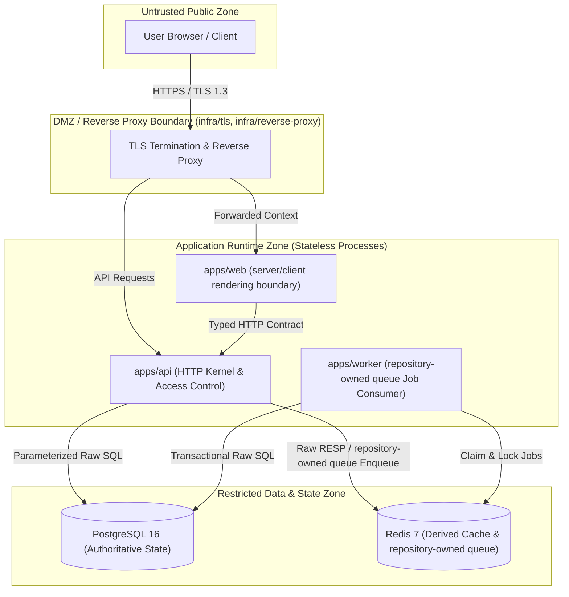
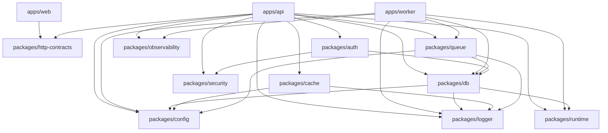
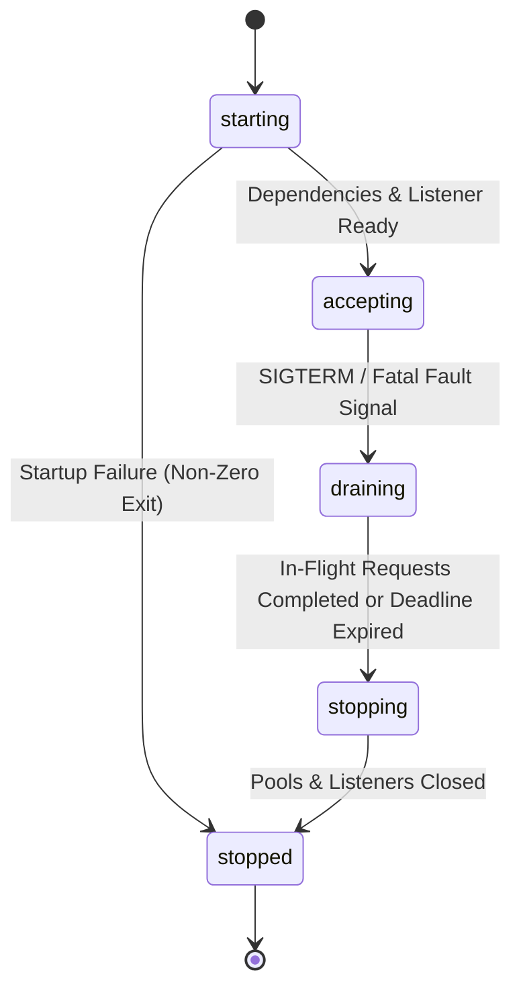

# Uruk System Topology & Diagrams-as-Code

## 1. C4 Container & Trust Boundary Diagram

## 2. Package Dependency Directed Acyclic Graph (DAG)

## 3. Runtime Lifecycle State Machine (`EXEC-FOUND-003` & `EXEC-FOUND-017`)

