# ARCH — Distributed Systems

> apps/gateway + packages/events, packages/tenancy, packages/resilience — activates once one service boundary is no longer sufficient

**Activation trigger:** Single Service Boundary No Longer Sufficient

## Shape

```mermaid
flowchart TD
  EXEC_ARCH_001["EXEC-ARCH-001 · Service Decomposition"]
  EXEC_ARCH_002["EXEC-ARCH-002 · Domain Boundary Identification"]
  EXEC_ARCH_003["EXEC-ARCH-003 · Shared Logic Extraction Decision"]
  EXEC_ARCH_004["EXEC-ARCH-004 · Data Ownership Boundaries"]
  EXEC_ARCH_005["EXEC-ARCH-005 · Ownership Assignment per Domain"]
  EXEC_ARCH_006["EXEC-ARCH-006 · Cross-Domain Data Access Policy"]
  EXEC_ARCH_007["EXEC-ARCH-007 · Inter-Service Communication Contract"]
  EXEC_ARCH_008["EXEC-ARCH-008 · Contract Versioning"]
  EXEC_ARCH_009["EXEC-ARCH-009 · Backward Compatibility Guarantee"]
  EXEC_ARCH_010["EXEC-ARCH-010 · Synchronous Dependency Risk"]
  EXEC_ARCH_011["EXEC-ARCH-011 · Dependency Chain Mapping"]
  EXEC_ARCH_012["EXEC-ARCH-012 · Timeout Propagation Awareness"]
  EXEC_ARCH_013["EXEC-ARCH-013 · Fault Isolation"]
  EXEC_ARCH_014["EXEC-ARCH-014 · Circuit Breaker Threshold Design"]
  EXEC_ARCH_015["EXEC-ARCH-015 · Bulkhead Resource Partitioning"]
  EXEC_ARCH_016["EXEC-ARCH-016 · Asynchronous Decoupling"]
  EXEC_ARCH_017["EXEC-ARCH-017 · Event Publishing"]
  EXEC_ARCH_018["EXEC-ARCH-018 · Event Subscription"]
  EXEC_ARCH_019["EXEC-ARCH-019 · Event Identity, Provenance & Idempotency"]
  EXEC_ARCH_020["EXEC-ARCH-020 · Event Schema Contract"]
  EXEC_ARCH_021["EXEC-ARCH-021 · Schema Versioning"]
  EXEC_ARCH_022["EXEC-ARCH-022 · Schema Compatibility Enforcement"]
  EXEC_ARCH_023["EXEC-ARCH-023 · Eventual Consistency Handling"]
  EXEC_ARCH_024["EXEC-ARCH-024 · Conflict Resolution Across Services"]
  EXEC_ARCH_025["EXEC-ARCH-025 · Convergence Verification"]
  EXEC_ARCH_026["EXEC-ARCH-026 · Multi-Tenant Isolation"]
  EXEC_ARCH_027["EXEC-ARCH-027 · Tenant Data Segregation"]
  EXEC_ARCH_028["EXEC-ARCH-028 · Tenant Resource Quota Enforcement"]
  EXEC_ARCH_029["EXEC-ARCH-029 · API Gateway"]
  EXEC_ARCH_030["EXEC-ARCH-030 · Request Aggregation"]
  EXEC_ARCH_031["EXEC-ARCH-031 · Gateway-Level Rate Limiting"]
  EXEC_ARCH_032["EXEC-ARCH-032 · Cross-Service Authorization Propagation"]
  EXEC_ARCH_033["EXEC-ARCH-033 · Identity Propagation"]
  EXEC_ARCH_034["EXEC-ARCH-034 · Scope Enforcement Across Boundaries"]
  EXEC_ARCH_035["EXEC-ARCH-035 · Global Traffic Routing"]
  EXEC_ARCH_036["EXEC-ARCH-036 · Geographic Routing"]
  EXEC_ARCH_037["EXEC-ARCH-037 · Failover Routing"]
  EXEC_ARCH_038["EXEC-ARCH-038 · Consistency vs Availability Trade-off Governance"]
  EXEC_ARCH_039["EXEC-ARCH-039 · Consistency Model Selection per Domain"]
  EXEC_ARCH_040["EXEC-ARCH-040 · Availability Guarantee Definition per Domain"]
  EXEC_ARCH_041["EXEC-ARCH-041 · Distributed Production Platform"]
  EXEC_ARCH_001 --> EXEC_ARCH_002
  EXEC_ARCH_001 --> EXEC_ARCH_003
  EXEC_ARCH_001 --> EXEC_ARCH_004
  EXEC_ARCH_004 --> EXEC_ARCH_005
  EXEC_ARCH_004 --> EXEC_ARCH_006
  EXEC_ARCH_004 --> EXEC_ARCH_007
  EXEC_ARCH_007 --> EXEC_ARCH_008
  EXEC_ARCH_007 --> EXEC_ARCH_009
  EXEC_ARCH_007 --> EXEC_ARCH_010
  EXEC_ARCH_010 --> EXEC_ARCH_011
  EXEC_ARCH_010 --> EXEC_ARCH_012
  EXEC_ARCH_010 --> EXEC_ARCH_013
  EXEC_ARCH_013 --> EXEC_ARCH_014
  EXEC_ARCH_013 --> EXEC_ARCH_015
  EXEC_ARCH_013 --> EXEC_ARCH_016
  EXEC_ARCH_016 --> EXEC_ARCH_017
  EXEC_ARCH_016 --> EXEC_ARCH_018
  EXEC_ARCH_016 --> EXEC_ARCH_019
  EXEC_ARCH_019 --> EXEC_ARCH_020
  EXEC_ARCH_020 --> EXEC_ARCH_021
  EXEC_ARCH_020 --> EXEC_ARCH_022
  EXEC_ARCH_020 --> EXEC_ARCH_023
  EXEC_ARCH_023 --> EXEC_ARCH_024
  EXEC_ARCH_023 --> EXEC_ARCH_025
  EXEC_ARCH_023 --> EXEC_ARCH_026
  EXEC_ARCH_026 --> EXEC_ARCH_027
  EXEC_ARCH_026 --> EXEC_ARCH_028
  EXEC_ARCH_023 --> EXEC_ARCH_029
  EXEC_ARCH_029 --> EXEC_ARCH_030
  EXEC_ARCH_029 --> EXEC_ARCH_031
  EXEC_ARCH_023 --> EXEC_ARCH_032
  EXEC_ARCH_032 --> EXEC_ARCH_033
  EXEC_ARCH_032 --> EXEC_ARCH_034
  EXEC_ARCH_032 --> EXEC_ARCH_035
  EXEC_ARCH_035 --> EXEC_ARCH_036
  EXEC_ARCH_035 --> EXEC_ARCH_037
  EXEC_ARCH_032 --> EXEC_ARCH_038
  EXEC_ARCH_038 --> EXEC_ARCH_039
  EXEC_ARCH_038 --> EXEC_ARCH_040
  EXEC_ARCH_001 --> EXEC_ARCH_041
  EXEC_ARCH_002 --> EXEC_ARCH_041
  EXEC_ARCH_003 --> EXEC_ARCH_041
  EXEC_ARCH_004 --> EXEC_ARCH_041
  EXEC_ARCH_005 --> EXEC_ARCH_041
  EXEC_ARCH_006 --> EXEC_ARCH_041
  EXEC_ARCH_007 --> EXEC_ARCH_041
  EXEC_ARCH_008 --> EXEC_ARCH_041
  EXEC_ARCH_009 --> EXEC_ARCH_041
  EXEC_ARCH_010 --> EXEC_ARCH_041
  EXEC_ARCH_011 --> EXEC_ARCH_041
  EXEC_ARCH_012 --> EXEC_ARCH_041
  EXEC_ARCH_013 --> EXEC_ARCH_041
  EXEC_ARCH_014 --> EXEC_ARCH_041
  EXEC_ARCH_015 --> EXEC_ARCH_041
  EXEC_ARCH_016 --> EXEC_ARCH_041
  EXEC_ARCH_017 --> EXEC_ARCH_041
  EXEC_ARCH_018 --> EXEC_ARCH_041
  EXEC_ARCH_019 --> EXEC_ARCH_041
  EXEC_ARCH_020 --> EXEC_ARCH_041
  EXEC_ARCH_021 --> EXEC_ARCH_041
  EXEC_ARCH_022 --> EXEC_ARCH_041
  EXEC_ARCH_023 --> EXEC_ARCH_041
  EXEC_ARCH_024 --> EXEC_ARCH_041
  EXEC_ARCH_025 --> EXEC_ARCH_041
  EXEC_ARCH_032 --> EXEC_ARCH_041
  EXEC_ARCH_033 --> EXEC_ARCH_041
  EXEC_ARCH_034 --> EXEC_ARCH_041
  EXEC_ARCH_038 --> EXEC_ARCH_041
  EXEC_ARCH_039 --> EXEC_ARCH_041
  EXEC_ARCH_040 --> EXEC_ARCH_041
```

## Execution specification

| Order | ID | Path | Purpose | Activation | Depends on | Exposes | Done when | Capability |
|---:|---|---|---|---|---|---|---|---|

| 388 | `EXEC-ARCH-001` | `docs/architecture/service-decomposition.md` | Service Decomposition | — | [`EXEC-OPS-036`](./ops.md#exec-ops-036) | `ServiceBoundaryPlan` | Service decomposition proceeds only from documented evidence that the current service boundary is insufficient; distributed architecture is not a default target. | `ARCH-001` |

| 389 | `EXEC-ARCH-002` | `docs/architecture/domain-boundaries.md` | Domain Boundary Identification | — | [`EXEC-ARCH-001`](#exec-arch-001) | `identifyDomainBoundaries(model) -> DomainBoundary[]` | Domain boundaries are derived from business invariants, ownership and change coupling; a review fixture demonstrates that each proposed boundary owns coherent behavior and does not split one invariant across services without an explicit protocol. | `ARCH-002` |

| 390 | `EXEC-ARCH-003` | `docs/architecture/shared-logic-decision.md` | Shared Logic Extraction Decision | — | [`EXEC-ARCH-001`](#exec-arch-001) | `SharedLogicDecision` | An ADR decides whether candidate shared logic remains duplicated, becomes a library, or becomes a service contract; coupling, release independence and ownership trade-offs are recorded and no network boundary is introduced merely for reuse. | `ARCH-003` |

| 391 | `EXEC-ARCH-004` | `docs/architecture/data-ownership.md` | Data Ownership Boundaries | — | [`EXEC-ARCH-001`](#exec-arch-001) | `DataOwnershipMap` | Every distributed data set has one authoritative owning domain and declared read/write access paths; the map contains no table or durable record with ambiguous multi-service write ownership. | `ARCH-004` |

| 392 | `EXEC-ARCH-005` | `docs/architecture/domain-ownership.md` | Ownership Assignment per Domain | — | [`EXEC-ARCH-004`](#exec-arch-004) | `assignDomainOwnership(resources) -> OwnershipMap` | Each resource is assigned exactly one authoritative domain owner and verification rejects unowned or multiply-owned resources unless a documented coordination protocol exists. | `ARCH-005` |

| 393 | `EXEC-ARCH-006` | `docs/architecture/cross-domain-access.md` | Cross-Domain Data Access Policy | — | [`EXEC-ARCH-004`](#exec-arch-004) | `CrossDomainAccessPolicy` | Cross-domain reads/writes use declared service/event contracts; direct access to another domain database is rejected by architecture checks except explicitly documented migration/operations paths. | `ARCH-006` |

| 394 | `EXEC-ARCH-007` | `packages/http-contracts/service-contracts/index.ts` | Inter-Service Communication Contract | — | [`EXEC-ARCH-004`](#exec-arch-004) | `ServiceContract` | A versioned HTTP/service contract defines request, response, error, timeout and compatibility semantics independently of service internals; producer and consumer fixtures verify the same contract. | `ARCH-007` |

| 395 | `EXEC-ARCH-008` | `packages/http-contracts/service-contracts/version.ts` | Contract Versioning | — | [`EXEC-ARCH-007`](#exec-arch-007) | `ContractVersion` | Every externally consumed contract carries an explicit version and lifecycle state; incompatible evolution requires a new supported version rather than silently mutating an existing contract. | `ARCH-008` |

| 396 | `EXEC-ARCH-009` | `packages/http-contracts/service-contracts/compatibility.ts` | Backward Compatibility Guarantee | — | [`EXEC-ARCH-007`](#exec-arch-007) | `checkBackwardCompatibility(previous, next) -> CompatibilityResult` | Compatibility fixtures prove supported consumers continue to accept a compatible contract change and deliberately incompatible removal/type/semantic changes fail before release. | `ARCH-009` |

| 397 | `EXEC-ARCH-010` | `docs/architecture/dependency-risk.md` | Synchronous Dependency Risk | — | [`EXEC-ARCH-007`](#exec-arch-007) | `DependencyRiskMap` | A dependency-risk document identifies synchronous chains, shared failure domains, latency budgets and critical dependencies using observed architecture rather than assuming distributed decomposition is beneficial. | `ARCH-010` |

| 398 | `EXEC-ARCH-011` | `docs/architecture/dependency-chain-map.md` | Dependency Chain Mapping | — | [`EXEC-ARCH-010`](#exec-arch-010) | `mapDependencyChains(services) -> DependencyChain[]` | All synchronous service edges are represented in a dependency-chain map; validation detects cycles and reports chains whose cumulative declared timeout/latency budget exceeds the caller budget. | `ARCH-011` |

| 399 | `EXEC-ARCH-012` | `packages/resilience/deadline-propagation.ts` | Timeout Propagation Awareness | — | [`EXEC-ARCH-010`](#exec-arch-010) | `propagateDeadline(context) -> DeadlineContext` | Inbound deadlines are reduced, never extended, across downstream calls; a forced slow dependency proves callers terminate within their declared budget and cancellation/timeout context is propagated. | `ARCH-012` |

| 400 | `EXEC-ARCH-013` | `packages/resilience/fault-isolation/index.ts` | Fault Isolation | — | [`EXEC-ARCH-010`](#exec-arch-010) | `FaultIsolationPolicy` | Failure of one service/dependency is bounded by explicit timeout, concurrency and fallback/failure rules so a forced dependency outage does not exhaust unrelated service resources. | `ARCH-013` |

| 401 | `EXEC-ARCH-014` | `packages/resilience/circuit-breaker.ts` | Circuit Breaker Threshold Design | — | [`EXEC-ARCH-013`](#exec-arch-013) | `CircuitBreakerPolicy` | The project-owned circuit breaker has explicit closed/open/probe transitions, bounded counters/windows and fake-clock tests; it is introduced only where measured synchronous dependency failure warrants it and uses no undeclared library. | `ARCH-014` |

| 402 | `EXEC-ARCH-015` | `packages/resilience/bulkhead.ts` | Bulkhead Resource Partitioning | — | [`EXEC-ARCH-013`](#exec-arch-013) | `BulkheadPolicy` | Concurrency/resource partitions cap the work one dependency or tenant can consume; saturation tests prove one failing dependency cannot consume the entire caller worker/connection capacity. | `ARCH-015` |

| 403 | `EXEC-ARCH-016` | `packages/events/async-boundary.ts` | Asynchronous Decoupling | — | [`EXEC-ARCH-013`](#exec-arch-013) | `AsyncBoundary` | An asynchronous boundary is used only where immediate synchronous completion is unnecessary; ownership, delivery semantics, failure handling and eventual-consistency effects are documented and reuse the declared queue/Redis queue layer. | `ARCH-016` |

| 404 | `EXEC-ARCH-017` | `packages/events/publishing/index.ts` | Event Publishing | — | [`EXEC-ARCH-016`](#exec-arch-016) | `publishDomainEvent(event) -> Promise<EventId>` | Domain events are published through the existing queue boundary with stable event identity, version, producer and correlation context; enqueue failure is surfaced and no exactly-once claim is made. | `ARCH-017` |

| 405 | `EXEC-ARCH-018` | `packages/events/subscription.ts` | Event Subscription | — | [`EXEC-ARCH-016`](#exec-arch-016) | `subscribeDomainEvent(type, handler) -> Subscription` | Subscribers declare accepted event versions and idempotent processing requirements; duplicate delivery and worker restart tests prove repeated delivery cannot silently duplicate protected side effects. | `ARCH-018` |

| 406 | `EXEC-ARCH-019` | `packages/events/identity/index.ts` | Event Identity, Provenance & Idempotency | — | [`EXEC-ARCH-016`](#exec-arch-016), [`EXEC-QUEUE-039`](./queue.md#exec-queue-039), [`EXEC-OBS-001`](./obs.md#exec-obs-001) | `eventIdentityProvenanceIdempotency` | Each published event has stable identity, producer/provenance and schema version; duplicate delivery is detectable and supported consumers prove idempotent handling under at-least-once transport. | `ARCH-019` |

| 407 | `EXEC-ARCH-020` | `packages/events/schema-contract/index.ts` | Event Schema Contract | — | [`EXEC-ARCH-019`](#exec-arch-019) | `EventContract` | Each event type has one versioned project-owned schema defining required fields, meaning and ownership; publishers/subscribers import or verify that contract rather than redeclaring it. | `ARCH-020` |

| 408 | `EXEC-ARCH-021` | `packages/events/schema-version.ts` | Schema Versioning | — | [`EXEC-ARCH-020`](#exec-arch-020) | `EventSchemaVersion` | Event schema versions are immutable identities; compatible evolution and version transition rules are explicit and historical events remain interpretable for the supported retention window. | `ARCH-021` |

| 409 | `EXEC-ARCH-022` | `packages/events/schema-compatibility.ts` | Schema Compatibility Enforcement | — | [`EXEC-ARCH-020`](#exec-arch-020) | `checkEventCompatibility(previous, next) -> CompatibilityResult` | Compatibility verification accepts declared additive/compatible changes and rejects removal, incompatible type/meaning changes, or unsupported versions before producer deployment. | `ARCH-022` |

| 410 | `EXEC-ARCH-023` | `packages/events/eventual-consistency/index.ts` | Eventual Consistency Handling | — | [`EXEC-ARCH-020`](#exec-arch-020) | `ConvergencePolicy` | Every eventually consistent workflow declares authoritative state, convergence condition, maximum tolerated divergence where applicable, retry/reconciliation ownership and user-visible behavior while divergent. | `ARCH-023` |

| 411 | `EXEC-ARCH-024` | `packages/events/conflict-resolution.ts` | Conflict Resolution Across Services | — | [`EXEC-ARCH-023`](#exec-arch-023) | `resolveDomainConflict(state) -> Resolution` | Concurrent cross-domain updates use a documented deterministic resolution rule or explicit rejection/manual resolution path; tests prove the system does not silently choose by arrival order unless that is the declared rule. | `ARCH-024` |

| 412 | `EXEC-ARCH-025` | `packages/events/convergence.ts` | Convergence Verification | — | [`EXEC-ARCH-023`](#exec-arch-023) | `verifyConvergence(observations) -> ConvergenceResult` | A reconciliation test starts replicas/read models in divergent states, applies the declared event/recovery process and proves convergence to the authoritative expected state within the defined condition/window. | `ARCH-025` |

| 413 | `EXEC-ARCH-026` | `packages/tenancy/isolation/index.ts` | Multi-Tenant Isolation | Activate this optional distributed branch only from its documented architectural pressure; ARCH activation alone is insufficient. | [`EXEC-ARCH-023`](#exec-arch-023) | `TenantIsolationPolicy` | Tenant isolation is end-to-end across authentication context, authorization, PostgreSQL access, cache keys, queued jobs and resource accounting; cross-tenant fixtures fail at every relevant boundary. | `ARCH-026` |

| 414 | `EXEC-ARCH-027` | `packages/tenancy/context.ts` | Tenant Data Segregation | Activate this optional distributed branch only from its documented architectural pressure; ARCH activation alone is insufficient. | [`EXEC-ARCH-026`](#exec-arch-026) | `TenantContext` | Tenant identity is derived from authenticated trusted context, propagated explicitly, immutable within a request/job and unavailable to caller-controlled header spoofing; missing tenant context fails closed where tenancy is required. | `ARCH-027` |

| 415 | `EXEC-ARCH-028` | `packages/tenancy/quota.ts` | Tenant Resource Quota Enforcement | Activate this optional distributed branch only from its documented architectural pressure; ARCH activation alone is insufficient. | [`EXEC-ARCH-026`](#exec-arch-026) | `TenantQuotaPolicy` | Per-tenant quotas have explicit units/windows and atomic enforcement at the owning resource boundary; concurrent tests prove one tenant cannot exceed its quota or consume another tenant quota. | `ARCH-028` |

| 416 | `EXEC-ARCH-029` | `apps/gateway/src/index.ts` | API Gateway | Activate this optional distributed branch only from its documented architectural pressure; ARCH activation alone is insufficient. | [`EXEC-ARCH-023`](#exec-arch-023) | `GatewayContract` | The application-owned Node.js gateway exposes only declared external routes and composes existing service contracts; it contains no domain persistence ownership and requires no undeclared gateway product. | `ARCH-029` |

| 417 | `EXEC-ARCH-030` | `apps/gateway/src/request-aggregation.ts` | Request Aggregation | Activate this optional distributed branch only from its documented architectural pressure; ARCH activation alone is insufficient. | [`EXEC-ARCH-029`](#exec-arch-029) | `aggregateRequest(request) -> GatewayResponse` | Aggregation invokes only declared downstream contracts, propagates deadlines/correlation, defines partial-failure behavior and preserves response ownership; forced downstream failure proves the declared aggregate result. | `ARCH-030` |

| 418 | `EXEC-ARCH-031` | `apps/gateway/src/rate-limit.ts` | Gateway-Level Rate Limiting | Activate this optional distributed branch only from its documented architectural pressure; ARCH activation alone is insufficient. | [`EXEC-ARCH-029`](#exec-arch-029) | `enforceGatewayRateLimit(subject) -> RateLimitDecision` | Gateway rate limiting reuses the audited raw security limiter/policy and trusted identity/network dimensions; concurrent requests cannot bypass the limit and no external gateway/rate-limit product is assumed. | `ARCH-031` |

| 419 | `EXEC-ARCH-032` | `packages/auth/cross-service-propagation/index.ts` | Cross-Service Authorization Propagation | — | [`EXEC-ARCH-023`](#exec-arch-023) | `ServiceAuthorizationContext` | Cross-service authorization has one typed context containing authenticated subject, tenant where applicable, scopes, issuer/audience and expiry needed downstream; ordinary caller headers cannot instantiate trusted context. | `ARCH-032` |

| 420 | `EXEC-ARCH-033` | `packages/auth/cross-service-propagation/identity.ts` | Identity Propagation | — | [`EXEC-ARCH-032`](#exec-arch-032) | `propagateIdentity(context) -> SignedServiceIdentity` | Identity propagation uses a project-owned authenticated integrity mechanism based on declared Node crypto/secrets, with bounded lifetime and audience; tampered, expired or wrong-audience identities are rejected. | `ARCH-033` |

| 421 | `EXEC-ARCH-034` | `packages/auth/cross-service-propagation/scope.ts` | Scope Enforcement Across Boundaries | — | [`EXEC-ARCH-032`](#exec-arch-032) | `enforceServiceScope(context, resource) -> AuthorizationDecision` | Each receiving service re-evaluates required scope/resource authorization from trusted propagated context; upstream authorization alone never grants undeclared downstream privilege. | `ARCH-034` |

| 422 | `EXEC-ARCH-035` | `infra/routing/global/index.yml` | Global Traffic Routing | Activate this optional distributed branch only from its documented architectural pressure; ARCH activation alone is insufficient. | [`EXEC-ARCH-032`](#exec-arch-032) | `GlobalRoutingPolicy` | A version-controlled routing policy defines origin/region selection, health inputs, TTL/failover assumptions and recovery behavior using declared DNS/reverse-proxy/Linux infrastructure only. | `ARCH-035` |

| 423 | `EXEC-ARCH-036` | `infra/routing/global/geographic-routing.yml` | Geographic Routing | Activate this optional distributed branch only from its documented architectural pressure; ARCH activation alone is insufficient. | [`EXEC-ARCH-035`](#exec-arch-035) | `GeographicRouteDecision` | When multiple declared locations exist, deterministic policy selects an eligible location from trusted request/operational inputs and documents behavior when geographic information is unavailable; no cloud routing service is assumed. | `ARCH-036` |

| 424 | `EXEC-ARCH-037` | `infra/routing/global/failover-routing.yml` | Failover Routing | Activate this optional distributed branch only from its documented architectural pressure; ARCH activation alone is insufficient. | [`EXEC-ARCH-035`](#exec-arch-035) | `FailoverRouteDecision` | A simulated primary-location failure removes it from eligible routing and sends new traffic to the declared healthy fallback within the stated detection/TTL bounds; recovery avoids unsafe split routing. | `ARCH-037` |

| 425 | `EXEC-ARCH-038` | `docs/architecture/consistency-availability.md` | Consistency vs Availability Trade-off Governance | — | [`EXEC-ARCH-032`](#exec-arch-032) | `ConsistencyAvailabilityDecision` | An ADR records consistency-versus-availability requirements per domain/workflow, failure partitions considered, chosen guarantees and rejected alternatives; it does not impose one model globally. | `ARCH-038` |

| 426 | `EXEC-ARCH-039` | `docs/architecture/domain-consistency.md` | Consistency Model Selection per Domain | — | [`EXEC-ARCH-038`](#exec-arch-038) | `DomainConsistencyModel` | Each distributed domain declares the consistency model clients may rely on, including read-after-write/eventual/strong boundaries where applicable, and tests demonstrate the promised observable behavior. | `ARCH-039` |

| 427 | `EXEC-ARCH-040` | `docs/architecture/domain-availability.md` | Availability Guarantee Definition per Domain | — | [`EXEC-ARCH-038`](#exec-arch-038) | `DomainAvailabilityGuarantee` | Each distributed domain declares availability behavior during dependency/network failure, including operations that fail closed, degrade, queue, or remain available; failure drills verify those guarantees. | `ARCH-040` |

| 428 | `EXEC-ARCH-041` | — | Distributed Production Platform | — | [`EXEC-ARCH-001`](#exec-arch-001), [`EXEC-ARCH-002`](#exec-arch-002), [`EXEC-ARCH-003`](#exec-arch-003), [`EXEC-ARCH-004`](#exec-arch-004), [`EXEC-ARCH-005`](#exec-arch-005), [`EXEC-ARCH-006`](#exec-arch-006), [`EXEC-ARCH-007`](#exec-arch-007), [`EXEC-ARCH-008`](#exec-arch-008), [`EXEC-ARCH-009`](#exec-arch-009), [`EXEC-ARCH-010`](#exec-arch-010), [`EXEC-ARCH-011`](#exec-arch-011), [`EXEC-ARCH-012`](#exec-arch-012), [`EXEC-ARCH-013`](#exec-arch-013), [`EXEC-ARCH-014`](#exec-arch-014), [`EXEC-ARCH-015`](#exec-arch-015), [`EXEC-ARCH-016`](#exec-arch-016), [`EXEC-ARCH-017`](#exec-arch-017), [`EXEC-ARCH-018`](#exec-arch-018), [`EXEC-ARCH-019`](#exec-arch-019), [`EXEC-ARCH-020`](#exec-arch-020), [`EXEC-ARCH-021`](#exec-arch-021), [`EXEC-ARCH-022`](#exec-arch-022), [`EXEC-ARCH-023`](#exec-arch-023), [`EXEC-ARCH-024`](#exec-arch-024), [`EXEC-ARCH-025`](#exec-arch-025), [`EXEC-ARCH-032`](#exec-arch-032), [`EXEC-ARCH-033`](#exec-arch-033), [`EXEC-ARCH-034`](#exec-arch-034), [`EXEC-ARCH-038`](#exec-arch-038), [`EXEC-ARCH-039`](#exec-arch-039), [`EXEC-ARCH-040`](#exec-arch-040), [`EXEC-OPS-036`](./ops.md#exec-ops-036) | — | Only after the activation evidence exists, a distributed-system drill proves service ownership, versioned contracts, bounded synchronous failure, queue-backed asynchronous delivery, convergence, tenant isolation, gateway authorization and routing/failover using only declared stack components; absent activation evidence this outcome remains intentionally inactive. | `ARCH-041` |
