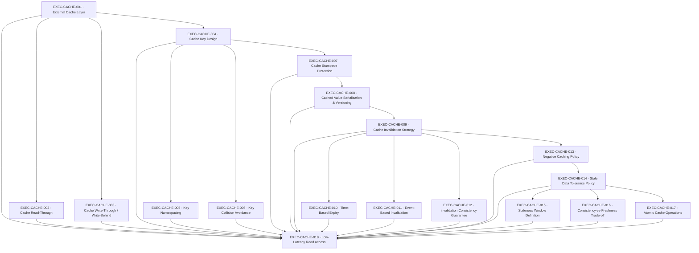

# CACHE — Caching

> Redis via a raw RESP adapter over Node.js networking primitives (packages/cache) — no Redis client library; sits in front of packages/db

**Activation trigger:** High Read Latency

## Shape

## Execution specification

| Order | ID | Path | Purpose | Activation | Depends on | Exposes | Done when | Capability |
|---:|---|---|---|---|---|---|---|---|

| 122 | `EXEC-CACHE-001` | `packages/cache/src/store/index.ts` | External Cache Layer | — | [`EXEC-DB-061`](./db.md#exec-db-061) | `CacheStore` | Redis remains derived state: cache loss or unavailability follows the declared authoritative PostgreSQL fallback/degradation contract and never makes Redis the system of record. | `CACHE-001` |

| 123 | `EXEC-CACHE-002` | `packages/cache/src/read-through.ts` | Cache Read-Through | — | [`EXEC-CACHE-001`](#exec-cache-001) | `getOrLoad<T>(key, loader, policy) -> Promise<T>` | A cache hit returns without calling the backing loader; a miss calls the loader once, stores the successful result with the declared policy, and returns it; concurrent misses for the same key follow the documented stampede behavior and loader/cache failures do not silently return fabricated data. | `CACHE-002` |

| 124 | `EXEC-CACHE-003` | `packages/cache/src/write-policy.ts` | Cache Write-Through / Write-Behind | — | [`EXEC-CACHE-001`](#exec-cache-001) | `writeWithCache<T>(key, value, persist, mode) -> Promise<void>` | The supported write mode is explicit per operation: write-through does not report success until persistence succeeds and cache state is updated/invalidated as declared; any write-behind mode has durable ownership, retry/failure semantics, and tests proving a process/cache failure cannot acknowledge data that is then silently lost. | `CACHE-003` |

| 125 | `EXEC-CACHE-004` | `packages/cache/src/keys/index.ts` | Cache Key Design | — | [`EXEC-CACHE-001`](#exec-cache-001) | `CacheKey` + `buildCacheKey(parts) -> CacheKey` | All cacheable resources use one typed key-construction contract with explicit version, namespace, identity, and encoding rules; representative keys are deterministic and no caller hand-concatenates production cache keys outside this boundary. | `CACHE-004` |

| 126 | `EXEC-CACHE-005` | `packages/cache/src/keys/namespace.ts` | Key Namespacing | — | [`EXEC-CACHE-004`](#exec-cache-004) | `CacheNamespace` + `namespaceKey(namespace, key) -> CacheKey` | Keys from different applications, environments, tenants, resource classes, or schema versions cannot overlap when those dimensions require isolation; tests construct identical logical identifiers in distinct namespaces and prove different Redis keys. | `CACHE-005` |

| 127 | `EXEC-CACHE-006` | `packages/cache/src/keys/canonicalize.ts` | Key Collision Avoidance | — | [`EXEC-CACHE-004`](#exec-cache-004) | `canonicalizeKey(parts) -> CacheKey` | Distinct supported key inputs cannot collapse through ambiguous delimiters, ordering, case, escaping, or serialization; property/table tests cover collision-prone examples and key length is bounded or hashed by a documented deterministic rule. | `CACHE-006` |

| 128 | `EXEC-CACHE-007` | `packages/cache/stampede/index.ts` | Cache Stampede Protection | — | [`EXEC-CACHE-004`](#exec-cache-004) | `cacheStampedeProtection` | Concurrent misses for the same key cause at most the declared bounded number of authoritative loads while waiters receive the resulting value or bounded failure. | `CACHE-007` |

| 129 | `EXEC-CACHE-008` | `packages/cache/serialization/index.ts` | Cached Value Serialization & Versioning | — | [`EXEC-CACHE-007`](#exec-cache-007) | `cachedValueSerializationVersioning` | Cached values carry an explicit version; supported versions deserialize deterministically and unknown/incompatible versions are treated as misses rather than corrupt authoritative state. | `CACHE-008` |

| 130 | `EXEC-CACHE-009` | `docs/decisions/cache-invalidation-strategy.md` | Cache Invalidation Strategy | — | [`EXEC-CACHE-008`](#exec-cache-008) | `CacheInvalidationPolicy` | An ADR defines which data uses TTL, explicit event invalidation, versioned keys, or no cache; it records source-of-truth ownership, ordering/failure assumptions, and rejected strategies, and every cacheable resource maps to exactly one declared invalidation policy. | `CACHE-009` |

| 131 | `EXEC-CACHE-010` | `packages/cache/src/invalidation/expiry.ts` | Time-Based Expiry | — | [`EXEC-CACHE-009`](#exec-cache-009) | `ExpiryPolicy` + `ttlFor(resource) -> Duration` | Entries governed by TTL receive the configured positive expiry atomically with the write, are unavailable after expiry, and never accidentally become immortal on refresh/update; fake-clock or Redis integration tests cover before/at/after expiry semantics. | `CACHE-010` |

| 132 | `EXEC-CACHE-011` | `packages/cache/src/invalidation/events.ts` | Event-Based Invalidation | — | [`EXEC-CACHE-009`](#exec-cache-009) | `invalidate(event) -> Promise<InvalidationResult>` | A committed source-of-truth change emits or invokes the declared invalidation path, affected keys are removed/version-shifted idempotently, duplicate events are harmless, and a forced invalidation failure follows the documented retry/reconciliation path rather than being silently dropped. | `CACHE-011` |

| 133 | `EXEC-CACHE-012` | `packages/cache/src/invalidation/consistency.ts` | Invalidation Consistency Guarantee | — | [`EXEC-CACHE-009`](#exec-cache-009) | `InvalidationConsistency` | The maximum period in which an invalidated value may remain observable is explicitly stated and demonstrated under event delay, duplicate delivery, Redis outage, and recovery; the implementation either meets that bound or fails closed for resources whose policy forbids stale reads. | `CACHE-012` |

| 134 | `EXEC-CACHE-013` | `docs/decisions/cache-negative-caching.md` | Negative Caching Policy | — | [`EXEC-CACHE-009`](#exec-cache-009) | `negativeCachingPolicy` | An ADR defines which not-found results may be cached, their shorter TTL/invalidation rules, and tests prove a later authoritative create becomes visible within the declared bound. | `CACHE-013` |

| 135 | `EXEC-CACHE-014` | `docs/decisions/cache-staleness-policy.md` | Stale Data Tolerance Policy | — | [`EXEC-CACHE-013`](#exec-cache-013) | `StalenessPolicy` | An ADR classifies cacheable data by tolerated staleness, identifies data that must bypass caching, defines behavior when Redis/source-of-truth is unavailable, and records the user/business consequence of serving stale data for each class. | `CACHE-014` |

| 136 | `EXEC-CACHE-015` | `packages/cache/src/staleness/window.ts` | Staleness Window Definition | — | [`EXEC-CACHE-014`](#exec-cache-014) | `maxStalenessFor(resource) -> Duration` | Each cacheable resource class resolves to a machine-readable non-negative maximum-staleness duration (or an explicit no-stale value); boundary tests prove values older than the permitted window are rejected/refreshed according to policy. | `CACHE-015` |

| 137 | `EXEC-CACHE-016` | `docs/decisions/cache-consistency-freshness.md` | Consistency-vs-Freshness Trade-off | — | [`EXEC-CACHE-014`](#exec-cache-014) | `FreshnessConsistencyPolicy` | An ADR states, per resource class, whether reads prioritize freshness, availability, or bounded staleness during cache/source-of-truth disagreement and outage; tests exercise the chosen behavior so callers cannot silently choose a different trade-off. | `CACHE-016` |

| 138 | `EXEC-CACHE-017` | `packages/cache/atomic/index.ts` | Atomic Cache Operations | — | [`EXEC-CACHE-014`](#exec-cache-014) | `atomicCacheOperations` | Operations requiring compare/update, claim, or increment semantics execute atomically in Redis and a concurrency test proves no lost update for the declared operation. | `CACHE-017` |

| 139 | `EXEC-CACHE-018` | — | Low-Latency Read Access | — | [`EXEC-CACHE-001`](#exec-cache-001), [`EXEC-CACHE-002`](#exec-cache-002), [`EXEC-CACHE-003`](#exec-cache-003), [`EXEC-CACHE-004`](#exec-cache-004), [`EXEC-CACHE-005`](#exec-cache-005), [`EXEC-CACHE-006`](#exec-cache-006), [`EXEC-CACHE-007`](#exec-cache-007), [`EXEC-CACHE-008`](#exec-cache-008), [`EXEC-CACHE-009`](#exec-cache-009), [`EXEC-CACHE-010`](#exec-cache-010), [`EXEC-CACHE-011`](#exec-cache-011), [`EXEC-CACHE-012`](#exec-cache-012), [`EXEC-CACHE-013`](#exec-cache-013), [`EXEC-CACHE-014`](#exec-cache-014), [`EXEC-CACHE-015`](#exec-cache-015), [`EXEC-CACHE-016`](#exec-cache-016), [`EXEC-CACHE-017`](#exec-cache-017), [`EXEC-DB-061`](./db.md#exec-db-061) | — | With a real Redis and seeded PostgreSQL source of truth, representative reads demonstrate cache hits avoid the database and meet the declared latency objective, misses populate correctly, writes/invalidation converge within the declared bound, stale-policy behavior is exercised, and Redis loss degrades according to policy without corrupting persistent state. | `CACHE-018` |
