# CICD — CI/CD

> .github/workflows + infra/docker + infra/deploy — portable build artifacts; build correctness is cache-independent

## Shape

```mermaid
flowchart TD
  EXEC_CICD_001["EXEC-CICD-001 · Version Control Foundation"]
  EXEC_CICD_002["EXEC-CICD-002 · Change History Tracking"]
  EXEC_CICD_003["EXEC-CICD-003 · Commit Granularity Design"]
  EXEC_CICD_004["EXEC-CICD-004 · Change Attribution"]
  EXEC_CICD_005["EXEC-CICD-005 · Change Isolation"]
  EXEC_CICD_006["EXEC-CICD-006 · Branch Lifecycle Management"]
  EXEC_CICD_007["EXEC-CICD-007 · Parallel Change Isolation"]
  EXEC_CICD_008["EXEC-CICD-008 · Change Reconciliation"]
  EXEC_CICD_009["EXEC-CICD-009 · Conflict Detection"]
  EXEC_CICD_010["EXEC-CICD-010 · Conflict Resolution Strategy"]
  EXEC_CICD_011["EXEC-CICD-011 · Change Provenance"]
  EXEC_CICD_012["EXEC-CICD-012 · Release Tagging"]
  EXEC_CICD_013["EXEC-CICD-013 · Traceability to Origin Change"]
  EXEC_CICD_014["EXEC-CICD-014 · Automated Build on Change"]
  EXEC_CICD_015["EXEC-CICD-015 · Build Trigger Definition"]
  EXEC_CICD_016["EXEC-CICD-016 · Build Failure Notification"]
  EXEC_CICD_017["EXEC-CICD-017 · Build Reproducibility"]
  EXEC_CICD_018["EXEC-CICD-018 · Environment Snapshotting"]
  EXEC_CICD_019["EXEC-CICD-019 · Build Determinism"]
  EXEC_CICD_020["EXEC-CICD-020 · Build Artifact Versioning"]
  EXEC_CICD_021["EXEC-CICD-021 · Artifact Immutability"]
  EXEC_CICD_022["EXEC-CICD-022 · Artifact Traceability to Source"]
  EXEC_CICD_023["EXEC-CICD-023 · Artifact Integrity Verification"]
  EXEC_CICD_024["EXEC-CICD-024 · Automated Test Execution on Change"]
  EXEC_CICD_025["EXEC-CICD-025 · Test Suite Selection per Change"]
  EXEC_CICD_026["EXEC-CICD-026 · Test Result Reporting"]
  EXEC_CICD_027["EXEC-CICD-027 · Automated Deployment Pipeline"]
  EXEC_CICD_028["EXEC-CICD-028 · Deployment Trigger Definition"]
  EXEC_CICD_029["EXEC-CICD-029 · Deployment Execution Ordering"]
  EXEC_CICD_030["EXEC-CICD-030 · Deployment Concurrency Control"]
  EXEC_CICD_031["EXEC-CICD-031 · Progressive Rollout"]
  EXEC_CICD_032["EXEC-CICD-032 · Traffic Shifting"]
  EXEC_CICD_033["EXEC-CICD-033 · Rollout Health Evaluation"]
  EXEC_CICD_034["EXEC-CICD-034 · Rollback Feasibility Classification"]
  EXEC_CICD_035["EXEC-CICD-035 · Automated Rollback on Failure Signal"]
  EXEC_CICD_036["EXEC-CICD-036 · Rollback Trigger Condition"]
  EXEC_CICD_037["EXEC-CICD-037 · Rollback Execution"]
  EXEC_CICD_038["EXEC-CICD-038 · Environment Promotion"]
  EXEC_CICD_039["EXEC-CICD-039 · Promotion Criteria Definition"]
  EXEC_CICD_040["EXEC-CICD-040 · Environment-Specific Configuration Handling"]
  EXEC_CICD_041["EXEC-CICD-041 · Deployment Gating"]
  EXEC_CICD_042["EXEC-CICD-042 · Manual Approval Gate"]
  EXEC_CICD_043["EXEC-CICD-043 · Automated Policy Gate"]
  EXEC_CICD_044["EXEC-CICD-044 · Continuously Deployable System"]
  EXEC_CICD_001 --> EXEC_CICD_002
  EXEC_CICD_002 --> EXEC_CICD_003
  EXEC_CICD_002 --> EXEC_CICD_004
  EXEC_CICD_002 --> EXEC_CICD_005
  EXEC_CICD_005 --> EXEC_CICD_006
  EXEC_CICD_005 --> EXEC_CICD_007
  EXEC_CICD_005 --> EXEC_CICD_008
  EXEC_CICD_008 --> EXEC_CICD_009
  EXEC_CICD_008 --> EXEC_CICD_010
  EXEC_CICD_008 --> EXEC_CICD_011
  EXEC_CICD_011 --> EXEC_CICD_012
  EXEC_CICD_011 --> EXEC_CICD_013
  EXEC_CICD_011 --> EXEC_CICD_014
  EXEC_CICD_014 --> EXEC_CICD_015
  EXEC_CICD_014 --> EXEC_CICD_016
  EXEC_CICD_014 --> EXEC_CICD_017
  EXEC_CICD_017 --> EXEC_CICD_018
  EXEC_CICD_017 --> EXEC_CICD_019
  EXEC_CICD_017 --> EXEC_CICD_020
  EXEC_CICD_020 --> EXEC_CICD_021
  EXEC_CICD_020 --> EXEC_CICD_022
  EXEC_CICD_020 --> EXEC_CICD_023
  EXEC_CICD_023 --> EXEC_CICD_024
  EXEC_CICD_024 --> EXEC_CICD_025
  EXEC_CICD_024 --> EXEC_CICD_026
  EXEC_CICD_024 --> EXEC_CICD_027
  EXEC_CICD_027 --> EXEC_CICD_028
  EXEC_CICD_027 --> EXEC_CICD_029
  EXEC_CICD_027 --> EXEC_CICD_030
  EXEC_CICD_030 --> EXEC_CICD_031
  EXEC_CICD_031 --> EXEC_CICD_032
  EXEC_CICD_031 --> EXEC_CICD_033
  EXEC_CICD_031 --> EXEC_CICD_034
  EXEC_CICD_034 --> EXEC_CICD_035
  EXEC_CICD_035 --> EXEC_CICD_036
  EXEC_CICD_035 --> EXEC_CICD_037
  EXEC_CICD_035 --> EXEC_CICD_038
  EXEC_CICD_038 --> EXEC_CICD_039
  EXEC_CICD_038 --> EXEC_CICD_040
  EXEC_CICD_038 --> EXEC_CICD_041
  EXEC_CICD_041 --> EXEC_CICD_042
  EXEC_CICD_041 --> EXEC_CICD_043
  EXEC_CICD_001 --> EXEC_CICD_044
  EXEC_CICD_002 --> EXEC_CICD_044
  EXEC_CICD_003 --> EXEC_CICD_044
  EXEC_CICD_004 --> EXEC_CICD_044
  EXEC_CICD_005 --> EXEC_CICD_044
  EXEC_CICD_006 --> EXEC_CICD_044
  EXEC_CICD_007 --> EXEC_CICD_044
  EXEC_CICD_008 --> EXEC_CICD_044
  EXEC_CICD_009 --> EXEC_CICD_044
  EXEC_CICD_010 --> EXEC_CICD_044
  EXEC_CICD_011 --> EXEC_CICD_044
  EXEC_CICD_012 --> EXEC_CICD_044
  EXEC_CICD_013 --> EXEC_CICD_044
  EXEC_CICD_014 --> EXEC_CICD_044
  EXEC_CICD_015 --> EXEC_CICD_044
  EXEC_CICD_016 --> EXEC_CICD_044
  EXEC_CICD_017 --> EXEC_CICD_044
  EXEC_CICD_018 --> EXEC_CICD_044
  EXEC_CICD_019 --> EXEC_CICD_044
  EXEC_CICD_020 --> EXEC_CICD_044
  EXEC_CICD_021 --> EXEC_CICD_044
  EXEC_CICD_022 --> EXEC_CICD_044
  EXEC_CICD_023 --> EXEC_CICD_044
  EXEC_CICD_024 --> EXEC_CICD_044
  EXEC_CICD_025 --> EXEC_CICD_044
  EXEC_CICD_026 --> EXEC_CICD_044
  EXEC_CICD_027 --> EXEC_CICD_044
  EXEC_CICD_028 --> EXEC_CICD_044
  EXEC_CICD_029 --> EXEC_CICD_044
  EXEC_CICD_030 --> EXEC_CICD_044
  EXEC_CICD_031 --> EXEC_CICD_044
  EXEC_CICD_032 --> EXEC_CICD_044
  EXEC_CICD_033 --> EXEC_CICD_044
  EXEC_CICD_034 --> EXEC_CICD_044
  EXEC_CICD_035 --> EXEC_CICD_044
  EXEC_CICD_036 --> EXEC_CICD_044
  EXEC_CICD_037 --> EXEC_CICD_044
  EXEC_CICD_038 --> EXEC_CICD_044
  EXEC_CICD_039 --> EXEC_CICD_044
  EXEC_CICD_040 --> EXEC_CICD_044
  EXEC_CICD_041 --> EXEC_CICD_044
  EXEC_CICD_042 --> EXEC_CICD_044
  EXEC_CICD_043 --> EXEC_CICD_044
```

## Execution specification

| Order | ID | Path | Purpose | Activation | Depends on | Exposes | Done when | Capability |
|---:|---|---|---|---|---|---|---|---|

| 308 | `EXEC-CICD-001` | — | Version Control Foundation | — | [`EXEC-TEST-026`](./test.md#exec-test-026) | — | The repository is initialized under Git with a committed baseline; a clean clone reproduces tracked source/history metadata required by later provenance checks. | `CICD-001` |

| 309 | `EXEC-CICD-002` | `docs/vcs/history-policy.md` | Change History Tracking | — | [`EXEC-CICD-001`](#exec-cicd-001) | `ChangeHistoryPolicy` | A documented Git history policy defines what is tracked, ignored and retained; repository checks prove generated secrets/build outputs are excluded and required source is versioned. | `CICD-002` |

| 310 | `EXEC-CICD-003` | `docs/vcs/commit-policy.md` | Commit Granularity Design | — | [`EXEC-CICD-002`](#exec-cicd-002) | `CommitPolicy` | Commit policy defines atomic change expectations and evidence linkage; representative accepted/rejected examples make the boundary actionable without requiring a commit-message framework. | `CICD-003` |

| 311 | `EXEC-CICD-004` | `packages/release/src/change-attribution.ts` | Change Attribution | — | [`EXEC-CICD-002`](#exec-cicd-002) | `ChangeAttribution` | A release/build can resolve author/commit identity and changed paths directly from Git metadata; missing provenance causes an explicit failure rather than an anonymous artifact. | `CICD-004` |

| 312 | `EXEC-CICD-005` | `docs/vcs/change-isolation.md` | Change Isolation | — | [`EXEC-CICD-002`](#exec-cicd-002) | `ChangeIsolationPolicy` | The documented change-isolation model prevents unfinished parallel work from entering the protected release line without reconciliation and verification. | `CICD-005` |

| 313 | `EXEC-CICD-006` | `docs/vcs/branch-lifecycle.md` | Branch Lifecycle Management | — | [`EXEC-CICD-005`](#exec-cicd-005) | `BranchLifecyclePolicy` | Branch lifecycle states creation, update, review/merge and deletion rules using native Git/GitHub capabilities; stale/diverged branch handling is explicit. | `CICD-006` |

| 314 | `EXEC-CICD-007` | `docs/vcs/parallel-changes.md` | Parallel Change Isolation | — | [`EXEC-CICD-005`](#exec-cicd-005) | `ParallelChangePolicy` | Two independent changes can be developed and verified without sharing mutable build outputs or deployment state; integration occurs only through the declared reconciliation path. | `CICD-007` |

| 315 | `EXEC-CICD-008` | `docs/vcs/reconciliation.md` | Change Reconciliation | — | [`EXEC-CICD-005`](#exec-cicd-005) | `ReconciliationPolicy` | Reconciliation requires an explicit merge/rebase policy plus post-reconciliation verification; conflicts cannot be marked resolved without a resulting commit and green required checks. | `CICD-008` |

| 316 | `EXEC-CICD-009` | `packages/release/src/conflict-detection.ts` | Conflict Detection | — | [`EXEC-CICD-008`](#exec-cicd-008) | `detectConflict()` | Native Git conflict state is detected before build/release continuation; unresolved index conflicts produce a non-zero guard result. | `CICD-009` |

| 317 | `EXEC-CICD-010` | `docs/decisions/conflict-resolution.md` | Conflict Resolution Strategy | — | [`EXEC-CICD-008`](#exec-cicd-008) | `ConflictResolutionDecision` | An ADR records the selected conflict-resolution strategy, alternatives and cases requiring human semantic review; automation never guesses resolution content. | `CICD-010` |

| 318 | `EXEC-CICD-011` | `packages/release/src/provenance.ts` | Change Provenance | — | [`EXEC-CICD-008`](#exec-cicd-008) | `ChangeProvenance` | Each candidate/release records source commit, tree identity, workflow/run identity and artifact identity in machine-readable provenance. | `CICD-011` |

| 319 | `EXEC-CICD-012` | `docs/vcs/release-tagging.md` | Release Tagging | — | [`EXEC-CICD-011`](#exec-cicd-011) | `ReleaseTagPolicy` | Release tags are immutable by policy, identify a verified source commit, follow the declared naming/version convention and cannot silently be reused for different source. | `CICD-012` |

| 320 | `EXEC-CICD-013` | `packages/release/src/traceability.ts` | Traceability to Origin Change | — | [`EXEC-CICD-011`](#exec-cicd-011) | `traceReleaseToCommit()` | Given a release/artifact identity, tooling resolves its exact Git commit and provenance record; mismatch or missing origin fails verification. | `CICD-013` |

| 321 | `EXEC-CICD-014` | `.github/workflows/build.yml` | Automated Build on Change | — | [`EXEC-CICD-011`](#exec-cicd-011) | `BuildWorkflow` | A first-party GitHub Actions workflow builds from a clean checkout using repository commands only; build failure returns a failed workflow and no releasable artifact. | `CICD-014` |

| 322 | `EXEC-CICD-015` | `.github/workflows/build-trigger.yml` | Build Trigger Definition | — | [`EXEC-CICD-014`](#exec-cicd-014) | `BuildTriggerPolicy` | Build triggers are explicitly limited to declared branches/events/paths with manual dispatch policy documented; fixture/config inspection proves unintended events do not deploy. | `CICD-015` |

| 323 | `EXEC-CICD-016` | `packages/release/src/build-failure.ts` | Build Failure Notification | — | [`EXEC-CICD-014`](#exec-cicd-014) | `BuildFailureRecord` | A failed build emits machine-readable failed step/commit/run evidence through native workflow output/artifacts/logs and cannot be interpreted as success. | `CICD-016` |

| 324 | `EXEC-CICD-017` | `infra/docker/build-reproducibility.yml` | Build Reproducibility | — | [`EXEC-CICD-014`](#exec-cicd-014) | `ReproducibleBuildContract` | A clean uncached build from the same declared inputs produces equivalent immutable output; optional caches may improve speed but cannot change correctness. | `CICD-017` |

| 325 | `EXEC-CICD-018` | `infra/docker/build-environment.yml` | Environment Snapshotting | — | [`EXEC-CICD-017`](#exec-cicd-017) | `BuildEnvironmentManifest` | The build records Node/pnpm/base-image/OS and lockfile/source identities needed to explain the environment; missing required identity fails reproducibility verification. | `CICD-018` |

| 326 | `EXEC-CICD-019` | `packages/release/src/build-determinism.ts` | Build Determinism | — | [`EXEC-CICD-017`](#exec-cicd-017) | `verifyBuildDeterminism()` | Two clean builds from identical declared inputs are compared using normalized artifact manifests/content hashes; unexplained differences fail the determinism check rather than being ignored. | `CICD-019` |

| 327 | `EXEC-CICD-020` | `packages/release/src/artifact-identity.ts` | Build Artifact Versioning | — | [`EXEC-CICD-017`](#exec-cicd-017) | `ArtifactIdentity` | Every releasable artifact receives a content-derived or source+content immutable identity and stores that identity with provenance. | `CICD-020` |

| 328 | `EXEC-CICD-021` | `infra/registry/artifact-immutability.yml` | Artifact Immutability | — | [`EXEC-CICD-020`](#exec-cicd-020) | `ArtifactImmutabilityPolicy` | Publishing refuses to overwrite an existing released artifact identity with different bytes; verification demonstrates a conflicting publish is rejected. | `CICD-021` |

| 329 | `EXEC-CICD-022` | `packages/release/src/artifact-provenance.ts` | Artifact Traceability to Source | — | [`EXEC-CICD-020`](#exec-cicd-020) | `ArtifactProvenance` | Artifact metadata links content digest to exact source commit, build run and declared build inputs; verification recomputes the digest before promotion/deployment. | `CICD-022` |

| 330 | `EXEC-CICD-023` | `infra/registry/artifact-integrity.yml` | Artifact Integrity Verification | — | [`EXEC-CICD-020`](#exec-cicd-020) | `verifyArtifactIntegrity()` | The artifact promoted/deployed has the same cryptographic digest produced by the build and recorded by release provenance; tampering or digest mismatch blocks deployment. | `CICD-023` |

| 331 | `EXEC-CICD-024` | `.github/workflows/test-on-change.yml` | Automated Test Execution on Change | — | [`EXEC-CICD-023`](#exec-cicd-023) | `TestOnChangeWorkflow` | The first-party workflow invokes the repository verification gate for changes and blocks subsequent release/deploy jobs when mandatory tests fail or are missing. | `CICD-024` |

| 332 | `EXEC-CICD-025` | `packages/release/src/change-selection.ts` | Test Suite Selection per Change | — | [`EXEC-CICD-024`](#exec-cicd-024) | `selectTestsForChange()` | Test selection uses the audited repository-owned change-impact logic and falls back to the complete mandatory suite when impact is ambiguous. | `CICD-025` |

| 333 | `EXEC-CICD-026` | `packages/testing-kit/src/report.ts` | Test Result Reporting | — | [`EXEC-CICD-024`](#exec-cicd-024) | `TestReport` | Native workflow output preserves machine-readable selected tests, statuses, durations and evidence references; failed/cancelled mandatory tests produce a failed aggregate result. | `CICD-026` |

| 334 | `EXEC-CICD-027` | `.github/workflows/deploy.yml` | Automated Deployment Pipeline | — | [`EXEC-CICD-024`](#exec-cicd-024), [`EXEC-TEST-026`](./test.md#exec-test-026), [`EXEC-DB-047`](./db.md#exec-db-047) | `DeploymentPipeline` | Deployment is expressed as a first-party workflow plus repository-owned shell/config steps, consumes an immutable verified artifact, and never rebuilds source during deployment. | `CICD-027` |

| 335 | `EXEC-CICD-028` | `.github/workflows/deploy-trigger.yml` | Deployment Trigger Definition | — | [`EXEC-CICD-027`](#exec-cicd-027) | `DeploymentTriggerPolicy` | Deployment triggers identify allowed source branches/tags/environments and required upstream evidence; unverified or unapproved source cannot invoke production deployment. | `CICD-028` |

| 336 | `EXEC-CICD-029` | `infra/deploy/plan.yml` | Deployment Execution Ordering | — | [`EXEC-CICD-027`](#exec-cicd-027) | `DeploymentPlan` | The deployment plan orders prerequisite checks, schema/config changes, service rollout, health verification and completion; a failed step stops later unsafe steps. | `CICD-029` |

| 337 | `EXEC-CICD-030` | `infra/deploy/concurrency.yml` | Deployment Concurrency Control | — | [`EXEC-CICD-027`](#exec-cicd-027) | `deploymentConcurrencyControl` | Only one conflicting deployment/migration operation may mutate a target environment at a time; concurrent attempts serialize or fail before partial execution. | `CICD-030` |

| 338 | `EXEC-CICD-031` | `docs/decisions/progressive-rollout.md` | Progressive Rollout | — | [`EXEC-CICD-030`](#exec-cicd-030) | `ProgressiveRolloutDecision` | An ADR defines whether progressive rollout is supported with the declared reverse-proxy/Docker infrastructure, traffic stages, observation windows, abort conditions and the simpler alternative when safe traffic splitting is unavailable. | `CICD-031` |

| 339 | `EXEC-CICD-032` | `infra/deploy/traffic-shift.yml` | Traffic Shifting | — | [`EXEC-CICD-031`](#exec-cicd-031) | `TrafficShiftPlan` | When progressive rollout is enabled, version-controlled reverse-proxy/deployment configuration moves only the declared traffic fraction between immutable revisions and can restore the prior routing state deterministically. | `CICD-032` |

| 340 | `EXEC-CICD-033` | `packages/release/src/rollout-health.ts` | Rollout Health Evaluation | — | [`EXEC-CICD-031`](#exec-cicd-031), [`EXEC-OBS-031`](./obs.md#exec-obs-031) | `evaluateRolloutHealth()` | Rollout health evaluation consumes declared health/SLO/error signals over a bounded window and returns continue/hold/rollback; missing required telemetry fails closed. | `CICD-033` |

| 341 | `EXEC-CICD-034` | `docs/decisions/rollback-feasibility.md` | Rollback Feasibility Classification | — | [`EXEC-CICD-031`](#exec-cicd-031) | `classifyRollbackFeasibility()` | Before rollout, the release is classified for application, schema, and external-side-effect rollback feasibility; unsafe rollback paths are blocked from automated rollback and have an explicit forward-recovery plan. | `CICD-034` |

| 342 | `EXEC-CICD-035` | `infra/deploy/rollback.yml` | Automated Rollback on Failure Signal | — | [`EXEC-CICD-034`](#exec-cicd-034) | `RollbackController` | Rollback identifies the last known-good immutable artifact/config and provides one deterministic execution path that does not rebuild source. | `CICD-035` |

| 343 | `EXEC-CICD-036` | `packages/release/src/rollback-condition.ts` | Rollback Trigger Condition | — | [`EXEC-CICD-035`](#exec-cicd-035) | `RollbackCondition` | Rollback conditions are machine-readable thresholds over deployment/health evidence, include missing-signal behavior, and tests prove trigger/non-trigger boundaries. | `CICD-036` |

| 344 | `EXEC-CICD-037` | `infra/deploy/rollback-execution.yml` | Rollback Execution | — | [`EXEC-CICD-035`](#exec-cicd-035) | `rollbackToArtifact()` | A rollback restores the selected prior artifact and compatible configuration, runs readiness/smoke verification, and records resulting deployment identity; failed rollback is surfaced as an incident. | `CICD-037` |

| 345 | `EXEC-CICD-038` | `infra/deploy/environment-promotion.yml` | Environment Promotion | — | [`EXEC-CICD-035`](#exec-cicd-035) | `PromotionPolicy` | Promotion moves the same immutable artifact identity between environments; no environment promotion step recompiles or mutates application bytes. | `CICD-038` |

| 346 | `EXEC-CICD-039` | `packages/release/src/promotion-criteria.ts` | Promotion Criteria Definition | — | [`EXEC-CICD-038`](#exec-cicd-038) | `PromotionCriteria` | Promotion criteria enumerate mandatory verification, health, provenance and approval requirements; absent or stale evidence rejects promotion. | `CICD-039` |

| 347 | `EXEC-CICD-040` | `infra/deploy/environment-config.yml` | Environment-Specific Configuration Handling | — | [`EXEC-CICD-038`](#exec-cicd-038) | `EnvironmentConfigContract` | Environment-specific configuration is external to immutable application artifacts, validated before activation, contains no committed secrets, and has an auditable version/identity. | `CICD-040` |

| 348 | `EXEC-CICD-041` | `infra/deploy/gating.yml` | Deployment Gating | — | [`EXEC-CICD-038`](#exec-cicd-038) | `DeploymentGate` | One deployment gate aggregates automated policy and any required human approval; missing, failed, expired or mismatched evidence returns deny rather than implicit allow. | `CICD-041` |

| 349 | `EXEC-CICD-042` | `docs/deploy/manual-approval.md` | Manual Approval Gate | — | [`EXEC-CICD-041`](#exec-cicd-041) | `ManualApprovalRecord` | When a manual gate is required, native GitHub environment/review approval records approver, target artifact/environment and time; approval for one artifact cannot authorize another. | `CICD-042` |

| 350 | `EXEC-CICD-043` | `packages/release/src/automated-policy-gate.ts` | Automated Policy Gate | — | [`EXEC-CICD-041`](#exec-cicd-041) | `AutomatedPolicyGate` | Automated gating verifies artifact provenance/digest, required tests, configuration validation and declared operational/security policy using repository-owned scripts; any unavailable mandatory input blocks. | `CICD-043` |

| 351 | `EXEC-CICD-044` | — | Continuously Deployable System | — | [`EXEC-CICD-001`](#exec-cicd-001), [`EXEC-CICD-002`](#exec-cicd-002), [`EXEC-CICD-003`](#exec-cicd-003), [`EXEC-CICD-004`](#exec-cicd-004), [`EXEC-CICD-005`](#exec-cicd-005), [`EXEC-CICD-006`](#exec-cicd-006), [`EXEC-CICD-007`](#exec-cicd-007), [`EXEC-CICD-008`](#exec-cicd-008), [`EXEC-CICD-009`](#exec-cicd-009), [`EXEC-CICD-010`](#exec-cicd-010), [`EXEC-CICD-011`](#exec-cicd-011), [`EXEC-CICD-012`](#exec-cicd-012), [`EXEC-CICD-013`](#exec-cicd-013), [`EXEC-CICD-014`](#exec-cicd-014), [`EXEC-CICD-015`](#exec-cicd-015), [`EXEC-CICD-016`](#exec-cicd-016), [`EXEC-CICD-017`](#exec-cicd-017), [`EXEC-CICD-018`](#exec-cicd-018), [`EXEC-CICD-019`](#exec-cicd-019), [`EXEC-CICD-020`](#exec-cicd-020), [`EXEC-CICD-021`](#exec-cicd-021), [`EXEC-CICD-022`](#exec-cicd-022), [`EXEC-CICD-023`](#exec-cicd-023), [`EXEC-CICD-024`](#exec-cicd-024), [`EXEC-CICD-025`](#exec-cicd-025), [`EXEC-CICD-026`](#exec-cicd-026), [`EXEC-CICD-027`](#exec-cicd-027), [`EXEC-CICD-028`](#exec-cicd-028), [`EXEC-CICD-029`](#exec-cicd-029), [`EXEC-CICD-030`](#exec-cicd-030), [`EXEC-CICD-031`](#exec-cicd-031), [`EXEC-CICD-032`](#exec-cicd-032), [`EXEC-CICD-033`](#exec-cicd-033), [`EXEC-CICD-034`](#exec-cicd-034), [`EXEC-CICD-035`](#exec-cicd-035), [`EXEC-CICD-036`](#exec-cicd-036), [`EXEC-CICD-037`](#exec-cicd-037), [`EXEC-CICD-038`](#exec-cicd-038), [`EXEC-CICD-039`](#exec-cicd-039), [`EXEC-CICD-040`](#exec-cicd-040), [`EXEC-CICD-041`](#exec-cicd-041), [`EXEC-CICD-042`](#exec-cicd-042), [`EXEC-CICD-043`](#exec-cicd-043), [`EXEC-TEST-026`](./test.md#exec-test-026) | — | A tagged, verified immutable artifact can traverse the declared build, test, promotion, deployment, health evaluation and rollback-capable path using only declared tooling, with provenance linking production state back to exact source. | `CICD-044` |
