# CLIENT — Client Interface

> server/client rendering boundary (apps/web) + shared packages/http-contracts — activates once the system is user-facing

**Activation trigger:** System Becomes User-Facing

## Shape

```mermaid
flowchart TD
  EXEC_CLIENT_001["EXEC-CLIENT-001 · Server/Browser Trust Boundary"]
  EXEC_CLIENT_002["EXEC-CLIENT-002 · Server-Rendered Response Generation"]
  EXEC_CLIENT_003["EXEC-CLIENT-003 · Template/Data Composition"]
  EXEC_CLIENT_004["EXEC-CLIENT-004 · Render Failure Fallback"]
  EXEC_CLIENT_005["EXEC-CLIENT-005 · Client-Side Interactivity Layer"]
  EXEC_CLIENT_006["EXEC-CLIENT-006 · State Management on Client"]
  EXEC_CLIENT_007["EXEC-CLIENT-007 · Client-Server State Synchronization"]
  EXEC_CLIENT_008["EXEC-CLIENT-008 · Hydration Consistency"]
  EXEC_CLIENT_009["EXEC-CLIENT-009 · Client/Server Data Fetching Contract"]
  EXEC_CLIENT_010["EXEC-CLIENT-010 · Data Shape Agreement"]
  EXEC_CLIENT_011["EXEC-CLIENT-011 · Fetch Failure/Retry Handling"]
  EXEC_CLIENT_012["EXEC-CLIENT-012 · User Mutation Contract"]
  EXEC_CLIENT_013["EXEC-CLIENT-013 · Rendering Strategy Selection"]
  EXEC_CLIENT_014["EXEC-CLIENT-014 · Build-Time Rendering"]
  EXEC_CLIENT_015["EXEC-CLIENT-015 · Request-Time Rendering"]
  EXEC_CLIENT_016["EXEC-CLIENT-016 · Client-Time Rendering"]
  EXEC_CLIENT_017["EXEC-CLIENT-017 · Partial Update Regeneration"]
  EXEC_CLIENT_018["EXEC-CLIENT-018 · Change Detection Trigger"]
  EXEC_CLIENT_019["EXEC-CLIENT-019 · Selective Regeneration Scope"]
  EXEC_CLIENT_020["EXEC-CLIENT-020 · Asset Delivery Optimization"]
  EXEC_CLIENT_021["EXEC-CLIENT-021 · Asset Compression"]
  EXEC_CLIENT_022["EXEC-CLIENT-022 · Asset Caching Headers"]
  EXEC_CLIENT_023["EXEC-CLIENT-023 · Edge Distribution"]
  EXEC_CLIENT_024["EXEC-CLIENT-024 · Edge Cache Placement"]
  EXEC_CLIENT_025["EXEC-CLIENT-025 · Edge-Origin Consistency"]
  EXEC_CLIENT_026["EXEC-CLIENT-026 · User-Facing Interface"]
  EXEC_CLIENT_001 --> EXEC_CLIENT_002
  EXEC_CLIENT_002 --> EXEC_CLIENT_003
  EXEC_CLIENT_002 --> EXEC_CLIENT_004
  EXEC_CLIENT_002 --> EXEC_CLIENT_005
  EXEC_CLIENT_005 --> EXEC_CLIENT_006
  EXEC_CLIENT_005 --> EXEC_CLIENT_007
  EXEC_CLIENT_005 --> EXEC_CLIENT_008
  EXEC_CLIENT_008 --> EXEC_CLIENT_009
  EXEC_CLIENT_009 --> EXEC_CLIENT_010
  EXEC_CLIENT_009 --> EXEC_CLIENT_011
  EXEC_CLIENT_009 --> EXEC_CLIENT_012
  EXEC_CLIENT_012 --> EXEC_CLIENT_013
  EXEC_CLIENT_013 --> EXEC_CLIENT_014
  EXEC_CLIENT_013 --> EXEC_CLIENT_015
  EXEC_CLIENT_013 --> EXEC_CLIENT_016
  EXEC_CLIENT_013 --> EXEC_CLIENT_017
  EXEC_CLIENT_017 --> EXEC_CLIENT_018
  EXEC_CLIENT_017 --> EXEC_CLIENT_019
  EXEC_CLIENT_017 --> EXEC_CLIENT_020
  EXEC_CLIENT_020 --> EXEC_CLIENT_021
  EXEC_CLIENT_020 --> EXEC_CLIENT_022
  EXEC_CLIENT_020 --> EXEC_CLIENT_023
  EXEC_CLIENT_023 --> EXEC_CLIENT_024
  EXEC_CLIENT_023 --> EXEC_CLIENT_025
  EXEC_CLIENT_001 --> EXEC_CLIENT_026
  EXEC_CLIENT_002 --> EXEC_CLIENT_026
  EXEC_CLIENT_003 --> EXEC_CLIENT_026
  EXEC_CLIENT_004 --> EXEC_CLIENT_026
  EXEC_CLIENT_005 --> EXEC_CLIENT_026
  EXEC_CLIENT_006 --> EXEC_CLIENT_026
  EXEC_CLIENT_007 --> EXEC_CLIENT_026
  EXEC_CLIENT_008 --> EXEC_CLIENT_026
  EXEC_CLIENT_009 --> EXEC_CLIENT_026
  EXEC_CLIENT_010 --> EXEC_CLIENT_026
  EXEC_CLIENT_011 --> EXEC_CLIENT_026
  EXEC_CLIENT_012 --> EXEC_CLIENT_026
  EXEC_CLIENT_013 --> EXEC_CLIENT_026
  EXEC_CLIENT_014 --> EXEC_CLIENT_026
  EXEC_CLIENT_015 --> EXEC_CLIENT_026
  EXEC_CLIENT_016 --> EXEC_CLIENT_026
  EXEC_CLIENT_017 --> EXEC_CLIENT_026
  EXEC_CLIENT_018 --> EXEC_CLIENT_026
  EXEC_CLIENT_019 --> EXEC_CLIENT_026
  EXEC_CLIENT_020 --> EXEC_CLIENT_026
  EXEC_CLIENT_021 --> EXEC_CLIENT_026
  EXEC_CLIENT_022 --> EXEC_CLIENT_026
```

## Execution specification

| Order | ID | Path | Purpose | Activation | Depends on | Exposes | Done when | Capability |
|---:|---|---|---|---|---|---|---|---|

| 225 | `EXEC-CLIENT-001` | `apps/web/src/server-boundary/index.ts` | Server/Browser Trust Boundary | — | [`EXEC-SEC-046`](./sec.md#exec-sec-046) | `serverBrowserTrustBoundary` | Secrets and privileged authorization decisions remain server-side; browser-supplied identity/authorization claims are treated as untrusted input and verified server-side. | `CLIENT-001` |

| 226 | `EXEC-CLIENT-002` | `apps/web/src/server/render-response.ts` | Server-Rendered Response Generation | — | [`EXEC-CLIENT-001`](#exec-client-001) | `renderServerResponse(request) -> Promise<Response>` | A server rendering boundary renders representative routes from typed server data without importing client-only modules; success, not-found, redirect, and server-failure paths are verified with the declared framework/runtime only. | `CLIENT-002` |

| 227 | `EXEC-CLIENT-003` | `apps/web/src/server/compose-view-data.ts` | Template/Data Composition | — | [`EXEC-CLIENT-002`](#exec-client-002) | `composeViewData(input) -> Promise<ViewModel>` | Server data composition has one typed boundary that resolves the exact view model required by a route, rejects missing required data before rendering, and tests prove unrelated persistence/domain fields do not leak into the client model. | `CLIENT-003` |

| 228 | `EXEC-CLIENT-004` | `apps/web/src/server/render-fallback.ts` | Render Failure Fallback | — | [`EXEC-CLIENT-002`](#exec-client-002) | `renderFallback(error) -> Response` | Render failures produce the declared safe fallback/error response without exposing stack traces, secrets, or internal objects; forced render failures prove status, logging/correlation, and recovery behavior. | `CLIENT-004` |

| 229 | `EXEC-CLIENT-005` | `apps/web/src/client/interaction-boundary.tsx` | Client-Side Interactivity Layer | — | [`EXEC-CLIENT-002`](#exec-client-002) | `ClientInteractionBoundary` | Interactive behavior is isolated behind explicit React client boundaries; server components remain server-only unless browser state/events are required, and a build/import check detects accidental client-boundary expansion. | `CLIENT-005` |

| 230 | `EXEC-CLIENT-006` | `apps/web/src/client/state-store.ts` | State Management on Client | — | [`EXEC-CLIENT-005`](#exec-client-005) | `ClientStateStore<State>` | Client state has explicit ownership: authoritative server state is not independently redefined in the browser, and reconciliation after mutations/fetches is deterministic. | `CLIENT-006` |

| 231 | `EXEC-CLIENT-007` | `apps/web/src/client/state-sync.ts` | Client-Server State Synchronization | — | [`EXEC-CLIENT-005`](#exec-client-005) | `synchronizeClientState(change) -> Promise<SyncResult>` | Client/server synchronization defines authoritative ownership, update ordering, conflict/stale-response handling, and rollback/revalidation behavior; tests force delayed and out-of-order responses and prove stale results cannot silently overwrite newer authoritative state. | `CLIENT-007` |

| 232 | `EXEC-CLIENT-008` | `apps/web/src/hydration/index.ts` | Hydration Consistency | — | [`EXEC-CLIENT-005`](#exec-client-005) | `hydrationConsistency` | Representative server-rendered state hydrates without semantic mismatch, and intentionally divergent server/client inputs trigger the documented recovery rather than silently replacing authoritative state. | `CLIENT-008` |

| 233 | `EXEC-CLIENT-009` | `packages/http-contracts/src/data-fetching/contract.ts` | Client/Server Data Fetching Contract | — | [`EXEC-CLIENT-008`](#exec-client-008) | `DataFetchContract<Request, Response>` | A shared typed request/response contract is the single source for supported client-server data exchange; both web callers and server handlers compile against it rather than redeclaring payload shapes. | `CLIENT-009` |

| 234 | `EXEC-CLIENT-010` | `packages/http-contracts/src/data-fetching/shapes.ts` | Data Shape Agreement | — | [`EXEC-CLIENT-009`](#exec-client-009) | `ApiDataShape` | Every public payload has an explicit serializable shape and version/compatibility rule where required; tests reject missing/invalid fields at the appropriate trusted boundary without adding an undeclared validation package. | `CLIENT-010` |

| 235 | `EXEC-CLIENT-011` | `apps/web/src/client/fetch-with-policy.ts` | Fetch Failure/Retry Handling | — | [`EXEC-CLIENT-009`](#exec-client-009) | `fetchWithPolicy(request) -> Promise<Response>` | Data fetching uses the Web Platform `fetch`/Web Platform facilities only; timeout/cancellation, HTTP failure classification, bounded retry eligibility, and non-idempotent retry restrictions are explicit and tested with deterministic failure cases. | `CLIENT-011` |

| 236 | `EXEC-CLIENT-012` | `packages/http-contracts/mutations/index.ts` | User Mutation Contract | — | [`EXEC-CLIENT-009`](#exec-client-009) | `userMutationContract` | Each supported mutation defines input validation, authorization, idempotency/retry classification, authoritative result, and client reconciliation; duplicate unsafe mutations are not automatically retried. | `CLIENT-012` |

| 237 | `EXEC-CLIENT-013` | `docs/decisions/client-rendering-strategy.md` | Rendering Strategy Selection | — | [`EXEC-CLIENT-012`](#exec-client-012) | `ADR: Rendering Strategy` | An ADR chooses build-time, request-time, client-time, or mixed rendering per route class, records cache/freshness/SEO/interactivity trade-offs and rejected alternatives, and prevents individual routes from selecting strategies without the documented rule. | `CLIENT-013` |

| 238 | `EXEC-CLIENT-014` | `apps/web/src/rendering/build-time.ts` | Build-Time Rendering | — | [`EXEC-CLIENT-013`](#exec-client-013) | `buildStaticOutput(route) -> Promise<StaticArtifact>` | Routes designated build-time render successfully without runtime-only dependencies, produce deterministic artifacts for identical inputs, and fail the build when required source data cannot satisfy the declared policy. | `CLIENT-014` |

| 239 | `EXEC-CLIENT-015` | `apps/web/src/rendering/request-time.ts` | Request-Time Rendering | — | [`EXEC-CLIENT-013`](#exec-client-013) | `renderAtRequestTime(request) -> Promise<Response>` | Routes designated request-time derive output from request-scoped data on each required request, do not leak state between requests, and expose the declared cache/no-cache behavior in response metadata. | `CLIENT-015` |

| 240 | `EXEC-CLIENT-016` | `apps/web/src/rendering/client-time.tsx` | Client-Time Rendering | — | [`EXEC-CLIENT-013`](#exec-client-013) | `renderOnClient(input) -> Promise<void>` | Client-time rendering occurs only inside declared client components, begins from a defined loading/empty state, handles cancellation/unmount and failure, and does not duplicate a server-rendered fetch unless the rendering policy explicitly requires revalidation. | `CLIENT-016` |

| 241 | `EXEC-CLIENT-017` | `apps/web/src/regeneration/policy.ts` | Partial Update Regeneration | — | [`EXEC-CLIENT-013`](#exec-client-013) | `RegenerationPolicy` | Partial regeneration has one policy defining eligibility, freshness bound, failure behavior, and fallback to the last valid artifact; tests prove regeneration failure does not silently publish partial output. | `CLIENT-017` |

| 242 | `EXEC-CLIENT-018` | `apps/web/src/regeneration/change-detection.ts` | Change Detection Trigger | — | [`EXEC-CLIENT-017`](#exec-client-017) | `shouldRegenerate(change) -> boolean` | Only declared content/data changes trigger regeneration; irrelevant changes do not, and representative change events prove deterministic trigger decisions. | `CLIENT-018` |

| 243 | `EXEC-CLIENT-019` | `apps/web/src/regeneration/scope.ts` | Selective Regeneration Scope | — | [`EXEC-CLIENT-017`](#exec-client-017) | `regenerationScope(change) -> RouteSet` | A triggering change maps to the minimum declared route/tag scope; tests prove affected pages are included and unrelated pages are not invalidated, preventing accidental whole-site regeneration. | `CLIENT-019` |

| 244 | `EXEC-CLIENT-020` | `apps/web/src/assets/policy.ts` | Asset Delivery Optimization | — | [`EXEC-CLIENT-017`](#exec-client-017) | `AssetDeliveryPolicy` | Static/client assets have one delivery policy covering immutable naming, compression eligibility, cacheability, content type, and size constraints using browser/reverse-proxy capabilities only. | `CLIENT-020` |

| 245 | `EXEC-CLIENT-021` | `apps/web/src/assets/compression.ts` | Asset Compression | — | [`EXEC-CLIENT-020`](#exec-client-020) | `CompressionBoundary` | Compressible assets are served with an encoding supported by the declared runtime/proxy, already-compressed formats are not recompressed unnecessarily, and response headers correctly vary by accepted encoding. | `CLIENT-021` |

| 246 | `EXEC-CLIENT-022` | `apps/web/src/assets/cache-headers.ts` | Asset Caching Headers | — | [`EXEC-CLIENT-020`](#exec-client-020) | `assetCacheHeaders(asset) -> Headers` | Fingerprint/immutable assets receive long-lived immutable caching while mutable HTML/data receives the explicitly shorter/no-cache policy; header tests prove no user-specific response is accidentally publicly cacheable. | `CLIENT-022` |

| 247 | `EXEC-CLIENT-023` | `infra/edge/config.yml` | Edge Distribution | Activate edge distribution only from measured delivery/latency or geographic-distribution need. | [`EXEC-CLIENT-020`](#exec-client-020) | `EdgeDeliveryConfig` | Edge delivery is expressed as deployment/reverse-proxy configuration only; origin, forwarded headers, TLS boundary, cacheable paths, and bypass paths are explicit and no undeclared CDN/edge SDK is assumed. | `CLIENT-023` |

| 248 | `EXEC-CLIENT-024` | `infra/edge/cache-policy.yml` | Edge Cache Placement | Activate edge distribution only from measured delivery/latency or geographic-distribution need. | [`EXEC-CLIENT-023`](#exec-client-023) | `EdgeCachePolicy` | The edge cache key includes every request dimension that can legitimately change a cacheable response and excludes user-specific/authenticated responses unless explicitly safe; tests prove no cross-user or cross-variant cache leakage. | `CLIENT-024` |

| 249 | `EXEC-CLIENT-025` | `infra/edge/origin-consistency.yml` | Edge-Origin Consistency | Activate edge distribution only from measured delivery/latency or geographic-distribution need. | [`EXEC-CLIENT-023`](#exec-client-023) | `verifyEdgeOriginConsistency() -> Promise<ConsistencyResult>` | Cache purge/revalidation and origin updates converge within a declared bound; tests/config verification cover stale edge content after deployment/change and prove the system either serves the last valid version within policy or reaches the new origin version without mixed unsafe state. | `CLIENT-025` |

| 250 | `EXEC-CLIENT-026` | — | User-Facing Interface | — | [`EXEC-CLIENT-001`](#exec-client-001), [`EXEC-CLIENT-002`](#exec-client-002), [`EXEC-CLIENT-003`](#exec-client-003), [`EXEC-CLIENT-004`](#exec-client-004), [`EXEC-CLIENT-005`](#exec-client-005), [`EXEC-CLIENT-006`](#exec-client-006), [`EXEC-CLIENT-007`](#exec-client-007), [`EXEC-CLIENT-008`](#exec-client-008), [`EXEC-CLIENT-009`](#exec-client-009), [`EXEC-CLIENT-010`](#exec-client-010), [`EXEC-CLIENT-011`](#exec-client-011), [`EXEC-CLIENT-012`](#exec-client-012), [`EXEC-CLIENT-013`](#exec-client-013), [`EXEC-CLIENT-014`](#exec-client-014), [`EXEC-CLIENT-015`](#exec-client-015), [`EXEC-CLIENT-016`](#exec-client-016), [`EXEC-CLIENT-017`](#exec-client-017), [`EXEC-CLIENT-018`](#exec-client-018), [`EXEC-CLIENT-019`](#exec-client-019), [`EXEC-CLIENT-020`](#exec-client-020), [`EXEC-CLIENT-021`](#exec-client-021), [`EXEC-CLIENT-022`](#exec-client-022), [`EXEC-SEC-046`](./sec.md#exec-sec-046) | — | Representative user-facing routes render through the selected strategy, become interactive where required, exchange only declared typed data, tolerate fetch/render/regeneration failures, and serve assets/cache headers according to policy using only browser platform, browser primitives, and declared infrastructure. | `CLIENT-026` |
