# DB — Persistence

> PostgreSQL + raw SQL (packages/db) — first external stateful dependency

**Activation trigger:** Persistence Required

## Shape

```mermaid
flowchart TD
  EXEC_DB_001["EXEC-DB-001 · Database Connection Establishment"]
  EXEC_DB_002["EXEC-DB-002 · Connection Handshake"]
  EXEC_DB_003["EXEC-DB-003 · Connection Timeout Handling"]
  EXEC_DB_004["EXEC-DB-004 · Connection Failure Handling"]
  EXEC_DB_005["EXEC-DB-005 · Retry on Transient Failure"]
  EXEC_DB_006["EXEC-DB-006 · Circuit Breaking on Persistent Failure"]
  EXEC_DB_007["EXEC-DB-007 · Connection Pooling"]
  EXEC_DB_008["EXEC-DB-008 · Pool Initialization"]
  EXEC_DB_009["EXEC-DB-009 · Connection Acquisition"]
  EXEC_DB_010["EXEC-DB-010 · Connection Validation"]
  EXEC_DB_011["EXEC-DB-011 · Connection Release"]
  EXEC_DB_012["EXEC-DB-012 · Pool Exhaustion Handling"]
  EXEC_DB_013["EXEC-DB-013 · Pool Shutdown"]
  EXEC_DB_014["EXEC-DB-014 · Query Deadline & Cancellation"]
  EXEC_DB_015["EXEC-DB-015 · Schema Definition"]
  EXEC_DB_016["EXEC-DB-016 · Entity Modeling"]
  EXEC_DB_017["EXEC-DB-017 · Relationship Modeling"]
  EXEC_DB_018["EXEC-DB-018 · Constraint Definition"]
  EXEC_DB_019["EXEC-DB-019 · Data Write Operations"]
  EXEC_DB_020["EXEC-DB-020 · Single-Record Write"]
  EXEC_DB_021["EXEC-DB-021 · Bulk Write"]
  EXEC_DB_022["EXEC-DB-022 · Write Conflict Detection"]
  EXEC_DB_023["EXEC-DB-023 · Data Read Operations"]
  EXEC_DB_024["EXEC-DB-024 · Single-Record Read"]
  EXEC_DB_025["EXEC-DB-025 · Filtered/Paginated Read"]
  EXEC_DB_026["EXEC-DB-026 · Aggregation Read"]
  EXEC_DB_027["EXEC-DB-027 · Domain Persistence Boundary"]
  EXEC_DB_028["EXEC-DB-028 · Query Interface Design"]
  EXEC_DB_029["EXEC-DB-029 · Data Mapping"]
  EXEC_DB_030["EXEC-DB-030 · Transactional Consistency"]
  EXEC_DB_031["EXEC-DB-031 · Transaction Boundary Definition"]
  EXEC_DB_032["EXEC-DB-032 · Commit/Rollback Handling"]
  EXEC_DB_033["EXEC-DB-033 · Isolation Level Selection"]
  EXEC_DB_034["EXEC-DB-034 · Concurrent Write Conflict Handling"]
  EXEC_DB_035["EXEC-DB-035 · Optimistic Locking"]
  EXEC_DB_036["EXEC-DB-036 · Pessimistic Locking"]
  EXEC_DB_037["EXEC-DB-037 · Deadlock Detection & Recovery"]
  EXEC_DB_038["EXEC-DB-038 · Data Integrity Constraints"]
  EXEC_DB_039["EXEC-DB-039 · Uniqueness Enforcement"]
  EXEC_DB_040["EXEC-DB-040 · Referential Integrity Enforcement"]
  EXEC_DB_041["EXEC-DB-041 · Validation-at-Write-Time"]
  EXEC_DB_042["EXEC-DB-042 · Schema Evolution"]
  EXEC_DB_043["EXEC-DB-043 · Migration Concurrency Control"]
  EXEC_DB_044["EXEC-DB-044 · Forward Migration"]
  EXEC_DB_045["EXEC-DB-045 · Backward Migration"]
  EXEC_DB_046["EXEC-DB-046 · Zero-Downtime Migration Strategy"]
  EXEC_DB_047["EXEC-DB-047 · Application/Schema Compatibility"]
  EXEC_DB_048["EXEC-DB-048 · Query Performance Awareness"]
  EXEC_DB_049["EXEC-DB-049 · Query Cost Estimation"]
  EXEC_DB_050["EXEC-DB-050 · N+1 Query Detection"]
  EXEC_DB_051["EXEC-DB-051 · Indexing"]
  EXEC_DB_052["EXEC-DB-052 · Index Selection"]
  EXEC_DB_053["EXEC-DB-053 · Index Maintenance Cost Awareness"]
  EXEC_DB_054["EXEC-DB-054 · Composite Index Design"]
  EXEC_DB_055["EXEC-DB-055 · Query Plan Analysis"]
  EXEC_DB_056["EXEC-DB-056 · Execution Plan Interpretation"]
  EXEC_DB_057["EXEC-DB-057 · Plan Regression Detection"]
  EXEC_DB_058["EXEC-DB-058 · Slow Query Detection"]
  EXEC_DB_059["EXEC-DB-059 · Query Latency Thresholding"]
  EXEC_DB_060["EXEC-DB-060 · Slow Query Logging"]
  EXEC_DB_061["EXEC-DB-061 · Persistent Storage Available"]
  EXEC_DB_001 --> EXEC_DB_002
  EXEC_DB_001 --> EXEC_DB_003
  EXEC_DB_001 --> EXEC_DB_004
  EXEC_DB_004 --> EXEC_DB_005
  EXEC_DB_004 --> EXEC_DB_006
  EXEC_DB_004 --> EXEC_DB_007
  EXEC_DB_007 --> EXEC_DB_008
  EXEC_DB_007 --> EXEC_DB_009
  EXEC_DB_007 --> EXEC_DB_010
  EXEC_DB_007 --> EXEC_DB_011
  EXEC_DB_007 --> EXEC_DB_012
  EXEC_DB_007 --> EXEC_DB_013
  EXEC_DB_007 --> EXEC_DB_014
  EXEC_DB_014 --> EXEC_DB_015
  EXEC_DB_015 --> EXEC_DB_016
  EXEC_DB_015 --> EXEC_DB_017
  EXEC_DB_015 --> EXEC_DB_018
  EXEC_DB_015 --> EXEC_DB_019
  EXEC_DB_019 --> EXEC_DB_020
  EXEC_DB_019 --> EXEC_DB_021
  EXEC_DB_019 --> EXEC_DB_022
  EXEC_DB_019 --> EXEC_DB_023
  EXEC_DB_023 --> EXEC_DB_024
  EXEC_DB_023 --> EXEC_DB_025
  EXEC_DB_023 --> EXEC_DB_026
  EXEC_DB_023 --> EXEC_DB_027
  EXEC_DB_027 --> EXEC_DB_028
  EXEC_DB_027 --> EXEC_DB_029
  EXEC_DB_027 --> EXEC_DB_030
  EXEC_DB_030 --> EXEC_DB_031
  EXEC_DB_030 --> EXEC_DB_032
  EXEC_DB_030 --> EXEC_DB_033
  EXEC_DB_030 --> EXEC_DB_034
  EXEC_DB_034 --> EXEC_DB_035
  EXEC_DB_034 --> EXEC_DB_036
  EXEC_DB_034 --> EXEC_DB_037
  EXEC_DB_034 --> EXEC_DB_038
  EXEC_DB_038 --> EXEC_DB_039
  EXEC_DB_038 --> EXEC_DB_040
  EXEC_DB_038 --> EXEC_DB_041
  EXEC_DB_038 --> EXEC_DB_042
  EXEC_DB_042 --> EXEC_DB_043
  EXEC_DB_042 --> EXEC_DB_044
  EXEC_DB_042 --> EXEC_DB_045
  EXEC_DB_042 --> EXEC_DB_046
  EXEC_DB_043 --> EXEC_DB_047
  EXEC_DB_047 --> EXEC_DB_048
  EXEC_DB_048 --> EXEC_DB_049
  EXEC_DB_048 --> EXEC_DB_050
  EXEC_DB_048 --> EXEC_DB_051
  EXEC_DB_051 --> EXEC_DB_052
  EXEC_DB_051 --> EXEC_DB_053
  EXEC_DB_051 --> EXEC_DB_054
  EXEC_DB_051 --> EXEC_DB_055
  EXEC_DB_055 --> EXEC_DB_056
  EXEC_DB_055 --> EXEC_DB_057
  EXEC_DB_055 --> EXEC_DB_058
  EXEC_DB_058 --> EXEC_DB_059
  EXEC_DB_058 --> EXEC_DB_060
  EXEC_DB_001 --> EXEC_DB_061
  EXEC_DB_002 --> EXEC_DB_061
  EXEC_DB_003 --> EXEC_DB_061
  EXEC_DB_004 --> EXEC_DB_061
  EXEC_DB_005 --> EXEC_DB_061
  EXEC_DB_006 --> EXEC_DB_061
  EXEC_DB_007 --> EXEC_DB_061
  EXEC_DB_008 --> EXEC_DB_061
  EXEC_DB_009 --> EXEC_DB_061
  EXEC_DB_010 --> EXEC_DB_061
  EXEC_DB_011 --> EXEC_DB_061
  EXEC_DB_012 --> EXEC_DB_061
  EXEC_DB_013 --> EXEC_DB_061
  EXEC_DB_014 --> EXEC_DB_061
  EXEC_DB_015 --> EXEC_DB_061
  EXEC_DB_016 --> EXEC_DB_061
  EXEC_DB_017 --> EXEC_DB_061
  EXEC_DB_018 --> EXEC_DB_061
  EXEC_DB_019 --> EXEC_DB_061
  EXEC_DB_020 --> EXEC_DB_061
  EXEC_DB_021 --> EXEC_DB_061
  EXEC_DB_022 --> EXEC_DB_061
  EXEC_DB_023 --> EXEC_DB_061
  EXEC_DB_024 --> EXEC_DB_061
  EXEC_DB_025 --> EXEC_DB_061
  EXEC_DB_026 --> EXEC_DB_061
  EXEC_DB_027 --> EXEC_DB_061
  EXEC_DB_028 --> EXEC_DB_061
  EXEC_DB_029 --> EXEC_DB_061
  EXEC_DB_030 --> EXEC_DB_061
  EXEC_DB_031 --> EXEC_DB_061
  EXEC_DB_032 --> EXEC_DB_061
  EXEC_DB_033 --> EXEC_DB_061
  EXEC_DB_034 --> EXEC_DB_061
  EXEC_DB_035 --> EXEC_DB_061
  EXEC_DB_036 --> EXEC_DB_061
  EXEC_DB_037 --> EXEC_DB_061
  EXEC_DB_038 --> EXEC_DB_061
  EXEC_DB_039 --> EXEC_DB_061
  EXEC_DB_040 --> EXEC_DB_061
  EXEC_DB_041 --> EXEC_DB_061
  EXEC_DB_042 --> EXEC_DB_061
  EXEC_DB_043 --> EXEC_DB_061
  EXEC_DB_044 --> EXEC_DB_061
  EXEC_DB_045 --> EXEC_DB_061
  EXEC_DB_046 --> EXEC_DB_061
  EXEC_DB_047 --> EXEC_DB_061
  EXEC_DB_048 --> EXEC_DB_061
  EXEC_DB_049 --> EXEC_DB_061
  EXEC_DB_050 --> EXEC_DB_061
  EXEC_DB_051 --> EXEC_DB_061
  EXEC_DB_052 --> EXEC_DB_061
  EXEC_DB_053 --> EXEC_DB_061
  EXEC_DB_054 --> EXEC_DB_061
  EXEC_DB_055 --> EXEC_DB_061
  EXEC_DB_056 --> EXEC_DB_061
  EXEC_DB_057 --> EXEC_DB_061
  EXEC_DB_058 --> EXEC_DB_061
  EXEC_DB_059 --> EXEC_DB_061
  EXEC_DB_060 --> EXEC_DB_061
```

## Execution specification

| Order | ID | Path | Purpose | Activation | Depends on | Exposes | Done when | Capability |
|---:|---|---|---|---|---|---|---|---|

| 61 | `EXEC-DB-001` | `packages/db/src/connection/connect.ts` | Database Connection Establishment | — | [`EXEC-FOUND-060`](./found.md#exec-found-060), [`EXEC-FOUND-003`](./found.md#exec-found-003) | `connectDatabase(config) -> Promise<DatabaseConnection>` | A disposable PostgreSQL instance accepts a connection through one database adapter using validated configuration; success returns a usable connection and authentication/network failure is surfaced without hanging. | `DB-001` |

| 62 | `EXEC-DB-002` | `packages/db/src/connection/handshake.ts` | Connection Handshake | — | [`EXEC-DB-001`](#exec-db-001) | `performHandshake(client) -> Promise<ServerIdentity>` | Connection startup verifies protocol/authentication and records the server identity/version needed by the adapter; an incompatible or rejected handshake fails before queries can run. | `DB-002` |

| 63 | `EXEC-DB-003` | `packages/db/src/connection/timeout.ts` | Connection Timeout Handling | — | [`EXEC-DB-001`](#exec-db-001) | `DatabaseConnectTimeoutError` | A connection attempt that exceeds the configured deadline is cancelled and returns the typed timeout failure; a test uses an unreachable/delayed endpoint and proves no connection remains pending. | `DB-003` |

| 64 | `EXEC-DB-004` | `packages/db/src/connection-resilience/failure.ts` | Connection Failure Handling | — | [`EXEC-DB-001`](#exec-db-001) | `classifyConnectionFailure(error) -> ConnectionFailure` | Authentication, DNS/network, timeout, and server-unavailable failures map to explicit connection-failure categories while preserving the original cause for internal diagnostics. | `DB-004` |

| 65 | `EXEC-DB-005` | `packages/db/src/connection-resilience/retry.ts` | Retry on Transient Failure | — | [`EXEC-DB-004`](#exec-db-004) | `retryTransientConnection(operation, policy) -> Promise<T>` | Only failures classified transient are retried, attempts are bounded, and a succeeding later attempt returns normally; permanent failures are not retried. | `DB-005` |

| 66 | `EXEC-DB-006` | `packages/db/src/connection-resilience/circuit-breaker.ts` | Circuit Breaking on Persistent Failure | — | [`EXEC-DB-004`](#exec-db-004) | `ConnectionCircuitBreaker` | Repeated qualifying connection failures open the breaker, open state rejects immediately, and a successful probe after the recovery interval closes it; state transitions are tested with a fake clock. | `DB-006` |

| 67 | `EXEC-DB-007` | `packages/db/src/pool/index.ts` | Connection Pooling | — | [`EXEC-DB-004`](#exec-db-004) | `DatabasePool` | All application database access obtains connections from one bounded pool; configured min/max limits are enforced and pool metrics expose active, idle, and waiting counts. | `DB-007` |

| 68 | `EXEC-DB-008` | `packages/db/src/pool/initialize.ts` | Pool Initialization | — | [`EXEC-DB-007`](#exec-db-007) | `createPool(config) -> DatabasePool` | Pool creation validates limits and connection configuration, establishes its required initial resources, and fails atomically without leaking clients when initialization cannot complete. | `DB-008` |

| 69 | `EXEC-DB-009` | `packages/db/src/pool/acquire.ts` | Connection Acquisition | — | [`EXEC-DB-007`](#exec-db-007) | `acquireConnection() -> Promise<PooledConnection>` | Acquisition returns an exclusively leased client or waits up to the configured acquisition deadline; concurrent tests prove no client is leased to two callers simultaneously. | `DB-009` |

| 70 | `EXEC-DB-010` | `packages/db/src/pool/validate.ts` | Connection Validation | — | [`EXEC-DB-007`](#exec-db-007) | `validateConnection(connection) -> Promise<boolean>` | A stale/broken pooled connection is detected before use and removed or replaced; a healthy connection passes without an unnecessary reconnect. | `DB-010` |

| 71 | `EXEC-DB-011` | `packages/db/src/pool/release.ts` | Connection Release | — | [`EXEC-DB-007`](#exec-db-007) | `releaseConnection(connection) -> void` | Released clients return to the pool exactly once, transaction state is not leaked to the next borrower, and double release is rejected or harmless by contract. | `DB-011` |

| 72 | `EXEC-DB-012` | `packages/db/src/pool/exhaustion.ts` | Pool Exhaustion Handling | — | [`EXEC-DB-007`](#exec-db-007) | `PoolExhaustedError` | When the pool is saturated, callers wait only to the configured limit and receive a typed exhaustion failure; a concurrency test saturates and then frees capacity. | `DB-012` |

| 73 | `EXEC-DB-013` | `packages/db/src/pool/shutdown.ts` | Pool Shutdown | — | [`EXEC-DB-007`](#exec-db-007) | `closePool() -> Promise<void>` | Shutdown rejects new acquisitions, waits for or bounds active leases, closes idle/returned clients, and leaves zero open pool connections in an integration test. | `DB-013` |

| 74 | `EXEC-DB-014` | `packages/db/src/query-deadline/index.ts` | Query Deadline & Cancellation | — | [`EXEC-DB-007`](#exec-db-007) | `queryDeadlineCancellation` | A query exceeding its deadline is cancelled at the PostgreSQL operation boundary, releases its connection, and returns a typed timeout/cancellation result without later committing work. | `DB-014` |

| 75 | `EXEC-DB-015` | `packages/db/src/schema/index.ts` | Schema Definition | — | [`EXEC-DB-014`](#exec-db-014) | `SchemaDefinition` | The database schema has one version-controlled definition from which a clean PostgreSQL database can be created deterministically; schema drift is detectable in verification. | `DB-015` |

| 76 | `EXEC-DB-016` | `packages/db/src/schema/entities.ts` | Entity Modeling | — | [`EXEC-DB-015`](#exec-db-015) | `EntityDefinition` | Each persisted entity has explicit table, column, nullability, identifier, and domain mapping definitions; no persisted field relies on an undocumented implicit representation. | `DB-016` |

| 77 | `EXEC-DB-017` | `packages/db/src/schema/relationships.ts` | Relationship Modeling | — | [`EXEC-DB-015`](#exec-db-015) | `RelationshipDefinition` | Required one-to-one, one-to-many, and many-to-many relationships are represented explicitly with ownership and delete/update behavior documented and integration-tested. | `DB-017` |

| 78 | `EXEC-DB-018` | `packages/db/src/schema/constraints.ts` | Constraint Definition | — | [`EXEC-DB-015`](#exec-db-015) | `ConstraintDefinition` | Primary keys, nullability, checks, uniqueness, and foreign-key constraints required by the model exist in PostgreSQL and rejecting examples fail at the database boundary. | `DB-018` |

| 79 | `EXEC-DB-019` | `packages/db/src/writes/index.ts` | Data Write Operations | — | [`EXEC-DB-015`](#exec-db-015) | `WriteRepository` | All supported writes execute through the declared write boundary using parameterized SQL and return deterministic success/failure results; direct string-concatenated user input is absent. | `DB-019` |

| 80 | `EXEC-DB-020` | `packages/db/src/writes/single.ts` | Single-Record Write | — | [`EXEC-DB-019`](#exec-db-019) | `insertOne(record) -> Promise<StoredRecord>` | A valid record is inserted and returned/mapped correctly; invalid constrained data fails without partial persistence, verified against real PostgreSQL. | `DB-020` |

| 81 | `EXEC-DB-021` | `packages/db/src/writes/bulk.ts` | Bulk Write | — | [`EXEC-DB-019`](#exec-db-019) | `insertMany(records) -> Promise<StoredRecord[]>` | Bulk writes define atomicity and batching semantics, preserve input/result correspondence where promised, and a forced invalid member proves the declared partial-or-all rollback behavior. | `DB-021` |

| 82 | `EXEC-DB-022` | `packages/db/src/writes/conflict.ts` | Write Conflict Detection | — | [`EXEC-DB-019`](#exec-db-019) | `WriteConflictError` | Conflicting writes are recognized from PostgreSQL error/state or version semantics and converted to WriteConflictError without misclassifying unrelated failures. | `DB-022` |

| 83 | `EXEC-DB-023` | `packages/db/src/reads/index.ts` | Data Read Operations | — | [`EXEC-DB-019`](#exec-db-019) | `ReadRepository` | All supported reads execute through the declared read boundary using parameterized SQL and deterministic mapping; query inputs cannot alter SQL structure except through allowed query construction. | `DB-023` |

| 84 | `EXEC-DB-024` | `packages/db/src/reads/single.ts` | Single-Record Read | — | [`EXEC-DB-023`](#exec-db-023) | `findOne(query) -> Promise<Record | null>` | Lookup by supported identity/filter returns exactly one mapped record or null, with not-found distinct from database failure. | `DB-024` |

| 85 | `EXEC-DB-025` | `packages/db/src/reads/paginated.ts` | Filtered/Paginated Read | — | [`EXEC-DB-023`](#exec-db-023) | `findPage(query) -> Promise<Page<Record>>` | Pagination uses deterministic total ordering with an explicit unique tie-breaker and documented mutation/consistency semantics; concurrent insert/update cases are verified. | `DB-025` |

| 86 | `EXEC-DB-026` | `packages/db/src/reads/aggregate.ts` | Aggregation Read | — | [`EXEC-DB-023`](#exec-db-023) | `aggregate(query) -> Promise<AggregateResult>` | Supported aggregates return database-computed values with explicit null/empty-set semantics and are verified against a seeded dataset. | `DB-026` |

| 87 | `EXEC-DB-027` | `packages/db/src/repository/index.ts` | Domain Persistence Boundary | — | [`EXEC-DB-023`](#exec-db-023) | `DomainPersistencePort` | Domain callers depend on a domain-specific persistence boundary implemented with parameterized raw SQL; no generic ORM/repository abstraction or database-driver primitive leaks across the boundary. | `DB-027` |

| 88 | `EXEC-DB-028` | `packages/db/src/repository/query-spec.ts` | Query Interface Design | — | [`EXEC-DB-027`](#exec-db-027) | `QuerySpec<T>` | Supported query criteria are represented by a typed QuerySpec whose translation is parameterized and rejects unsupported fields/operators before SQL execution. | `DB-028` |

| 89 | `EXEC-DB-029` | `packages/db/src/repository/mapping.ts` | Data Mapping | — | [`EXEC-DB-027`](#exec-db-027) | `mapRow(row) -> DomainRecord` | Database rows map to domain records in one location with explicit handling for timestamps, nullable values, numeric precision, and naming differences; round-trip fixtures are tested. | `DB-029` |

| 90 | `EXEC-DB-030` | `packages/db/src/transactions/index.ts` | Transactional Consistency | — | [`EXEC-DB-027`](#exec-db-027) | `TransactionManager` | Transaction boundaries declare retry safety; deadlock/serialization retries occur only for operations proven safe and never duplicate external side effects. | `DB-030` |

| 91 | `EXEC-DB-031` | `packages/db/src/transactions/boundary.ts` | Transaction Boundary Definition | — | [`EXEC-DB-030`](#exec-db-030) | `withTransaction(work) -> Promise<T>` | withTransaction commits only when work succeeds, rolls back on thrown/rejected work, returns the work result, and releases the client in both paths; real-PostgreSQL tests verify persisted state. | `DB-031` |

| 92 | `EXEC-DB-032` | `packages/db/src/transactions/outcome.ts` | Commit/Rollback Handling | — | [`EXEC-DB-030`](#exec-db-030) | `TransactionOutcome` | Commit and rollback failures are surfaced with the original operation context, no second commit occurs, and cleanup/release still follows the declared transaction outcome rules. | `DB-032` |

| 93 | `EXEC-DB-033` | `docs/decisions/db-isolation-level.md` | Isolation Level Selection | — | [`EXEC-DB-030`](#exec-db-030) | `IsolationLevel` | An ADR records the PostgreSQL isolation level(s) used by each transaction class, anomalies they prevent/permit, and rejected alternatives; integration tests demonstrate at least one relevant concurrency behavior. | `DB-033` |

| 94 | `EXEC-DB-034` | `packages/db/src/concurrency/index.ts` | Concurrent Write Conflict Handling | — | [`EXEC-DB-030`](#exec-db-030) | `ConcurrentWritePolicy` | The write model declares how concurrent updates are detected/resolved and applies that policy consistently; a two-client race test proves the losing/conflicting path. | `DB-034` |

| 95 | `EXEC-DB-035` | `packages/db/src/concurrency/optimistic-lock.ts` | Optimistic Locking | — | [`EXEC-DB-034`](#exec-db-034) | `OptimisticLock` | Version-checked updates affect exactly the expected version; stale versions update zero rows and produce the declared conflict without overwriting newer data. | `DB-035` |

| 96 | `EXEC-DB-036` | `packages/db/src/concurrency/pessimistic-lock.ts` | Pessimistic Locking | — | [`EXEC-DB-034`](#exec-db-034) | `PessimisticLock` | Operations requiring pessimistic exclusion acquire the documented PostgreSQL lock mode inside a transaction, block/skip/fail as declared, and release the lock on commit/rollback. | `DB-036` |

| 97 | `EXEC-DB-037` | `packages/db/src/concurrency/deadlock-recovery.ts` | Deadlock Detection & Recovery | — | [`EXEC-DB-034`](#exec-db-034) | `DeadlockRecoveryPolicy` | A reproducible two-transaction deadlock is detected via PostgreSQL, one transaction is safely rolled back, and retry occurs only when the operation is declared retry-safe and within bounds. | `DB-037` |

| 98 | `EXEC-DB-038` | `packages/db/src/integrity/index.ts` | Data Integrity Constraints | — | [`EXEC-DB-034`](#exec-db-034) | `IntegrityPolicy` | Integrity rules that must hold regardless of application caller are enforced in PostgreSQL, not only application validation; direct SQL violating each critical rule is rejected. | `DB-038` |

| 99 | `EXEC-DB-039` | `packages/db/src/integrity/uniqueness.ts` | Uniqueness Enforcement | — | [`EXEC-DB-038`](#exec-db-038) | `UniqueConstraint` | Duplicate values for each declared unique key are rejected by PostgreSQL and translated to the documented domain/database error; allowed null semantics are explicitly tested. | `DB-039` |

| 100 | `EXEC-DB-040` | `packages/db/src/integrity/referential.ts` | Referential Integrity Enforcement | — | [`EXEC-DB-038`](#exec-db-038) | `ForeignKeyConstraint` | Foreign keys prevent orphaned references and implement the declared update/delete action; tests cover valid relation, missing parent, and parent deletion behavior. | `DB-040` |

| 101 | `EXEC-DB-041` | `packages/db/src/integrity/write-validation.ts` | Validation-at-Write-Time | — | [`EXEC-DB-038`](#exec-db-038) | `validateWrite(record) -> void` | Application-level write validation rejects known invalid data before SQL when useful, while PostgreSQL remains the final integrity authority; validation and constraint behavior agree in tests. | `DB-041` |

| 102 | `EXEC-DB-042` | `packages/db/src/migrations/index.ts` | Schema Evolution | — | [`EXEC-DB-038`](#exec-db-038) | `MigrationRunner` | Migrations have immutable ordered identities, execute through one runner, and a clean database reaches the expected schema version; applied migration history is recorded and checksum/drift verification fails on mutation. | `DB-042` |

| 103 | `EXEC-DB-043` | `packages/db/src/migrations/concurrency.ts` | Migration Concurrency Control | — | [`EXEC-DB-042`](#exec-db-042) | `migrationConcurrencyControl` | Two concurrent migration runners cannot apply the same migration simultaneously; one holds the PostgreSQL advisory lock and the other waits or exits according to the declared bounded policy. | `DB-043` |

| 104 | `EXEC-DB-044` | `packages/db/src/migrations/forward.ts` | Forward Migration | — | [`EXEC-DB-042`](#exec-db-042) | `migrateUp(target?) -> Promise<MigrationResult>` | Applying pending forward migrations from the previous supported schema reaches the target schema without manual steps and is idempotently reported as already applied on a second run. | `DB-044` |

| 105 | `EXEC-DB-045` | `packages/db/src/migrations/backward.ts` | Backward Migration | — | [`EXEC-DB-042`](#exec-db-042) | `migrateDown(target) -> Promise<MigrationResult>` | For migrations declared reversible, the down path restores the documented prior schema/data contract in a disposable database; irreversible migrations are explicitly marked and cannot pretend to roll back. | `DB-045` |

| 106 | `EXEC-DB-046` | `docs/decisions/db-zero-downtime-migrations.md` | Zero-Downtime Migration Strategy | — | [`EXEC-DB-042`](#exec-db-042) | `ZeroDowntimeMigrationPlan` | An ADR defines expand/migrate/contract rules for production schema changes, including compatibility window and rollback path; a representative migration is verified with old/new application compatibility where applicable. | `DB-046` |

| 107 | `EXEC-DB-047` | `packages/db/src/migrations/compatibility.ts` | Application/Schema Compatibility | — | [`EXEC-DB-043`](#exec-db-043) | `applicationSchemaCompatibility` | The supported old/new application and schema combinations are explicitly enumerated and exercised so deployment ordering never runs an incompatible application/schema pair. | `DB-047` |

| 108 | `EXEC-DB-048` | `packages/db/src/query-performance/index.ts` | Query Performance Awareness | — | [`EXEC-DB-047`](#exec-db-047) | `QueryPerformanceProbe` | Database calls can capture duration, row count, operation identity, and safe query fingerprint without recording secrets/raw sensitive parameters; instrumentation overhead is bounded by test. | `DB-048` |

| 109 | `EXEC-DB-049` | `packages/db/src/query-performance/cost.ts` | Query Cost Estimation | — | [`EXEC-DB-048`](#exec-db-048) | `estimateQueryCost(query) -> Promise<QueryCost>` | Representative queries can be EXPLAINed and assigned a comparable cost/row estimate; the probe never executes mutating SQL merely to estimate cost. | `DB-049` |

| 110 | `EXEC-DB-050` | `packages/db/src/query-performance/n-plus-one.ts` | N+1 Query Detection | — | [`EXEC-DB-048`](#exec-db-048) | `detectNPlusOne(trace) -> NPlusOneFinding[]` | A test workload containing repeated per-row child queries is flagged as N+1 while an equivalent batched/joined workload is not; findings identify the responsible query fingerprint/context. | `DB-050` |

| 111 | `EXEC-DB-051` | `packages/db/src/indexing/index.ts` | Indexing | — | [`EXEC-DB-048`](#exec-db-048) | `IndexDefinition` | Indexes are represented by explicit version-controlled definitions and created through migrations; existence and indexed columns/order can be verified from PostgreSQL catalog metadata. | `DB-051` |

| 112 | `EXEC-DB-052` | `docs/decisions/db-index-selection.md` | Index Selection | — | [`EXEC-DB-051`](#exec-db-051) | `IndexSelectionDecision` | An ADR ties each nontrivial index to observed query predicates/order/join needs and records rejected alternatives; no index is justified solely by intuition. | `DB-052` |

| 113 | `EXEC-DB-053` | `packages/db/src/indexing/maintenance-cost.ts` | Index Maintenance Cost Awareness | — | [`EXEC-DB-051`](#exec-db-051) | `IndexMaintenanceEstimate` | Expected write/storage maintenance cost of each significant index is documented using measured or explainable evidence, and unused/redundant indexes can be identified for review. | `DB-053` |

| 114 | `EXEC-DB-054` | `packages/db/src/indexing/composite.ts` | Composite Index Design | — | [`EXEC-DB-051`](#exec-db-051) | `CompositeIndexDefinition` | Composite index column order is justified against concrete query patterns; EXPLAIN evidence demonstrates the intended query can use it and a regression test preserves the query shape. | `DB-054` |

| 115 | `EXEC-DB-055` | `packages/db/src/query-plan/index.ts` | Query Plan Analysis | — | [`EXEC-DB-051`](#exec-db-051) | `QueryPlanAnalyzer` | The system can obtain structured EXPLAIN output for representative read queries through a safe analysis path and retain the fields needed for plan comparison. | `DB-055` |

| 116 | `EXEC-DB-056` | `packages/db/src/query-plan/interpret.ts` | Execution Plan Interpretation | — | [`EXEC-DB-055`](#exec-db-055) | `explain(query) -> Promise<QueryPlan>` | Developers can interpret scan/join/sort nodes, estimates, and actual-vs-estimated behavior for the selected representative plans, with findings captured as machine-comparable plan evidence where feasible. | `DB-056` |

| 117 | `EXEC-DB-057` | `packages/db/src/query-plan/regression.ts` | Plan Regression Detection | — | [`EXEC-DB-055`](#exec-db-055) | `detectPlanRegression(baseline, current) -> PlanRegression | null` | A stored baseline and current representative plan are compared on stable selected properties; a deliberately degraded query/index scenario produces a regression finding without relying on volatile plan text. | `DB-057` |

| 118 | `EXEC-DB-058` | `packages/db/src/slow-query/index.ts` | Slow Query Detection | — | [`EXEC-DB-055`](#exec-db-055) | `SlowQueryMonitor` | Database query duration is measured at the database boundary and operations crossing the configured threshold produce one slow-query event with safe context. | `DB-058` |

| 119 | `EXEC-DB-059` | `packages/db/src/slow-query/threshold.ts` | Query Latency Thresholding | — | [`EXEC-DB-058`](#exec-db-058) | `SlowQueryThreshold` | Slow-query thresholds are explicit, configurable by environment/workload class where required, validated as positive durations, and boundary tests cover just-below/at/above behavior. | `DB-059` |

| 120 | `EXEC-DB-060` | `packages/db/src/slow-query/log.ts` | Slow Query Logging | — | [`EXEC-DB-058`](#exec-db-058) | `SlowQueryRecord` | Slow-query records contain duration, safe fingerprint, operation/context, and correlation identifier while excluding credentials and bound sensitive values; a redaction test proves this. | `DB-060` |

| 121 | `EXEC-DB-061` | — | Persistent Storage Available | — | [`EXEC-DB-001`](#exec-db-001), [`EXEC-DB-002`](#exec-db-002), [`EXEC-DB-003`](#exec-db-003), [`EXEC-DB-004`](#exec-db-004), [`EXEC-DB-005`](#exec-db-005), [`EXEC-DB-006`](#exec-db-006), [`EXEC-DB-007`](#exec-db-007), [`EXEC-DB-008`](#exec-db-008), [`EXEC-DB-009`](#exec-db-009), [`EXEC-DB-010`](#exec-db-010), [`EXEC-DB-011`](#exec-db-011), [`EXEC-DB-012`](#exec-db-012), [`EXEC-DB-013`](#exec-db-013), [`EXEC-DB-014`](#exec-db-014), [`EXEC-DB-015`](#exec-db-015), [`EXEC-DB-016`](#exec-db-016), [`EXEC-DB-017`](#exec-db-017), [`EXEC-DB-018`](#exec-db-018), [`EXEC-DB-019`](#exec-db-019), [`EXEC-DB-020`](#exec-db-020), [`EXEC-DB-021`](#exec-db-021), [`EXEC-DB-022`](#exec-db-022), [`EXEC-DB-023`](#exec-db-023), [`EXEC-DB-024`](#exec-db-024), [`EXEC-DB-025`](#exec-db-025), [`EXEC-DB-026`](#exec-db-026), [`EXEC-DB-027`](#exec-db-027), [`EXEC-DB-028`](#exec-db-028), [`EXEC-DB-029`](#exec-db-029), [`EXEC-DB-030`](#exec-db-030), [`EXEC-DB-031`](#exec-db-031), [`EXEC-DB-032`](#exec-db-032), [`EXEC-DB-033`](#exec-db-033), [`EXEC-DB-034`](#exec-db-034), [`EXEC-DB-035`](#exec-db-035), [`EXEC-DB-036`](#exec-db-036), [`EXEC-DB-037`](#exec-db-037), [`EXEC-DB-038`](#exec-db-038), [`EXEC-DB-039`](#exec-db-039), [`EXEC-DB-040`](#exec-db-040), [`EXEC-DB-041`](#exec-db-041), [`EXEC-DB-042`](#exec-db-042), [`EXEC-DB-043`](#exec-db-043), [`EXEC-DB-044`](#exec-db-044), [`EXEC-DB-045`](#exec-db-045), [`EXEC-DB-046`](#exec-db-046), [`EXEC-DB-047`](#exec-db-047), [`EXEC-DB-048`](#exec-db-048), [`EXEC-DB-049`](#exec-db-049), [`EXEC-DB-050`](#exec-db-050), [`EXEC-DB-051`](#exec-db-051), [`EXEC-DB-052`](#exec-db-052), [`EXEC-DB-053`](#exec-db-053), [`EXEC-DB-054`](#exec-db-054), [`EXEC-DB-055`](#exec-db-055), [`EXEC-DB-056`](#exec-db-056), [`EXEC-DB-057`](#exec-db-057), [`EXEC-DB-058`](#exec-db-058), [`EXEC-DB-059`](#exec-db-059), [`EXEC-DB-060`](#exec-db-060), [`EXEC-FOUND-060`](./found.md#exec-found-060) | — | From a clean disposable PostgreSQL instance, migrations apply, constrained data can be written/read transactionally, concurrency behavior is exercised, performance instrumentation emits evidence, and shutdown leaves no open database resources. | `DB-061` |
