# FOUND — Runtime & HTTP Foundation

> Node.js runtime and repository-owned HTTP kernel (apps/api) — the substrate every other layer runs on

## Shape

```mermaid
flowchart TD
  EXEC_FOUND_001["EXEC-FOUND-001 · Empty System"]
  EXEC_FOUND_002["EXEC-FOUND-002 · Process Startup"]
  EXEC_FOUND_003["EXEC-FOUND-003 · Runtime Lifecycle State Model"]
  EXEC_FOUND_004["EXEC-FOUND-004 · Environment Variable Loading"]
  EXEC_FOUND_005["EXEC-FOUND-005 · Dependency Initialization Order"]
  EXEC_FOUND_006["EXEC-FOUND-006 · Startup Failure Handling"]
  EXEC_FOUND_007["EXEC-FOUND-007 · Runtime Configuration Validation"]
  EXEC_FOUND_008["EXEC-FOUND-008 · Required Configuration Presence Check"]
  EXEC_FOUND_009["EXEC-FOUND-009 · Configuration Type/Format Validation"]
  EXEC_FOUND_010["EXEC-FOUND-010 · Configuration Default Resolution"]
  EXEC_FOUND_011["EXEC-FOUND-011 · Structured Logging"]
  EXEC_FOUND_012["EXEC-FOUND-012 · Log Level Classification"]
  EXEC_FOUND_013["EXEC-FOUND-013 · Log Context Enrichment"]
  EXEC_FOUND_014["EXEC-FOUND-014 · Log Output Routing"]
  EXEC_FOUND_015["EXEC-FOUND-015 · Fault Signaling"]
  EXEC_FOUND_016["EXEC-FOUND-016 · Unrecoverable Error Detection"]
  EXEC_FOUND_017["EXEC-FOUND-017 · In-Flight Request Draining"]
  EXEC_FOUND_018["EXEC-FOUND-018 · Graceful Shutdown on Fatal Error"]
  EXEC_FOUND_019["EXEC-FOUND-019 · Service Health & Readiness"]
  EXEC_FOUND_020["EXEC-FOUND-020 · Liveness Check"]
  EXEC_FOUND_021["EXEC-FOUND-021 · Readiness Check"]
  EXEC_FOUND_022["EXEC-FOUND-022 · Dependency Health Aggregation"]
  EXEC_FOUND_023["EXEC-FOUND-023 · Process Supervision"]
  EXEC_FOUND_024["EXEC-FOUND-024 · Crash Detection"]
  EXEC_FOUND_025["EXEC-FOUND-025 · Restart Policy"]
  EXEC_FOUND_026["EXEC-FOUND-026 · Restart Loop Prevention"]
  EXEC_FOUND_027["EXEC-FOUND-027 · Filesystem Access Layer"]
  EXEC_FOUND_028["EXEC-FOUND-028 · Read/Write Permission Boundaries"]
  EXEC_FOUND_029["EXEC-FOUND-029 · Temporary Storage Management"]
  EXEC_FOUND_030["EXEC-FOUND-030 · Network Interface Binding"]
  EXEC_FOUND_031["EXEC-FOUND-031 · Port Allocation"]
  EXEC_FOUND_032["EXEC-FOUND-032 · Bind Failure Handling"]
  EXEC_FOUND_033["EXEC-FOUND-033 · Runnable Service"]
  EXEC_FOUND_034["EXEC-FOUND-034 · HTTP Listener"]
  EXEC_FOUND_035["EXEC-FOUND-035 · Connection Acceptance"]
  EXEC_FOUND_036["EXEC-FOUND-036 · Concurrent Connection Handling"]
  EXEC_FOUND_037["EXEC-FOUND-037 · Connection Timeout Enforcement"]
  EXEC_FOUND_038["EXEC-FOUND-038 · Request Parsing"]
  EXEC_FOUND_039["EXEC-FOUND-039 · Header Parsing"]
  EXEC_FOUND_040["EXEC-FOUND-040 · Body Parsing"]
  EXEC_FOUND_041["EXEC-FOUND-041 · Malformed Request Rejection"]
  EXEC_FOUND_042["EXEC-FOUND-042 · Request Routing"]
  EXEC_FOUND_043["EXEC-FOUND-043 · Path Matching"]
  EXEC_FOUND_044["EXEC-FOUND-044 · Method Matching"]
  EXEC_FOUND_045["EXEC-FOUND-045 · Route Not Found Handling"]
  EXEC_FOUND_046["EXEC-FOUND-046 · Response Serialization"]
  EXEC_FOUND_047["EXEC-FOUND-047 · Content-Type Negotiation"]
  EXEC_FOUND_048["EXEC-FOUND-048 · Payload Encoding"]
  EXEC_FOUND_049["EXEC-FOUND-049 · Error Response Normalization"]
  EXEC_FOUND_050["EXEC-FOUND-050 · Error Classification (client vs server)"]
  EXEC_FOUND_051["EXEC-FOUND-051 · Consistent Error Shape Design"]
  EXEC_FOUND_052["EXEC-FOUND-052 · Input Validation"]
  EXEC_FOUND_053["EXEC-FOUND-053 · Type Validation"]
  EXEC_FOUND_054["EXEC-FOUND-054 · Boundary/Range Validation"]
  EXEC_FOUND_055["EXEC-FOUND-055 · Rejection Feedback Design"]
  EXEC_FOUND_056["EXEC-FOUND-056 · Stateless Request Handling"]
  EXEC_FOUND_057["EXEC-FOUND-057 · Request/Correlation Identity"]
  EXEC_FOUND_058["EXEC-FOUND-058 · Request Context Isolation"]
  EXEC_FOUND_059["EXEC-FOUND-059 · Cross-Request State Leak Prevention"]
  EXEC_FOUND_060["EXEC-FOUND-060 · Request-Serving System"]
  EXEC_FOUND_001 --> EXEC_FOUND_002
  EXEC_FOUND_002 --> EXEC_FOUND_003
  EXEC_FOUND_002 --> EXEC_FOUND_004
  EXEC_FOUND_002 --> EXEC_FOUND_005
  EXEC_FOUND_002 --> EXEC_FOUND_006
  EXEC_FOUND_003 --> EXEC_FOUND_007
  EXEC_FOUND_007 --> EXEC_FOUND_008
  EXEC_FOUND_007 --> EXEC_FOUND_009
  EXEC_FOUND_007 --> EXEC_FOUND_010
  EXEC_FOUND_007 --> EXEC_FOUND_011
  EXEC_FOUND_011 --> EXEC_FOUND_012
  EXEC_FOUND_011 --> EXEC_FOUND_013
  EXEC_FOUND_011 --> EXEC_FOUND_014
  EXEC_FOUND_011 --> EXEC_FOUND_015
  EXEC_FOUND_015 --> EXEC_FOUND_016
  EXEC_FOUND_015 --> EXEC_FOUND_017
  EXEC_FOUND_015 --> EXEC_FOUND_018
  EXEC_FOUND_017 --> EXEC_FOUND_019
  EXEC_FOUND_019 --> EXEC_FOUND_020
  EXEC_FOUND_019 --> EXEC_FOUND_021
  EXEC_FOUND_019 --> EXEC_FOUND_022
  EXEC_FOUND_019 --> EXEC_FOUND_023
  EXEC_FOUND_023 --> EXEC_FOUND_024
  EXEC_FOUND_023 --> EXEC_FOUND_025
  EXEC_FOUND_023 --> EXEC_FOUND_026
  EXEC_FOUND_023 --> EXEC_FOUND_027
  EXEC_FOUND_027 --> EXEC_FOUND_028
  EXEC_FOUND_027 --> EXEC_FOUND_029
  EXEC_FOUND_027 --> EXEC_FOUND_030
  EXEC_FOUND_030 --> EXEC_FOUND_031
  EXEC_FOUND_030 --> EXEC_FOUND_032
  EXEC_FOUND_030 --> EXEC_FOUND_033
  EXEC_FOUND_033 --> EXEC_FOUND_034
  EXEC_FOUND_034 --> EXEC_FOUND_035
  EXEC_FOUND_034 --> EXEC_FOUND_036
  EXEC_FOUND_034 --> EXEC_FOUND_037
  EXEC_FOUND_034 --> EXEC_FOUND_038
  EXEC_FOUND_038 --> EXEC_FOUND_039
  EXEC_FOUND_038 --> EXEC_FOUND_040
  EXEC_FOUND_038 --> EXEC_FOUND_041
  EXEC_FOUND_038 --> EXEC_FOUND_042
  EXEC_FOUND_042 --> EXEC_FOUND_043
  EXEC_FOUND_042 --> EXEC_FOUND_044
  EXEC_FOUND_042 --> EXEC_FOUND_045
  EXEC_FOUND_042 --> EXEC_FOUND_046
  EXEC_FOUND_046 --> EXEC_FOUND_047
  EXEC_FOUND_046 --> EXEC_FOUND_048
  EXEC_FOUND_046 --> EXEC_FOUND_049
  EXEC_FOUND_049 --> EXEC_FOUND_050
  EXEC_FOUND_049 --> EXEC_FOUND_051
  EXEC_FOUND_049 --> EXEC_FOUND_052
  EXEC_FOUND_052 --> EXEC_FOUND_053
  EXEC_FOUND_052 --> EXEC_FOUND_054
  EXEC_FOUND_052 --> EXEC_FOUND_055
  EXEC_FOUND_052 --> EXEC_FOUND_056
  EXEC_FOUND_056 --> EXEC_FOUND_057
  EXEC_FOUND_056 --> EXEC_FOUND_058
  EXEC_FOUND_056 --> EXEC_FOUND_059
  EXEC_FOUND_001 --> EXEC_FOUND_060
  EXEC_FOUND_002 --> EXEC_FOUND_060
  EXEC_FOUND_003 --> EXEC_FOUND_060
  EXEC_FOUND_004 --> EXEC_FOUND_060
  EXEC_FOUND_005 --> EXEC_FOUND_060
  EXEC_FOUND_006 --> EXEC_FOUND_060
  EXEC_FOUND_007 --> EXEC_FOUND_060
  EXEC_FOUND_008 --> EXEC_FOUND_060
  EXEC_FOUND_009 --> EXEC_FOUND_060
  EXEC_FOUND_010 --> EXEC_FOUND_060
  EXEC_FOUND_011 --> EXEC_FOUND_060
  EXEC_FOUND_012 --> EXEC_FOUND_060
  EXEC_FOUND_013 --> EXEC_FOUND_060
  EXEC_FOUND_014 --> EXEC_FOUND_060
  EXEC_FOUND_015 --> EXEC_FOUND_060
  EXEC_FOUND_016 --> EXEC_FOUND_060
  EXEC_FOUND_017 --> EXEC_FOUND_060
  EXEC_FOUND_018 --> EXEC_FOUND_060
  EXEC_FOUND_019 --> EXEC_FOUND_060
  EXEC_FOUND_020 --> EXEC_FOUND_060
  EXEC_FOUND_021 --> EXEC_FOUND_060
  EXEC_FOUND_022 --> EXEC_FOUND_060
  EXEC_FOUND_023 --> EXEC_FOUND_060
  EXEC_FOUND_024 --> EXEC_FOUND_060
  EXEC_FOUND_025 --> EXEC_FOUND_060
  EXEC_FOUND_026 --> EXEC_FOUND_060
  EXEC_FOUND_027 --> EXEC_FOUND_060
  EXEC_FOUND_028 --> EXEC_FOUND_060
  EXEC_FOUND_029 --> EXEC_FOUND_060
  EXEC_FOUND_030 --> EXEC_FOUND_060
  EXEC_FOUND_031 --> EXEC_FOUND_060
  EXEC_FOUND_032 --> EXEC_FOUND_060
  EXEC_FOUND_033 --> EXEC_FOUND_060
  EXEC_FOUND_034 --> EXEC_FOUND_060
  EXEC_FOUND_035 --> EXEC_FOUND_060
  EXEC_FOUND_036 --> EXEC_FOUND_060
  EXEC_FOUND_037 --> EXEC_FOUND_060
  EXEC_FOUND_038 --> EXEC_FOUND_060
  EXEC_FOUND_039 --> EXEC_FOUND_060
  EXEC_FOUND_040 --> EXEC_FOUND_060
  EXEC_FOUND_041 --> EXEC_FOUND_060
  EXEC_FOUND_042 --> EXEC_FOUND_060
  EXEC_FOUND_043 --> EXEC_FOUND_060
  EXEC_FOUND_044 --> EXEC_FOUND_060
  EXEC_FOUND_045 --> EXEC_FOUND_060
  EXEC_FOUND_046 --> EXEC_FOUND_060
  EXEC_FOUND_047 --> EXEC_FOUND_060
  EXEC_FOUND_048 --> EXEC_FOUND_060
  EXEC_FOUND_049 --> EXEC_FOUND_060
  EXEC_FOUND_050 --> EXEC_FOUND_060
  EXEC_FOUND_051 --> EXEC_FOUND_060
  EXEC_FOUND_052 --> EXEC_FOUND_060
  EXEC_FOUND_053 --> EXEC_FOUND_060
  EXEC_FOUND_054 --> EXEC_FOUND_060
  EXEC_FOUND_055 --> EXEC_FOUND_060
  EXEC_FOUND_056 --> EXEC_FOUND_060
  EXEC_FOUND_057 --> EXEC_FOUND_060
  EXEC_FOUND_058 --> EXEC_FOUND_060
  EXEC_FOUND_059 --> EXEC_FOUND_060
```

## Execution specification

| Order | ID | Path | Purpose | Activation | Depends on | Exposes | Done when | Capability |
|---:|---|---|---|---|---|---|---|---|

| 1 | `EXEC-FOUND-001` | — | Empty System | — | — | — | Starting state is documented as having no runtime behavior, no listener, and no external dependencies; no implementation artifact is required. | `FOUND-001` |

| 2 | `EXEC-FOUND-002` | `apps/api/src/bootstrap/index.ts` | Process Startup | — | [`EXEC-FOUND-001`](#exec-found-001) | `bootstrap() -> Promise<void>` | Starting the API process executes one bootstrap path; successful startup reaches dependency initialization and any bootstrap rejection terminates with a non-zero exit code in an integration test. | `FOUND-002` |

| 3 | `EXEC-FOUND-003` | `packages/runtime/lifecycle/state.ts` | Runtime Lifecycle State Model | — | [`EXEC-FOUND-002`](#exec-found-002) | `runtimeLifecycleStateModel` | Startup, accepting, draining, stopping, and stopped states have legal transitions; invalid transitions fail deterministically and a lifecycle test proves the transition table. | `FOUND-003` |

| 4 | `EXEC-FOUND-004` | `packages/config/src/environment.ts` | Environment Variable Loading | — | [`EXEC-FOUND-002`](#exec-found-002) | `loadEnvironment() -> Environment` | Environment values are loaded exactly once before runtime configuration validation; a test proves process environment input is available to the validator and is not mutated by loading. | `FOUND-004` |

| 5 | `EXEC-FOUND-005` | `apps/api/src/bootstrap/dependencies.ts` | Dependency Initialization Order | — | [`EXEC-FOUND-002`](#exec-found-002) | `initializeDependencies() -> Promise<Dependencies>` | Dependencies initialize in a declared deterministic order and later dependencies cannot initialize before their prerequisites; an integration test records and asserts the order. | `FOUND-005` |

| 6 | `EXEC-FOUND-006` | `apps/api/src/bootstrap/startup-failure.ts` | Startup Failure Handling | — | [`EXEC-FOUND-002`](#exec-found-002) | `handleStartupFailure(error) -> never` | A forced bootstrap failure is logged with its cause, startup stops, no listener remains open, and the process resolves to a non-zero exit status in a subprocess test. | `FOUND-006` |

| 7 | `EXEC-FOUND-007` | `packages/config/src/runtime-config.ts` | Runtime Configuration Validation | — | [`EXEC-FOUND-003`](#exec-found-003) | `validateRuntimeConfig(env) -> RuntimeConfig` | Runtime configuration is converted into one typed RuntimeConfig before dependent services initialize; valid input returns the typed config and invalid input prevents startup. | `FOUND-007` |

| 8 | `EXEC-FOUND-008` | `packages/config/src/required.ts` | Required Configuration Presence Check | — | [`EXEC-FOUND-007`](#exec-found-007) | `requireConfig(key) -> string` | Every declared required key is rejected when absent or empty, and accepted when present; tests cover each required key. | `FOUND-008` |

| 9 | `EXEC-FOUND-009` | `packages/config/src/parsers.ts` | Configuration Type/Format Validation | — | [`EXEC-FOUND-007`](#exec-found-007) | `parseConfigValue(key, value) -> ConfigValue` | Configured booleans, numbers, enums, URLs, and strings are parsed to their declared types; malformed values fail with a key-specific configuration error. | `FOUND-009` |

| 10 | `EXEC-FOUND-010` | `packages/config/src/defaults.ts` | Configuration Default Resolution | — | [`EXEC-FOUND-007`](#exec-found-007) | `resolveConfigDefault(key) -> ConfigValue` | Defaults apply only to optional missing values and never overwrite supplied values; tests assert both cases. | `FOUND-010` |

| 11 | `EXEC-FOUND-011` | `packages/logger/src/index.ts` | Structured Logging | — | [`EXEC-FOUND-007`](#exec-found-007) | `Logger` | Every emitted log record is structured data containing timestamp, level, message, and context; tests parse emitted records rather than matching console text. | `FOUND-011` |

| 12 | `EXEC-FOUND-012` | `packages/logger/src/level.ts` | Log Level Classification | — | [`EXEC-FOUND-011`](#exec-found-011) | `LogLevel` | Supported severity levels have a single ordered definition and invalid levels cannot be emitted; tests cover every level and ordering. | `FOUND-012` |

| 13 | `EXEC-FOUND-013` | `packages/logger/src/context.ts` | Log Context Enrichment | — | [`EXEC-FOUND-011`](#exec-found-011) | `withLogContext(context) -> Logger` | Request/service context fields are merged without mutating the parent logger, and child context appears on every child emission; isolation is tested. | `FOUND-013` |

| 14 | `EXEC-FOUND-014` | `packages/logger/src/sink.ts` | Log Output Routing | — | [`EXEC-FOUND-011`](#exec-found-011) | `LogSink` | Log records are routed through the configured sink abstraction and sink failure behavior is deterministic; tests use an in-memory sink. | `FOUND-014` |

| 15 | `EXEC-FOUND-015` | `packages/runtime/src/faults/signal.ts` | Fault Signaling | — | [`EXEC-FOUND-011`](#exec-found-011) | `signalFault(error, context) -> FaultSignal` | Operational faults are represented by one FaultSignal contract carrying cause, severity, and context; tests assert preservation of the original cause. | `FOUND-015` |

| 16 | `EXEC-FOUND-016` | `packages/runtime/src/faults/classify.ts` | Unrecoverable Error Detection | — | [`EXEC-FOUND-015`](#exec-found-015) | `isUnrecoverable(error) -> boolean` | Fatal and recoverable errors are distinguished by explicit rules; representative errors for both classes are tested. | `FOUND-016` |

| 17 | `EXEC-FOUND-017` | `packages/runtime/lifecycle/draining.ts` | In-Flight Request Draining | — | [`EXEC-FOUND-015`](#exec-found-015) | `inFlightRequestDraining` | After draining starts, new requests are rejected, accepted requests finish within the configured deadline, and deadline expiry terminates remaining work deterministically. | `FOUND-017` |

| 18 | `EXEC-FOUND-018` | `apps/api/src/bootstrap/fatal-shutdown.ts` | Graceful Shutdown on Fatal Error | — | [`EXEC-FOUND-015`](#exec-found-015) | `shutdownOnFatal(signal) -> Promise<void>` | Shutdown has an explicit deadline; after entering draining state, new work is rejected, in-flight work is bounded, and deadline expiry forces deterministic termination with evidence. | `FOUND-018` |

| 19 | `EXEC-FOUND-019` | `apps/api/src/health/health.service.ts` | Service Health & Readiness | — | [`EXEC-FOUND-017`](#exec-found-017) | `HealthService` | Health evaluation has separate liveness and readiness results and can aggregate dependency state without throwing; endpoint adapters consume this service. | `FOUND-019` |

| 20 | `EXEC-FOUND-020` | `apps/api/src/health/liveness.ts` | Liveness Check | — | [`EXEC-FOUND-019`](#exec-found-019) | `liveness() -> HealthStatus` | Liveness reports healthy while the event loop/process can serve checks and reports failure for a simulated fatal runtime state. | `FOUND-020` |

| 21 | `EXEC-FOUND-021` | `apps/api/src/health/readiness.ts` | Readiness Check | — | [`EXEC-FOUND-019`](#exec-found-019) | `readiness() -> HealthStatus` | Readiness is false until required startup dependencies are initialized, becomes true afterward, and returns false when a required dependency is unhealthy. | `FOUND-021` |

| 22 | `EXEC-FOUND-022` | `apps/api/src/health/dependencies.ts` | Dependency Health Aggregation | — | [`EXEC-FOUND-019`](#exec-found-019) | `aggregateDependencyHealth() -> HealthStatus` | Required dependency checks are aggregated into one result that identifies each failing dependency and does not hide partial failure. | `FOUND-022` |

| 23 | `EXEC-FOUND-023` | `infra/process-supervisor/service.yml` | Process Supervision | — | [`EXEC-FOUND-019`](#exec-found-019) | `ProcessSupervisorConfig` | A supervisor configuration starts the service, observes its exit, applies the declared restart policy, and forwards termination for graceful shutdown; configuration is validated in a disposable process test. | `FOUND-023` |

| 24 | `EXEC-FOUND-024` | `packages/runtime/src/supervision/crash.ts` | Crash Detection | — | [`EXEC-FOUND-023`](#exec-found-023) | `detectCrash(exit) -> CrashEvent` | Unexpected process exit is distinguished from intentional shutdown and produces a crash event containing exit code/signal. | `FOUND-024` |

| 25 | `EXEC-FOUND-025` | `packages/runtime/src/supervision/restart-policy.ts` | Restart Policy | — | [`EXEC-FOUND-023`](#exec-found-023) | `RestartPolicy` | Restartable and non-restartable exits are explicitly defined and the supervisor follows that policy in tests. | `FOUND-025` |

| 26 | `EXEC-FOUND-026` | `packages/runtime/src/supervision/restart-loop.ts` | Restart Loop Prevention | — | [`EXEC-FOUND-023`](#exec-found-023) | `allowRestart(history) -> boolean` | Repeated crashes inside the configured window stop automatic restart after the threshold; the boundary and reset-after-window cases are tested. | `FOUND-026` |

| 27 | `EXEC-FOUND-027` | `packages/runtime/src/fs/index.ts` | Filesystem Access Layer | — | [`EXEC-FOUND-023`](#exec-found-023) | `FileSystemAccess` | Filesystem operations used by runtime code pass through one FileSystemAccess boundary; direct runtime filesystem access outside the adapter is prevented by an architectural test. | `FOUND-027` |

| 28 | `EXEC-FOUND-028` | `packages/runtime/src/fs/permissions.ts` | Read/Write Permission Boundaries | — | [`EXEC-FOUND-027`](#exec-found-027) | `assertPathAccess(path, mode) -> void` | Reads/writes outside configured allowed roots are rejected before I/O; allowed-root and traversal-escape cases are tested. | `FOUND-028` |

| 29 | `EXEC-FOUND-029` | `packages/runtime/src/fs/temp.ts` | Temporary Storage Management | — | [`EXEC-FOUND-027`](#exec-found-027) | `TemporaryStorage` | Temporary resources are created under the configured temp root, uniquely named, and removed on normal completion and failure; cleanup is tested. | `FOUND-029` |

| 30 | `EXEC-FOUND-030` | `apps/api/src/bootstrap/network.ts` | Network Interface Binding | — | [`EXEC-FOUND-027`](#exec-found-027) | `bindNetwork(config) -> Promise<BoundAddress>` | The service binds only to the configured host and resolved port and returns the actual bound address; loopback and externally bindable configurations are integration-tested. | `FOUND-030` |

| 31 | `EXEC-FOUND-031` | `packages/config/src/port.ts` | Port Allocation | — | [`EXEC-FOUND-030`](#exec-found-030) | `resolvePort(config) -> number` | Explicit ports are validated, port 0 is supported for tests, and invalid/out-of-range values fail before bind. | `FOUND-031` |

| 32 | `EXEC-FOUND-032` | `apps/api/src/bootstrap/bind-failure.ts` | Bind Failure Handling | — | [`EXEC-FOUND-030`](#exec-found-030) | `classifyBindFailure(error) -> BindFailure` | Address-in-use, permission, and invalid-address bind failures are classified and surfaced without an unhandled rejection; at least address-in-use is integration-tested. | `FOUND-032` |

| 33 | `EXEC-FOUND-033` | — | Runnable Service | — | [`EXEC-FOUND-030`](#exec-found-030) | — | A subprocess reaches the running state only after configuration, dependencies, logging, health, supervision contract, filesystem boundary, and network bind prerequisites are satisfied; an external probe confirms the bound service. | `FOUND-033` |

| 34 | `EXEC-FOUND-034` | `apps/api/src/bootstrap/http-listener.ts` | HTTP Listener | — | [`EXEC-FOUND-033`](#exec-found-033) | `startHttpListener(config) -> Promise<HttpServer>` | The Node.js HTTP kernel listens through one bootstrap adapter, exposes its bound address, and closes cleanly; no custom TCP/HTTP protocol implementation is introduced. | `FOUND-034` |

| 35 | `EXEC-FOUND-035` | `apps/api/src/http/connection.ts` | Connection Acceptance | — | [`EXEC-FOUND-034`](#exec-found-034) | `acceptConnection(socket) -> void` | A real HTTP client can establish a connection and receive a response through the framework listener; connection setup errors are surfaced through the framework adapter. | `FOUND-035` |

| 36 | `EXEC-FOUND-036` | `apps/api/src/http/concurrency.ts` | Concurrent Connection Handling | — | [`EXEC-FOUND-034`](#exec-found-034) | `ConnectionConcurrencyPolicy` | Concurrent requests remain independently serviceable up to the configured application/server limit; a load test proves no shared request-state corruption. | `FOUND-036` |

| 37 | `EXEC-FOUND-037` | `apps/api/src/http/timeouts.ts` | Connection Timeout Enforcement | — | [`EXEC-FOUND-034`](#exec-found-034) | `ConnectionTimeoutPolicy` | Connections exceeding the configured idle/request timeout are terminated predictably while requests within the limit complete. | `FOUND-037` |

| 38 | `EXEC-FOUND-038` | `apps/api/src/http/request.ts` | Request Parsing | — | [`EXEC-FOUND-034`](#exec-found-034) | `parseRequest(raw) -> ParsedRequest` | Framework-parsed request data is normalized into the application request contract before routing/application logic consumes it; malformed input never reaches handlers. | `FOUND-038` |

| 39 | `EXEC-FOUND-039` | `apps/api/src/http/headers.ts` | Header Parsing | — | [`EXEC-FOUND-038`](#exec-found-038) | `parseHeaders(rawHeaders) -> Headers` | Header names/values are exposed through one normalized contract with case-insensitive lookup; duplicate/header edge cases are tested. | `FOUND-039` |

| 40 | `EXEC-FOUND-040` | `apps/api/src/http/body.ts` | Body Parsing | — | [`EXEC-FOUND-038`](#exec-found-038) | `parseBody(stream, contentType) -> Promise<unknown>` | Supported content types produce the expected parsed body, size limits are enforced, and malformed bodies produce a controlled client error. | `FOUND-040` |

| 41 | `EXEC-FOUND-041` | `apps/api/src/http/malformed-request.ts` | Malformed Request Rejection | — | [`EXEC-FOUND-038`](#exec-found-038) | `rejectMalformedRequest(reason) -> HttpError` | Malformed syntax/body/header cases produce a deterministic 4xx response and never invoke the target application handler. | `FOUND-041` |

| 42 | `EXEC-FOUND-042` | `apps/api/src/http/routing.ts` | Request Routing | — | [`EXEC-FOUND-038`](#exec-found-038) | `routeRequest(request) -> RouteMatch` | Requests resolve through the framework router to exactly one registered handler or the not-found path; representative static and parameterized routes are tested. | `FOUND-042` |

| 43 | `EXEC-FOUND-043` | `apps/api/src/http/path-matching.ts` | Path Matching | — | [`EXEC-FOUND-042`](#exec-found-042) | `matchPath(path, routes) -> RouteMatch | null` | Static, parameterized, and nested paths resolve according to declared framework routing rules; ambiguous cases have a regression test. | `FOUND-043` |

| 44 | `EXEC-FOUND-044` | `apps/api/src/http/method-matching.ts` | Method Matching | — | [`EXEC-FOUND-042`](#exec-found-042) | `matchMethod(method, route) -> boolean` | A matching path with the wrong HTTP method cannot invoke the handler; supported methods reach the expected handler. | `FOUND-044` |

| 45 | `EXEC-FOUND-045` | `apps/api/src/http/not-found.ts` | Route Not Found Handling | — | [`EXEC-FOUND-042`](#exec-found-042) | `routeNotFound(request) -> HttpError` | An unmatched route returns the canonical not-found error shape without leaking framework internals. | `FOUND-045` |

| 46 | `EXEC-FOUND-046` | `apps/api/src/http/response.ts` | Response Serialization | — | [`EXEC-FOUND-042`](#exec-found-042) | `serializeResponse(value, context) -> SerializedResponse` | Handler results are serialized through one response boundary with deterministic status, headers, and body; tests cover object and empty responses. | `FOUND-046` |

| 47 | `EXEC-FOUND-047` | `apps/api/src/http/content-negotiation.ts` | Content-Type Negotiation | — | [`EXEC-FOUND-046`](#exec-found-046) | `negotiateContentType(accept, supported) -> MediaType` | Supported response media types are selected deterministically from request acceptance and endpoint support; unsupported negotiation returns the declared client error. | `FOUND-047` |

| 48 | `EXEC-FOUND-048` | `apps/api/src/http/payload.ts` | Payload Encoding | — | [`EXEC-FOUND-046`](#exec-found-046) | `encodePayload(value, mediaType) -> Buffer | string` | Each supported media type encodes payloads deterministically and sets matching content type/length semantics; encoding failure enters error normalization. | `FOUND-048` |

| 49 | `EXEC-FOUND-049` | `apps/api/src/http/errors/normalize.ts` | Error Response Normalization | — | [`EXEC-FOUND-046`](#exec-found-046) | `normalizeError(error) -> ErrorResponse` | Thrown framework/application errors are converted to the canonical ErrorResponse without leaking stack traces or internal causes to clients. | `FOUND-049` |

| 50 | `EXEC-FOUND-050` | `apps/api/src/http/errors/classify.ts` | Error Classification (client vs server) | — | [`EXEC-FOUND-049`](#exec-found-049) | `classifyHttpError(error) -> ClientError | ServerError` | Known client failures map to 4xx and unexpected/internal failures map to 5xx; representative mappings and the safe fallback are tested. | `FOUND-050` |

| 51 | `EXEC-FOUND-051` | `packages/http-contracts/src/error-response.ts` | Consistent Error Shape Design | — | [`EXEC-FOUND-049`](#exec-found-049) | `ErrorResponse` | One documented ErrorResponse schema defines code, message, status, and optional safe details; all error paths validate against it and no competing public shape exists. | `FOUND-051` |

| 52 | `EXEC-FOUND-052` | `apps/api/src/http/validation/index.ts` | Input Validation | — | [`EXEC-FOUND-049`](#exec-found-049) | `validateInput(schema, value) -> ValidatedInput` | Endpoint input is validated at the HTTP boundary before application logic; valid input reaches the handler and invalid input returns the canonical validation response. | `FOUND-052` |

| 53 | `EXEC-FOUND-053` | `apps/api/src/http/validation/type.ts` | Type Validation | — | [`EXEC-FOUND-052`](#exec-found-052) | `validateType(expected, value) -> void` | Runtime values that violate declared primitive/object/array types are rejected with field-local errors; valid typed values pass unchanged. | `FOUND-053` |

| 54 | `EXEC-FOUND-054` | `apps/api/src/http/validation/range.ts` | Boundary/Range Validation | — | [`EXEC-FOUND-052`](#exec-found-052) | `validateRange(bounds, value) -> void` | Declared numeric/string/collection bounds reject values below/above limits and accept exact boundary values. | `FOUND-054` |

| 55 | `EXEC-FOUND-055` | `packages/http-contracts/src/validation-problem.ts` | Rejection Feedback Design | — | [`EXEC-FOUND-052`](#exec-found-052) | `ValidationProblem` | Validation failures expose a stable field/code/message problem format with no sensitive raw payload; multiple-field rejection is deterministic. | `FOUND-055` |

| 56 | `EXEC-FOUND-056` | `apps/api/src/http/request-context/stateless.ts` | Stateless Request Handling | — | [`EXEC-FOUND-052`](#exec-found-052) | `runStateless(handler, request) -> Promise<Response>` | Request handlers receive all mutable request-scoped state through RequestContext and no module-level mutable request state is required; concurrent tests use distinct contexts. | `FOUND-056` |

| 57 | `EXEC-FOUND-057` | `apps/api/src/kernel/request-context/request-identity.ts` | Request/Correlation Identity | — | [`EXEC-FOUND-056`](#exec-found-056) | `requestCorrelationIdentity` | Every accepted request receives or validates one bounded correlation identifier, propagates it through request context, and rejects unsafe/oversized values without treating it as authenticated identity. | `FOUND-057` |

| 58 | `EXEC-FOUND-058` | `apps/api/src/http/request-context/context.ts` | Request Context Isolation | — | [`EXEC-FOUND-056`](#exec-found-056) | `RequestContext` | Each request receives a unique context carrying correlation and request-scoped values; child async work retains the correct context across await boundaries. | `FOUND-058` |

| 59 | `EXEC-FOUND-059` | `apps/api/src/http/request-context/leak-prevention.ts` | Cross-Request State Leak Prevention | — | [`EXEC-FOUND-056`](#exec-found-056) | `assertNoCrossRequestState() -> void` | Two overlapping requests with different sentinel context values never observe each other values across handler, logging, and async child work; stress test repeats the overlap. | `FOUND-059` |

| 60 | `EXEC-FOUND-060` | — | Request-Serving System | — | [`EXEC-FOUND-001`](#exec-found-001), [`EXEC-FOUND-002`](#exec-found-002), [`EXEC-FOUND-003`](#exec-found-003), [`EXEC-FOUND-004`](#exec-found-004), [`EXEC-FOUND-005`](#exec-found-005), [`EXEC-FOUND-006`](#exec-found-006), [`EXEC-FOUND-007`](#exec-found-007), [`EXEC-FOUND-008`](#exec-found-008), [`EXEC-FOUND-009`](#exec-found-009), [`EXEC-FOUND-010`](#exec-found-010), [`EXEC-FOUND-011`](#exec-found-011), [`EXEC-FOUND-012`](#exec-found-012), [`EXEC-FOUND-013`](#exec-found-013), [`EXEC-FOUND-014`](#exec-found-014), [`EXEC-FOUND-015`](#exec-found-015), [`EXEC-FOUND-016`](#exec-found-016), [`EXEC-FOUND-017`](#exec-found-017), [`EXEC-FOUND-018`](#exec-found-018), [`EXEC-FOUND-019`](#exec-found-019), [`EXEC-FOUND-020`](#exec-found-020), [`EXEC-FOUND-021`](#exec-found-021), [`EXEC-FOUND-022`](#exec-found-022), [`EXEC-FOUND-023`](#exec-found-023), [`EXEC-FOUND-024`](#exec-found-024), [`EXEC-FOUND-025`](#exec-found-025), [`EXEC-FOUND-026`](#exec-found-026), [`EXEC-FOUND-027`](#exec-found-027), [`EXEC-FOUND-028`](#exec-found-028), [`EXEC-FOUND-029`](#exec-found-029), [`EXEC-FOUND-030`](#exec-found-030), [`EXEC-FOUND-031`](#exec-found-031), [`EXEC-FOUND-032`](#exec-found-032), [`EXEC-FOUND-033`](#exec-found-033), [`EXEC-FOUND-034`](#exec-found-034), [`EXEC-FOUND-035`](#exec-found-035), [`EXEC-FOUND-036`](#exec-found-036), [`EXEC-FOUND-037`](#exec-found-037), [`EXEC-FOUND-038`](#exec-found-038), [`EXEC-FOUND-039`](#exec-found-039), [`EXEC-FOUND-040`](#exec-found-040), [`EXEC-FOUND-041`](#exec-found-041), [`EXEC-FOUND-042`](#exec-found-042), [`EXEC-FOUND-043`](#exec-found-043), [`EXEC-FOUND-044`](#exec-found-044), [`EXEC-FOUND-045`](#exec-found-045), [`EXEC-FOUND-046`](#exec-found-046), [`EXEC-FOUND-047`](#exec-found-047), [`EXEC-FOUND-048`](#exec-found-048), [`EXEC-FOUND-049`](#exec-found-049), [`EXEC-FOUND-050`](#exec-found-050), [`EXEC-FOUND-051`](#exec-found-051), [`EXEC-FOUND-052`](#exec-found-052), [`EXEC-FOUND-053`](#exec-found-053), [`EXEC-FOUND-054`](#exec-found-054), [`EXEC-FOUND-055`](#exec-found-055), [`EXEC-FOUND-056`](#exec-found-056), [`EXEC-FOUND-057`](#exec-found-057), [`EXEC-FOUND-058`](#exec-found-058), [`EXEC-FOUND-059`](#exec-found-059) | — | An external HTTP test starts the service from a clean process, waits for readiness, sends valid and invalid requests, observes canonical responses/log correlation, and shuts the process down cleanly. | `FOUND-060` |
