# OBS — Observability

> packages/observability raw in-process metrics/trace contracts + infra/dashboards, infra/alerting — no telemetry SDK unless separately approved

**Activation trigger:** System Behavior Becomes Opaque

## Shape

```mermaid
flowchart TD
  EXEC_OBS_001["EXEC-OBS-001 · Canonical Telemetry Context"]
  EXEC_OBS_002["EXEC-OBS-002 · Metrics Emission"]
  EXEC_OBS_003["EXEC-OBS-003 · Counter Metrics"]
  EXEC_OBS_004["EXEC-OBS-004 · Latency/Histogram Metrics"]
  EXEC_OBS_005["EXEC-OBS-005 · Metrics Aggregation"]
  EXEC_OBS_006["EXEC-OBS-006 · Time-Window Aggregation"]
  EXEC_OBS_007["EXEC-OBS-007 · Cardinality Management"]
  EXEC_OBS_008["EXEC-OBS-008 · Distributed Tracing"]
  EXEC_OBS_009["EXEC-OBS-009 · Trace Context Propagation"]
  EXEC_OBS_010["EXEC-OBS-010 · Span Boundary Definition"]
  EXEC_OBS_011["EXEC-OBS-011 · Log/Metric/Trace Correlation"]
  EXEC_OBS_012["EXEC-OBS-012 · Correlation Identifier Design"]
  EXEC_OBS_013["EXEC-OBS-013 · Cross-Signal Lookup"]
  EXEC_OBS_014["EXEC-OBS-014 · Telemetry Privacy & Redaction"]
  EXEC_OBS_015["EXEC-OBS-015 · Telemetry Failure Isolation"]
  EXEC_OBS_016["EXEC-OBS-016 · Dashboarding"]
  EXEC_OBS_017["EXEC-OBS-017 · Metric Visualization Design"]
  EXEC_OBS_018["EXEC-OBS-018 · Dashboard Drill-Down Design"]
  EXEC_OBS_019["EXEC-OBS-019 · Threshold-Based Alerting"]
  EXEC_OBS_020["EXEC-OBS-020 · Alert Condition Definition"]
  EXEC_OBS_021["EXEC-OBS-021 · Alert Routing"]
  EXEC_OBS_022["EXEC-OBS-022 · Alert Fatigue Reduction"]
  EXEC_OBS_023["EXEC-OBS-023 · Alert Deduplication"]
  EXEC_OBS_024["EXEC-OBS-024 · Alert Severity Tiering"]
  EXEC_OBS_025["EXEC-OBS-025 · Service-Level Objective Definition"]
  EXEC_OBS_026["EXEC-OBS-026 · SLI Selection"]
  EXEC_OBS_027["EXEC-OBS-027 · SLO Target Setting"]
  EXEC_OBS_028["EXEC-OBS-028 · Error Budget Tracking"]
  EXEC_OBS_029["EXEC-OBS-029 · Budget Consumption Measurement"]
  EXEC_OBS_030["EXEC-OBS-030 · Budget-Driven Release Gating"]
  EXEC_OBS_031["EXEC-OBS-031 · Observable System"]
  EXEC_OBS_001 --> EXEC_OBS_002
  EXEC_OBS_002 --> EXEC_OBS_003
  EXEC_OBS_002 --> EXEC_OBS_004
  EXEC_OBS_002 --> EXEC_OBS_005
  EXEC_OBS_005 --> EXEC_OBS_006
  EXEC_OBS_005 --> EXEC_OBS_007
  EXEC_OBS_005 --> EXEC_OBS_008
  EXEC_OBS_008 --> EXEC_OBS_009
  EXEC_OBS_008 --> EXEC_OBS_010
  EXEC_OBS_008 --> EXEC_OBS_011
  EXEC_OBS_011 --> EXEC_OBS_012
  EXEC_OBS_011 --> EXEC_OBS_013
  EXEC_OBS_011 --> EXEC_OBS_014
  EXEC_OBS_014 --> EXEC_OBS_015
  EXEC_OBS_015 --> EXEC_OBS_016
  EXEC_OBS_016 --> EXEC_OBS_017
  EXEC_OBS_016 --> EXEC_OBS_018
  EXEC_OBS_016 --> EXEC_OBS_019
  EXEC_OBS_019 --> EXEC_OBS_020
  EXEC_OBS_019 --> EXEC_OBS_021
  EXEC_OBS_019 --> EXEC_OBS_022
  EXEC_OBS_022 --> EXEC_OBS_023
  EXEC_OBS_022 --> EXEC_OBS_024
  EXEC_OBS_022 --> EXEC_OBS_025
  EXEC_OBS_025 --> EXEC_OBS_026
  EXEC_OBS_025 --> EXEC_OBS_027
  EXEC_OBS_025 --> EXEC_OBS_028
  EXEC_OBS_028 --> EXEC_OBS_029
  EXEC_OBS_028 --> EXEC_OBS_030
  EXEC_OBS_001 --> EXEC_OBS_031
  EXEC_OBS_002 --> EXEC_OBS_031
  EXEC_OBS_003 --> EXEC_OBS_031
  EXEC_OBS_004 --> EXEC_OBS_031
  EXEC_OBS_005 --> EXEC_OBS_031
  EXEC_OBS_006 --> EXEC_OBS_031
  EXEC_OBS_007 --> EXEC_OBS_031
  EXEC_OBS_008 --> EXEC_OBS_031
  EXEC_OBS_009 --> EXEC_OBS_031
  EXEC_OBS_010 --> EXEC_OBS_031
  EXEC_OBS_011 --> EXEC_OBS_031
  EXEC_OBS_012 --> EXEC_OBS_031
  EXEC_OBS_013 --> EXEC_OBS_031
  EXEC_OBS_014 --> EXEC_OBS_031
  EXEC_OBS_015 --> EXEC_OBS_031
  EXEC_OBS_016 --> EXEC_OBS_031
  EXEC_OBS_017 --> EXEC_OBS_031
  EXEC_OBS_018 --> EXEC_OBS_031
  EXEC_OBS_019 --> EXEC_OBS_031
  EXEC_OBS_020 --> EXEC_OBS_031
  EXEC_OBS_021 --> EXEC_OBS_031
  EXEC_OBS_022 --> EXEC_OBS_031
  EXEC_OBS_023 --> EXEC_OBS_031
  EXEC_OBS_024 --> EXEC_OBS_031
  EXEC_OBS_025 --> EXEC_OBS_031
  EXEC_OBS_026 --> EXEC_OBS_031
  EXEC_OBS_027 --> EXEC_OBS_031
  EXEC_OBS_028 --> EXEC_OBS_031
  EXEC_OBS_029 --> EXEC_OBS_031
  EXEC_OBS_030 --> EXEC_OBS_031
```

## Execution specification

| Order | ID | Path | Purpose | Activation | Depends on | Exposes | Done when | Capability |
|---:|---|---|---|---|---|---|---|---|

| 251 | `EXEC-OBS-001` | `packages/observability/context/index.ts` | Canonical Telemetry Context | — | [`EXEC-CLIENT-026`](./client.md#exec-client-026), [`EXEC-FOUND-057`](./found.md#exec-found-057), [`EXEC-QUEUE-039`](./queue.md#exec-queue-039) | `canonicalTelemetryContext` | One bounded telemetry context propagates correlation/trace causality across request and queued work while keeping authenticated identity separate unless an explicitly safe attribute is selected. | `OBS-001` |

| 252 | `EXEC-OBS-002` | `packages/observability/src/metrics/registry.ts` | Metrics Emission | — | [`EXEC-OBS-001`](#exec-obs-001) | `MetricRegistry` | A process-owned metric registry accepts only declared metric names/types/labels, exposes a deterministic snapshot/export boundary, and tests prove duplicate registration and invalid observations fail predictably without an external metrics SDK. | `OBS-002` |

| 253 | `EXEC-OBS-003` | `packages/observability/src/metrics/counter.ts` | Counter Metrics | — | [`EXEC-OBS-002`](#exec-obs-002) | `Counter` | Counters are monotonic within a process lifetime, reject invalid decrements/non-finite values, and concurrent increments produce the expected total in tests. | `OBS-003` |

| 254 | `EXEC-OBS-004` | `packages/observability/src/metrics/histogram.ts` | Latency/Histogram Metrics | — | [`EXEC-OBS-002`](#exec-obs-002) | `Histogram` | Latency/histogram observations use a monotonic Node.js clock, place observations into declared buckets/ranges, expose count/sum/distribution, and deterministic tests cover boundary values and concurrent recording. | `OBS-004` |

| 255 | `EXEC-OBS-005` | `packages/observability/src/metrics/aggregator.ts` | Metrics Aggregation | — | [`EXEC-OBS-002`](#exec-obs-002) | `MetricAggregator` | Aggregation combines compatible metric snapshots without changing metric meaning; incompatible names/types/label schemas are rejected and tests prove totals/distributions remain correct. | `OBS-005` |

| 256 | `EXEC-OBS-006` | `packages/observability/src/metrics/time-window.ts` | Time-Window Aggregation | — | [`EXEC-OBS-005`](#exec-obs-005) | `aggregateWindow(samples, window) -> Aggregate` | Time-window aggregation includes only samples inside the declared window with explicit boundary semantics; fake timestamps prove rollover, empty-window, and late-sample behavior. | `OBS-006` |

| 257 | `EXEC-OBS-007` | `packages/observability/src/metrics/cardinality-policy.ts` | Cardinality Management | — | [`EXEC-OBS-005`](#exec-obs-005) | `CardinalityPolicy` | A cardinality policy bounds label dimensions and values before recording; unbounded/user-controlled labels are rejected or normalized and a stress test proves series count cannot exceed the declared bound. | `OBS-007` |

| 258 | `EXEC-OBS-008` | `packages/observability/src/tracing/context.ts` | Distributed Tracing | — | [`EXEC-OBS-005`](#exec-obs-005) | `TraceContext` | Trace context has an explicit trace ID, span ID, parent relationship and lifecycle using application-owned types; creation and nesting tests prove parentage without an undeclared tracing SDK. | `OBS-008` |

| 259 | `EXEC-OBS-009` | `packages/observability/src/tracing/propagation.ts` | Trace Context Propagation | — | [`EXEC-OBS-008`](#exec-obs-008) | `propagateTraceContext(carrier) -> TraceContext` | Trace context propagates across supported HTTP/job boundaries using explicitly named headers/envelope fields; missing, malformed and untrusted inbound context is handled deterministically and tests prove continuity across boundaries. | `OBS-009` |

| 260 | `EXEC-OBS-010` | `packages/observability/src/tracing/span.ts` | Span Boundary Definition | — | [`EXEC-OBS-008`](#exec-obs-008) | `withSpan(name, fn) -> Promise<Result>` | Span boundaries wrap declared operations, use monotonic timing, record success/failure without swallowing the original result/error, and nested/concurrent tests prove context isolation. | `OBS-010` |

| 261 | `EXEC-OBS-011` | `packages/observability/src/correlation/context.ts` | Log/Metric/Trace Correlation | — | [`EXEC-OBS-008`](#exec-obs-008) | `CorrelationContext` | Logs, metrics and traces obtain correlation metadata from one request/job-scoped context; concurrent operations prove identifiers never leak between contexts. | `OBS-011` |

| 262 | `EXEC-OBS-012` | `packages/observability/src/correlation/id.ts` | Correlation Identifier Design | — | [`EXEC-OBS-011`](#exec-obs-011) | `CorrelationId` | Correlation identifiers are generated with Node.js cryptographic randomness, validated at trust boundaries, and remain stable for one logical operation while child work preserves the relationship. | `OBS-012` |

| 263 | `EXEC-OBS-013` | `packages/observability/src/correlation/lookup.ts` | Cross-Signal Lookup | — | [`EXEC-OBS-011`](#exec-obs-011) | `lookupSignals(correlationId) -> SignalSet` | Given a correlation identifier, the supported local/exported signal stores can be queried to recover the related log/metric/trace references; tests prove missing and partial signals are represented explicitly rather than fabricated. | `OBS-013` |

| 264 | `EXEC-OBS-014` | `packages/observability/privacy/index.ts` | Telemetry Privacy & Redaction | — | [`EXEC-OBS-011`](#exec-obs-011) | `telemetryPrivacyRedaction` | A deny-oriented telemetry policy removes configured secrets and sensitive fields before emission; fixture tests prove prohibited values do not appear in logs, metrics attributes, or traces. | `OBS-014` |

| 265 | `EXEC-OBS-015` | `packages/observability/isolation/index.ts` | Telemetry Failure Isolation | — | [`EXEC-OBS-014`](#exec-obs-014) | `isolateTelemetryFailure()` | Telemetry sink failure or backpressure cannot exhaust request/worker resources or change authoritative business outcomes; loss/degradation is bounded and itself observable. | `OBS-015` |

| 266 | `EXEC-OBS-016` | `infra/dashboards/dashboard.yml` | Dashboarding | — | [`EXEC-OBS-015`](#exec-obs-015) | `DashboardDefinition` | Dashboard configuration is version-controlled and references only declared exported signals; validation proves every panel/query points to an existing metric/signal and no vendor SDK is required by application code. | `OBS-016` |

| 267 | `EXEC-OBS-017` | `infra/dashboards/metric-views.yml` | Metric Visualization Design | — | [`EXEC-OBS-016`](#exec-obs-016) | `MetricViewDefinition` | Each metric visualization declares its source, unit, aggregation, time window and interpretation; fixture data proves the view cannot silently mix incompatible units or aggregation semantics. | `OBS-017` |

| 268 | `EXEC-OBS-018` | `infra/dashboards/drill-down.yml` | Dashboard Drill-Down Design | — | [`EXEC-OBS-016`](#exec-obs-016) | `DrillDownDefinition` | Every declared top-level health/SLO view has a documented drill-down path to lower-level evidence such as route, dependency or worker signals, and static validation proves referenced targets exist. | `OBS-018` |

| 269 | `EXEC-OBS-019` | `infra/alerting/rules.yml` | Threshold-Based Alerting | — | [`EXEC-OBS-016`](#exec-obs-016) | `AlertRule` | Alert rules are version-controlled data with owner, signal, threshold/window, severity and recovery condition; a raw evaluator fixture proves firing and recovery behavior without an external alerting library. | `OBS-019` |

| 270 | `EXEC-OBS-020` | `infra/alerting/conditions.yml` | Alert Condition Definition | — | [`EXEC-OBS-019`](#exec-obs-019) | `AlertCondition` | Alert conditions define comparison, duration/window and missing-data behavior explicitly; boundary tests prove exactly when a condition enters and leaves firing state. | `OBS-020` |

| 271 | `EXEC-OBS-021` | `infra/alerting/routes.yml` | Alert Routing | — | [`EXEC-OBS-019`](#exec-obs-019) | `AlertRoute` | Alert routing maps severity/component to an explicitly configured destination abstraction, rejects missing routes for actionable severities, and tests prove routing decisions without assuming a third-party paging service. | `OBS-021` |

| 272 | `EXEC-OBS-022` | `infra/alerting/noise-policy.yml` | Alert Fatigue Reduction | — | [`EXEC-OBS-019`](#exec-obs-019) | `AlertNoisePolicy` | Noise policy defines suppression/grouping/recovery behavior and measurable limits; repeated fixture incidents prove one underlying condition cannot create an unbounded alert storm. | `OBS-022` |

| 273 | `EXEC-OBS-023` | `infra/alerting/dedup.yml` | Alert Deduplication | — | [`EXEC-OBS-022`](#exec-obs-022) | `deduplicateAlerts(events) -> AlertEvent[]` | Deduplication uses a deterministic incident fingerprint and bounded time window; duplicate events collapse while materially different incidents remain distinct in tests. | `OBS-023` |

| 274 | `EXEC-OBS-024` | `infra/alerting/severity.yml` | Alert Severity Tiering | — | [`EXEC-OBS-022`](#exec-obs-022) | `AlertSeverity` | Severity tiers have objective impact/urgency criteria and required response behavior; fixtures at each boundary classify deterministically and unknown cases fail closed to an explicitly defined default. | `OBS-024` |

| 275 | `EXEC-OBS-025` | `docs/observability/slo.md` | Service-Level Objective Definition | — | [`EXEC-OBS-022`](#exec-obs-022) | `ServiceLevelObjective` | Each SLO defines its SLI, eligible population, measurement window, missing-data behavior, and target so evaluation is reproducible. | `OBS-025` |

| 276 | `EXEC-OBS-026` | `packages/observability/src/slo/indicator.ts` | SLI Selection | — | [`EXEC-OBS-025`](#exec-obs-025) | `ServiceLevelIndicator` | Each SLI is computed from explicitly defined good/valid event counts or latency observations, handles missing/invalid samples deterministically, and fixture calculations reproduce expected values. | `OBS-026` |

| 277 | `EXEC-OBS-027` | `docs/observability/slo-targets.md` | SLO Target Setting | — | [`EXEC-OBS-025`](#exec-obs-025) | `SloTarget` | SLO targets specify numeric objective and window plus rationale; validation rejects impossible/out-of-range targets and prevents an SLO from existing without a resolvable SLI. | `OBS-027` |

| 278 | `EXEC-OBS-028` | `packages/observability/src/error-budget/budget.ts` | Error Budget Tracking | — | [`EXEC-OBS-025`](#exec-obs-025) | `ErrorBudget` | Error budget is derived mechanically from SLO target and eligible-event/window data; tests cover zero traffic, full compliance, exhaustion and window rollover. | `OBS-028` |

| 279 | `EXEC-OBS-029` | `packages/observability/src/error-budget/consumption.ts` | Budget Consumption Measurement | — | [`EXEC-OBS-028`](#exec-obs-028) | `measureBudgetConsumption(window) -> BudgetStatus` | Budget consumption reports remaining budget and burn over the declared window from raw SLI observations; deterministic fixtures prove consumption cannot become negative or exceed defined bounds without explicit saturation semantics. | `OBS-029` |

| 280 | `EXEC-OBS-030` | `packages/observability/src/error-budget/release-gate.ts` | Budget-Driven Release Gating | — | [`EXEC-OBS-028`](#exec-obs-028) | `evaluateReleaseGate(status) -> GateDecision` | Release gating consumes the declared budget state through a version-controlled policy and returns allow/block/review without mutating telemetry; tests cover healthy, exhausted and unavailable-signal states. | `OBS-030` |

| 281 | `EXEC-OBS-031` | — | Observable System | — | [`EXEC-OBS-001`](#exec-obs-001), [`EXEC-OBS-002`](#exec-obs-002), [`EXEC-OBS-003`](#exec-obs-003), [`EXEC-OBS-004`](#exec-obs-004), [`EXEC-OBS-005`](#exec-obs-005), [`EXEC-OBS-006`](#exec-obs-006), [`EXEC-OBS-007`](#exec-obs-007), [`EXEC-OBS-008`](#exec-obs-008), [`EXEC-OBS-009`](#exec-obs-009), [`EXEC-OBS-010`](#exec-obs-010), [`EXEC-OBS-011`](#exec-obs-011), [`EXEC-OBS-012`](#exec-obs-012), [`EXEC-OBS-013`](#exec-obs-013), [`EXEC-OBS-014`](#exec-obs-014), [`EXEC-OBS-015`](#exec-obs-015), [`EXEC-OBS-016`](#exec-obs-016), [`EXEC-OBS-017`](#exec-obs-017), [`EXEC-OBS-018`](#exec-obs-018), [`EXEC-OBS-019`](#exec-obs-019), [`EXEC-OBS-020`](#exec-obs-020), [`EXEC-OBS-021`](#exec-obs-021), [`EXEC-OBS-022`](#exec-obs-022), [`EXEC-OBS-023`](#exec-obs-023), [`EXEC-OBS-024`](#exec-obs-024), [`EXEC-OBS-025`](#exec-obs-025), [`EXEC-OBS-026`](#exec-obs-026), [`EXEC-OBS-027`](#exec-obs-027), [`EXEC-OBS-028`](#exec-obs-028), [`EXEC-OBS-029`](#exec-obs-029), [`EXEC-OBS-030`](#exec-obs-030), [`EXEC-CLIENT-026`](./client.md#exec-client-026) | — | A representative request and background job emit bounded metrics, preserve trace/correlation context, appear in version-controlled dashboard definitions, trigger/recover a threshold alert in fixture evaluation, and feed SLI/SLO/error-budget calculations using only declared stack/runtime primitives. | `OBS-031` |
