# OPS — Production Operations

> infra/* (Linux process and reverse-proxy + Linux target) + docs/ops runbooks — no orchestration platform beyond the declared stack

**Activation trigger:** Deployments Are Automated and Observable

## Shape

```mermaid
flowchart TD
  EXEC_OPS_001["EXEC-OPS-001 · Capacity Forecasting"]
  EXEC_OPS_002["EXEC-OPS-002 · Historical Usage Trend Analysis"]
  EXEC_OPS_003["EXEC-OPS-003 · Growth Projection"]
  EXEC_OPS_004["EXEC-OPS-004 · Horizontal Scaling Trigger"]
  EXEC_OPS_005["EXEC-OPS-005 · Scaling Metric Selection"]
  EXEC_OPS_006["EXEC-OPS-006 · Scale-Out/Scale-In Thresholding"]
  EXEC_OPS_007["EXEC-OPS-007 · Load Balancing Across Instances"]
  EXEC_OPS_008["EXEC-OPS-008 · Traffic Distribution Strategy"]
  EXEC_OPS_009["EXEC-OPS-009 · Unhealthy Instance Exclusion"]
  EXEC_OPS_010["EXEC-OPS-010 · Resource Isolation Between Workloads"]
  EXEC_OPS_011["EXEC-OPS-011 · CPU/Memory Boundary Enforcement"]
  EXEC_OPS_012["EXEC-OPS-012 · Noisy-Neighbor Prevention"]
  EXEC_OPS_013["EXEC-OPS-013 · Resource Limit Exhaustion Handling"]
  EXEC_OPS_014["EXEC-OPS-014 · Cost-Aware Resource Allocation"]
  EXEC_OPS_015["EXEC-OPS-015 · Resource Utilization Tracking"]
  EXEC_OPS_016["EXEC-OPS-016 · Over-Provisioning Detection"]
  EXEC_OPS_017["EXEC-OPS-017 · Incident Detection"]
  EXEC_OPS_018["EXEC-OPS-018 · Incident Signal Correlation"]
  EXEC_OPS_019["EXEC-OPS-019 · Incident Severity Classification"]
  EXEC_OPS_020["EXEC-OPS-020 · Incident Lifecycle State Machine"]
  EXEC_OPS_021["EXEC-OPS-021 · Incident Response Process"]
  EXEC_OPS_022["EXEC-OPS-022 · Incident Triage"]
  EXEC_OPS_023["EXEC-OPS-023 · Incident Communication"]
  EXEC_OPS_024["EXEC-OPS-024 · On-Call Escalation Path"]
  EXEC_OPS_025["EXEC-OPS-025 · Escalation Tier Definition"]
  EXEC_OPS_026["EXEC-OPS-026 · Escalation Timeout Handling"]
  EXEC_OPS_027["EXEC-OPS-027 · Postmortem & Runbook Codification"]
  EXEC_OPS_028["EXEC-OPS-028 · Root Cause Analysis"]
  EXEC_OPS_029["EXEC-OPS-029 · Preventive Action Tracking"]
  EXEC_OPS_030["EXEC-OPS-030 · Disaster Recovery Procedure"]
  EXEC_OPS_031["EXEC-OPS-031 · Recovery Time Objective Definition"]
  EXEC_OPS_032["EXEC-OPS-032 · Recovery Point Objective Definition"]
  EXEC_OPS_033["EXEC-OPS-033 · Backup Verification"]
  EXEC_OPS_034["EXEC-OPS-034 · Backup Integrity Check"]
  EXEC_OPS_035["EXEC-OPS-035 · Restore Drill Execution"]
  EXEC_OPS_036["EXEC-OPS-036 · Operable Production System"]
  EXEC_OPS_001 --> EXEC_OPS_002
  EXEC_OPS_001 --> EXEC_OPS_003
  EXEC_OPS_001 --> EXEC_OPS_004
  EXEC_OPS_004 --> EXEC_OPS_005
  EXEC_OPS_004 --> EXEC_OPS_006
  EXEC_OPS_001 --> EXEC_OPS_007
  EXEC_OPS_007 --> EXEC_OPS_008
  EXEC_OPS_007 --> EXEC_OPS_009
  EXEC_OPS_001 --> EXEC_OPS_010
  EXEC_OPS_010 --> EXEC_OPS_011
  EXEC_OPS_010 --> EXEC_OPS_012
  EXEC_OPS_010 --> EXEC_OPS_013
  EXEC_OPS_013 --> EXEC_OPS_014
  EXEC_OPS_014 --> EXEC_OPS_015
  EXEC_OPS_014 --> EXEC_OPS_016
  EXEC_OPS_014 --> EXEC_OPS_017
  EXEC_OPS_017 --> EXEC_OPS_018
  EXEC_OPS_017 --> EXEC_OPS_019
  EXEC_OPS_017 --> EXEC_OPS_020
  EXEC_OPS_020 --> EXEC_OPS_021
  EXEC_OPS_021 --> EXEC_OPS_022
  EXEC_OPS_021 --> EXEC_OPS_023
  EXEC_OPS_021 --> EXEC_OPS_024
  EXEC_OPS_024 --> EXEC_OPS_025
  EXEC_OPS_024 --> EXEC_OPS_026
  EXEC_OPS_024 --> EXEC_OPS_027
  EXEC_OPS_027 --> EXEC_OPS_028
  EXEC_OPS_027 --> EXEC_OPS_029
  EXEC_OPS_027 --> EXEC_OPS_030
  EXEC_OPS_030 --> EXEC_OPS_031
  EXEC_OPS_030 --> EXEC_OPS_032
  EXEC_OPS_030 --> EXEC_OPS_033
  EXEC_OPS_033 --> EXEC_OPS_034
  EXEC_OPS_033 --> EXEC_OPS_035
  EXEC_OPS_001 --> EXEC_OPS_036
  EXEC_OPS_002 --> EXEC_OPS_036
  EXEC_OPS_003 --> EXEC_OPS_036
  EXEC_OPS_010 --> EXEC_OPS_036
  EXEC_OPS_011 --> EXEC_OPS_036
  EXEC_OPS_012 --> EXEC_OPS_036
  EXEC_OPS_013 --> EXEC_OPS_036
  EXEC_OPS_014 --> EXEC_OPS_036
  EXEC_OPS_015 --> EXEC_OPS_036
  EXEC_OPS_016 --> EXEC_OPS_036
  EXEC_OPS_017 --> EXEC_OPS_036
  EXEC_OPS_018 --> EXEC_OPS_036
  EXEC_OPS_019 --> EXEC_OPS_036
  EXEC_OPS_020 --> EXEC_OPS_036
  EXEC_OPS_021 --> EXEC_OPS_036
  EXEC_OPS_022 --> EXEC_OPS_036
  EXEC_OPS_023 --> EXEC_OPS_036
  EXEC_OPS_024 --> EXEC_OPS_036
  EXEC_OPS_025 --> EXEC_OPS_036
  EXEC_OPS_026 --> EXEC_OPS_036
  EXEC_OPS_027 --> EXEC_OPS_036
  EXEC_OPS_028 --> EXEC_OPS_036
  EXEC_OPS_029 --> EXEC_OPS_036
  EXEC_OPS_030 --> EXEC_OPS_036
  EXEC_OPS_031 --> EXEC_OPS_036
  EXEC_OPS_032 --> EXEC_OPS_036
  EXEC_OPS_033 --> EXEC_OPS_036
  EXEC_OPS_034 --> EXEC_OPS_036
  EXEC_OPS_035 --> EXEC_OPS_036
```

## Execution specification

| Order | ID | Path | Purpose | Activation | Depends on | Exposes | Done when | Capability |
|---:|---|---|---|---|---|---|---|---|

| 352 | `EXEC-OPS-001` | `docs/ops/capacity/forecast.md` | Capacity Forecasting | — | [`EXEC-CICD-044`](./cicd.md#exec-cicd-044) | `CapacityForecast` | A versioned capacity forecast records measured demand, declared resource ceilings, headroom and forecast horizon; it is recomputable from retained observations rather than intuition. | `OPS-001` |

| 353 | `EXEC-OPS-002` | `packages/observability/capacity/usage-trend.ts` | Historical Usage Trend Analysis | — | [`EXEC-OPS-001`](#exec-ops-001) | `analyzeUsageHistory(samples) -> UsageTrend` | Historical CPU, memory, request, queue and storage observations are reduced into timestamped trends with missing intervals surfaced; a fixed fixture reproduces the same trend output. | `OPS-002` |

| 354 | `EXEC-OPS-003` | `packages/observability/capacity/projection.ts` | Growth Projection | — | [`EXEC-OPS-001`](#exec-ops-001) | `projectCapacity(trend, horizon) -> CapacityProjection` | Growth projection states model, horizon and uncertainty, and identifies the first projected resource boundary; backtesting against retained history records projection error. | `OPS-003` |

| 355 | `EXEC-OPS-004` | `infra/scaling/decision.ts` | Horizontal Scaling Trigger | Activate horizontal scaling/load balancing only after statelessness and dependency-capacity evidence exists. | [`EXEC-OPS-001`](#exec-ops-001) | `ScalingDecision` | A scale decision consumes declared signals and policy and returns scale-out, hold or scale-in with evidence; it never invokes an undeclared orchestrator. | `OPS-004` |

| 356 | `EXEC-OPS-005` | `infra/scaling/metric-selection.md` | Scaling Metric Selection | Activate horizontal scaling/load balancing only after statelessness and dependency-capacity evidence exists. | [`EXEC-OPS-004`](#exec-ops-004) | `selectScalingSignal(metrics) -> ScalingSignal` | Each scaling signal has unit, source, sampling window and failure behavior and is demonstrably correlated with the constrained resource it is intended to protect. | `OPS-005` |

| 357 | `EXEC-OPS-006` | `infra/scaling/thresholds.ts` | Scale-Out/Scale-In Thresholding | Activate horizontal scaling/load balancing only after statelessness and dependency-capacity evidence exists. | [`EXEC-OPS-004`](#exec-ops-004) | `evaluateScaleThreshold(signal, policy) -> ScaleDecision` | Scale-out/scale-in thresholds include hysteresis/cooldown and deterministic boundary tests so oscillation around one threshold does not repeatedly resize capacity. | `OPS-006` |

| 358 | `EXEC-OPS-007` | `infra/reverse-proxy/load-balancer.yml` | Load Balancing Across Instances | Activate horizontal scaling/load balancing only after statelessness and dependency-capacity evidence exists. | [`EXEC-OPS-001`](#exec-ops-001), [`EXEC-FOUND-019`](./found.md#exec-found-019), [`EXEC-FOUND-017`](./found.md#exec-found-017) | `LoadBalancerConfig` | Version-controlled reverse-proxy configuration distributes requests only across declared service instances and can be validated/reloaded without silently changing application artifacts. | `OPS-007` |

| 359 | `EXEC-OPS-008` | `docs/ops/traffic-distribution.md` | Traffic Distribution Strategy | Activate horizontal scaling/load balancing only after statelessness and dependency-capacity evidence exists. | [`EXEC-OPS-007`](#exec-ops-007) | `TrafficDistributionPolicy` | An ADR records the declared reverse-proxy traffic algorithm, persistence assumptions and failure trade-offs; no undeclared orchestration or managed load-balancer behavior is assumed. | `OPS-008` |

| 360 | `EXEC-OPS-009` | `infra/reverse-proxy/backend-health.ts` | Unhealthy Instance Exclusion | Activate horizontal scaling/load balancing only after statelessness and dependency-capacity evidence exists. | [`EXEC-OPS-007`](#exec-ops-007) | `eligibleBackends(health) -> Backend[]` | A backend failing the audited readiness contract is excluded within the declared detection interval and is admitted again only after the recovery condition is satisfied. | `OPS-009` |

| 361 | `EXEC-OPS-010` | `infra/docker/resource-policy.yml` | Resource Isolation Between Workloads | — | [`EXEC-OPS-001`](#exec-ops-001) | `WorkloadResourcePolicy` | Every production workload declares CPU/memory boundaries and ownership in Linux process and reverse-proxy configuration; absence of required limits fails the operational validation. | `OPS-010` |

| 362 | `EXEC-OPS-011` | `infra/docker/resource-limits.yml` | CPU/Memory Boundary Enforcement | — | [`EXEC-OPS-010`](#exec-ops-010) | `ContainerResourceLimits` | Container CPU and memory limits are applied and inspected from the running Linux/Docker environment; a stress probe demonstrates enforcement at the configured boundary. | `OPS-011` |

| 363 | `EXEC-OPS-012` | `infra/docker/isolation-check.sh` | Noisy-Neighbor Prevention | — | [`EXEC-OPS-010`](#exec-ops-010) | `assertWorkloadIsolation(probe) -> IsolationResult` | A noisy-neighbor drill drives one workload to its declared resource boundary while a separate workload remains within its measured service objective; host exhaustion is surfaced explicitly. | `OPS-012` |

| 364 | `EXEC-OPS-013` | `infra/resource-isolation/exhaustion.yml` | Resource Limit Exhaustion Handling | — | [`EXEC-OPS-010`](#exec-ops-010) | `handleResourceLimitExhaustion()` | CPU/memory/process/resource exhaustion follows a documented bounded failure mode; health/readiness changes and recovery are observable without corrupting authoritative state. | `OPS-013` |

| 365 | `EXEC-OPS-014` | `docs/ops/cost/resource-allocation.md` | Cost-Aware Resource Allocation | — | [`EXEC-OPS-013`](#exec-ops-013) | `ResourceAllocationPlan` | A documented allocation plan maps measured demand and headroom to declared compute/storage resources and records the cost-relevant quantities without requiring an external cost SDK. | `OPS-014` |

| 366 | `EXEC-OPS-015` | `packages/observability/resource-utilization.ts` | Resource Utilization Tracking | — | [`EXEC-OPS-014`](#exec-ops-014) | `measureResourceUtilization() -> ResourceUsage` | CPU, memory, disk and relevant container utilization are captured from declared Linux/Docker/runtime signals with timestamps and are queryable for the capacity window. | `OPS-015` |

| 367 | `EXEC-OPS-016` | `packages/observability/over-provisioning.ts` | Over-Provisioning Detection | — | [`EXEC-OPS-014`](#exec-ops-014) | `detectOverProvisioning(usage, policy) -> Finding[]` | A deterministic policy flags sustained materially unused allocation over a declared window and does not flag short idle intervals; both cases are fixture-tested. | `OPS-016` |

| 368 | `EXEC-OPS-017` | `packages/observability/incident-detection.ts` | Incident Detection | — | [`EXEC-OPS-014`](#exec-ops-014), [`EXEC-OBS-031`](./obs.md#exec-obs-031) | `detectIncident(signals) -> IncidentSignal[]` | Known failure fixtures cross declared operational thresholds and produce incident signals; normal fixtures do not, and missing mandatory telemetry is itself surfaced. | `OPS-017` |

| 369 | `EXEC-OPS-018` | `packages/observability/incident-correlation.ts` | Incident Signal Correlation | — | [`EXEC-OPS-017`](#exec-ops-017) | `correlateIncidentSignals(signals) -> IncidentCandidate[]` | Signals sharing declared service/time/correlation dimensions are grouped into one incident candidate while unrelated concurrent failures remain separable in tests. | `OPS-018` |

| 370 | `EXEC-OPS-019` | `packages/observability/incident-severity.ts` | Incident Severity Classification | — | [`EXEC-OPS-017`](#exec-ops-017) | `classifyIncidentSeverity(incident) -> IncidentSeverity` | Severity is derived from documented impact criteria such as availability, data integrity and scope; boundary cases map deterministically and do not depend on operator intuition. | `OPS-019` |

| 371 | `EXEC-OPS-020` | `docs/ops/incident-lifecycle.md` | Incident Lifecycle State Machine | — | [`EXEC-OPS-017`](#exec-ops-017) | `incidentLifecycleStateMachine` | Incidents move through explicit detected, acknowledged, mitigated, resolved, and reviewed states with ownership and timestamps; invalid transitions and duplicate alert creation are controlled. | `OPS-020` |

| 372 | `EXEC-OPS-021` | `docs/ops/incident-response.md` | Incident Response Process | — | [`EXEC-OPS-020`](#exec-ops-020) | `IncidentResponseRunbook` | The runbook defines detection, ownership, stabilization, communication, escalation, recovery and closure steps and references executable checks already present in the graph. | `OPS-021` |

| 373 | `EXEC-OPS-022` | `docs/ops/incident-triage.md` | Incident Triage | — | [`EXEC-OPS-021`](#exec-ops-021) | `triageIncident(incident) -> TriageRecord` | A simulated incident produces a timestamped triage record containing impact, affected components, evidence, current hypothesis and next action without requiring a third-party incident platform. | `OPS-022` |

| 374 | `EXEC-OPS-023` | `docs/ops/incident-communication.md` | Incident Communication | — | [`EXEC-OPS-021`](#exec-ops-021) | `IncidentCommunicationRecord` | For a drill, stakeholder updates contain incident identity, verified impact, current mitigation state and next update condition/time; unverified root-cause claims are not presented as fact. | `OPS-023` |

| 375 | `EXEC-OPS-024` | `docs/ops/escalation-policy.md` | On-Call Escalation Path | — | [`EXEC-OPS-021`](#exec-ops-021) | `EscalationPolicy` | The escalation policy names roles/tier transitions and contact mechanism abstractions, not a vendor; an unavailable owner has a deterministic next escalation path. | `OPS-024` |

| 376 | `EXEC-OPS-025` | `docs/ops/escalation-tiers.md` | Escalation Tier Definition | — | [`EXEC-OPS-024`](#exec-ops-024) | `EscalationTier` | Every escalation tier has entry criteria, authority and next-tier transition; a table-driven test verifies there is no dead-end before the terminal accountable role. | `OPS-025` |

| 377 | `EXEC-OPS-026` | `packages/observability/escalation-timeout.ts` | Escalation Timeout Handling | — | [`EXEC-OPS-024`](#exec-ops-024) | `evaluateEscalationTimeout(state, now) -> EscalationAction` | A fake-clock test proves an unacknowledged incident advances after the declared timeout while acknowledged/resolved incidents do not escalate spuriously. | `OPS-026` |

| 378 | `EXEC-OPS-027` | `docs/ops/postmortem-template.md` | Postmortem & Runbook Codification | — | [`EXEC-OPS-024`](#exec-ops-024) | `PostmortemRecord` | A completed incident can produce a versioned postmortem containing timeline, impact, evidence, contributing conditions, corrective actions and owners without requiring blame attribution. | `OPS-027` |

| 379 | `EXEC-OPS-028` | `docs/ops/root-cause-analysis.md` | Root Cause Analysis | — | [`EXEC-OPS-027`](#exec-ops-027) | `RootCauseRecord` | Root-cause analysis links each causal claim to retained evidence and distinguishes root/contributing conditions from unsupported hypotheses. | `OPS-028` |

| 380 | `EXEC-OPS-029` | `docs/ops/preventive-actions.md` | Preventive Action Tracking | — | [`EXEC-OPS-027`](#exec-ops-027) | `PreventiveActionRecord` | Preventive actions have owner, due condition, verification method and status; closure requires recorded verification evidence rather than merely marking an item complete. | `OPS-029` |

| 381 | `EXEC-OPS-030` | `docs/ops/disaster-recovery.md` | Disaster Recovery Procedure | — | [`EXEC-OPS-027`](#exec-ops-027) | `DisasterRecoveryRunbook` | The disaster-recovery runbook identifies authoritative backups, bootstrap dependencies, restore ordering, validation, traffic restoration and failure/escalation paths using the declared Linux/Docker stack. | `OPS-030` |

| 382 | `EXEC-OPS-031` | `docs/ops/rto.md` | Recovery Time Objective Definition | — | [`EXEC-OPS-030`](#exec-ops-030) | `RecoveryTimeObjective` | RTO is defined from incident declaration to verified service restoration, and a timed recovery drill produces a measured value that can be compared with the target. | `OPS-031` |

| 383 | `EXEC-OPS-032` | `docs/ops/rpo.md` | Recovery Point Objective Definition | — | [`EXEC-OPS-030`](#exec-ops-030) | `RecoveryPointObjective` | RPO defines the maximum acceptable data-loss window from durable source state; backup cadence and a restore drill demonstrate the achievable recovery point. | `OPS-032` |

| 384 | `EXEC-OPS-033` | `infra/backup/verification.sh` | Backup Verification | — | [`EXEC-OPS-030`](#exec-ops-030) | `BackupVerificationReport` | Backup verification requires both integrity inspection and restoration evidence; creation of a backup file alone can never satisfy this node. | `OPS-033` |

| 385 | `EXEC-OPS-034` | `infra/backup/integrity-check.sh` | Backup Integrity Check | — | [`EXEC-OPS-033`](#exec-ops-033) | `verifyBackupIntegrity(artifact) -> VerificationResult` | The integrity check verifies backup readability/format, expected metadata and cryptographic digest where recorded, rejects a deliberately corrupted artifact, and never modifies the source backup. | `OPS-034` |

| 386 | `EXEC-OPS-035` | `infra/backup/restore-drill.sh` | Restore Drill Execution | — | [`EXEC-OPS-033`](#exec-ops-033) | `executeRestoreDrill(artifact, target) -> RestoreDrillReport` | A restore drill rebuilds representative application state from backup, verifies that state through application-level checks, and records measured RPO/RTO evidence. | `OPS-035` |

| 387 | `EXEC-OPS-036` | — | Operable Production System | — | [`EXEC-OPS-001`](#exec-ops-001), [`EXEC-OPS-002`](#exec-ops-002), [`EXEC-OPS-003`](#exec-ops-003), [`EXEC-OPS-010`](#exec-ops-010), [`EXEC-OPS-011`](#exec-ops-011), [`EXEC-OPS-012`](#exec-ops-012), [`EXEC-OPS-013`](#exec-ops-013), [`EXEC-OPS-014`](#exec-ops-014), [`EXEC-OPS-015`](#exec-ops-015), [`EXEC-OPS-016`](#exec-ops-016), [`EXEC-OPS-017`](#exec-ops-017), [`EXEC-OPS-018`](#exec-ops-018), [`EXEC-OPS-019`](#exec-ops-019), [`EXEC-OPS-020`](#exec-ops-020), [`EXEC-OPS-021`](#exec-ops-021), [`EXEC-OPS-022`](#exec-ops-022), [`EXEC-OPS-023`](#exec-ops-023), [`EXEC-OPS-024`](#exec-ops-024), [`EXEC-OPS-025`](#exec-ops-025), [`EXEC-OPS-026`](#exec-ops-026), [`EXEC-OPS-027`](#exec-ops-027), [`EXEC-OPS-028`](#exec-ops-028), [`EXEC-OPS-029`](#exec-ops-029), [`EXEC-OPS-030`](#exec-ops-030), [`EXEC-OPS-031`](#exec-ops-031), [`EXEC-OPS-032`](#exec-ops-032), [`EXEC-OPS-033`](#exec-ops-033), [`EXEC-OPS-034`](#exec-ops-034), [`EXEC-OPS-035`](#exec-ops-035), [`EXEC-CICD-044`](./cicd.md#exec-cicd-044) | — | A clean production drill demonstrates capacity evidence, health-aware traffic distribution, resource boundaries, incident handling/escalation and verified backup restoration using only declared Linux, Linux process and reverse-proxy, reverse-proxy and repository-owned tooling. | `OPS-036` |
