# QUEUE — Asynchronous Job Processing

> repository-owned queue boundary (packages/queue + apps/worker) — deferred work off the request path

**Activation trigger:** Deferred Execution Required

## Shape

```mermaid
flowchart TD
  EXEC_QUEUE_001["EXEC-QUEUE-001 · Job Queue"]
  EXEC_QUEUE_002["EXEC-QUEUE-002 · Queue Durability Guarantee"]
  EXEC_QUEUE_003["EXEC-QUEUE-003 · Queue Ordering Guarantee"]
  EXEC_QUEUE_004["EXEC-QUEUE-004 · Durable Database-to-Queue Handoff"]
  EXEC_QUEUE_005["EXEC-QUEUE-005 · Job Producer"]
  EXEC_QUEUE_006["EXEC-QUEUE-006 · Job Payload Definition"]
  EXEC_QUEUE_007["EXEC-QUEUE-007 · Enqueue Failure Handling"]
  EXEC_QUEUE_008["EXEC-QUEUE-008 · Job Consumer"]
  EXEC_QUEUE_009["EXEC-QUEUE-009 · Job Dequeue & Lock"]
  EXEC_QUEUE_010["EXEC-QUEUE-010 · Job Execution Isolation"]
  EXEC_QUEUE_011["EXEC-QUEUE-011 · Stalled Job & Lock-Loss Recovery"]
  EXEC_QUEUE_012["EXEC-QUEUE-012 · Job Timeout & Cancellation"]
  EXEC_QUEUE_013["EXEC-QUEUE-013 · Job Failure Handling"]
  EXEC_QUEUE_014["EXEC-QUEUE-014 · Failure Classification"]
  EXEC_QUEUE_015["EXEC-QUEUE-015 · Failure Logging & Context Capture"]
  EXEC_QUEUE_016["EXEC-QUEUE-016 · Retry Strategy"]
  EXEC_QUEUE_017["EXEC-QUEUE-017 · Retry Limit Definition"]
  EXEC_QUEUE_018["EXEC-QUEUE-018 · Retry Trigger Conditions"]
  EXEC_QUEUE_019["EXEC-QUEUE-019 · Backoff Strategy"]
  EXEC_QUEUE_020["EXEC-QUEUE-020 · Fixed Backoff"]
  EXEC_QUEUE_021["EXEC-QUEUE-021 · Exponential Backoff"]
  EXEC_QUEUE_022["EXEC-QUEUE-022 · Jitter Application"]
  EXEC_QUEUE_023["EXEC-QUEUE-023 · Dead-Letter Isolation"]
  EXEC_QUEUE_024["EXEC-QUEUE-024 · Dead-Letter Storage"]
  EXEC_QUEUE_025["EXEC-QUEUE-025 · Dead-Letter Reprocessing"]
  EXEC_QUEUE_026["EXEC-QUEUE-026 · Job Idempotency Guarantee"]
  EXEC_QUEUE_027["EXEC-QUEUE-027 · Duplicate Execution Detection"]
  EXEC_QUEUE_028["EXEC-QUEUE-028 · Idempotency Key Design"]
  EXEC_QUEUE_029["EXEC-QUEUE-029 · Job Scheduling"]
  EXEC_QUEUE_030["EXEC-QUEUE-030 · Delayed Execution"]
  EXEC_QUEUE_031["EXEC-QUEUE-031 · Recurring Execution"]
  EXEC_QUEUE_032["EXEC-QUEUE-032 · Schedule Drift Handling"]
  EXEC_QUEUE_033["EXEC-QUEUE-033 · Worker Concurrency Control"]
  EXEC_QUEUE_034["EXEC-QUEUE-034 · Concurrency Limit per Worker"]
  EXEC_QUEUE_035["EXEC-QUEUE-035 · Fair Scheduling Across Jobs"]
  EXEC_QUEUE_036["EXEC-QUEUE-036 · Queue Depth Monitoring"]
  EXEC_QUEUE_037["EXEC-QUEUE-037 · Backlog Growth Detection"]
  EXEC_QUEUE_038["EXEC-QUEUE-038 · Throughput vs Arrival Rate Comparison"]
  EXEC_QUEUE_039["EXEC-QUEUE-039 · Asynchronous Processing Capability"]
  EXEC_QUEUE_001 --> EXEC_QUEUE_002
  EXEC_QUEUE_001 --> EXEC_QUEUE_003
  EXEC_QUEUE_001 --> EXEC_QUEUE_004
  EXEC_QUEUE_004 --> EXEC_QUEUE_005
  EXEC_QUEUE_005 --> EXEC_QUEUE_006
  EXEC_QUEUE_005 --> EXEC_QUEUE_007
  EXEC_QUEUE_005 --> EXEC_QUEUE_008
  EXEC_QUEUE_008 --> EXEC_QUEUE_009
  EXEC_QUEUE_008 --> EXEC_QUEUE_010
  EXEC_QUEUE_008 --> EXEC_QUEUE_011
  EXEC_QUEUE_009 --> EXEC_QUEUE_011
  EXEC_QUEUE_011 --> EXEC_QUEUE_012
  EXEC_QUEUE_008 --> EXEC_QUEUE_012
  EXEC_QUEUE_012 --> EXEC_QUEUE_013
  EXEC_QUEUE_013 --> EXEC_QUEUE_014
  EXEC_QUEUE_013 --> EXEC_QUEUE_015
  EXEC_QUEUE_013 --> EXEC_QUEUE_016
  EXEC_QUEUE_016 --> EXEC_QUEUE_017
  EXEC_QUEUE_016 --> EXEC_QUEUE_018
  EXEC_QUEUE_016 --> EXEC_QUEUE_019
  EXEC_QUEUE_019 --> EXEC_QUEUE_020
  EXEC_QUEUE_019 --> EXEC_QUEUE_021
  EXEC_QUEUE_019 --> EXEC_QUEUE_022
  EXEC_QUEUE_019 --> EXEC_QUEUE_023
  EXEC_QUEUE_023 --> EXEC_QUEUE_024
  EXEC_QUEUE_023 --> EXEC_QUEUE_025
  EXEC_QUEUE_023 --> EXEC_QUEUE_026
  EXEC_QUEUE_026 --> EXEC_QUEUE_027
  EXEC_QUEUE_026 --> EXEC_QUEUE_028
  EXEC_QUEUE_026 --> EXEC_QUEUE_029
  EXEC_QUEUE_029 --> EXEC_QUEUE_030
  EXEC_QUEUE_029 --> EXEC_QUEUE_031
  EXEC_QUEUE_029 --> EXEC_QUEUE_032
  EXEC_QUEUE_029 --> EXEC_QUEUE_033
  EXEC_QUEUE_033 --> EXEC_QUEUE_034
  EXEC_QUEUE_033 --> EXEC_QUEUE_035
  EXEC_QUEUE_033 --> EXEC_QUEUE_036
  EXEC_QUEUE_036 --> EXEC_QUEUE_037
  EXEC_QUEUE_036 --> EXEC_QUEUE_038
  EXEC_QUEUE_001 --> EXEC_QUEUE_039
  EXEC_QUEUE_002 --> EXEC_QUEUE_039
  EXEC_QUEUE_003 --> EXEC_QUEUE_039
  EXEC_QUEUE_004 --> EXEC_QUEUE_039
  EXEC_QUEUE_005 --> EXEC_QUEUE_039
  EXEC_QUEUE_006 --> EXEC_QUEUE_039
  EXEC_QUEUE_007 --> EXEC_QUEUE_039
  EXEC_QUEUE_008 --> EXEC_QUEUE_039
  EXEC_QUEUE_009 --> EXEC_QUEUE_039
  EXEC_QUEUE_010 --> EXEC_QUEUE_039
  EXEC_QUEUE_011 --> EXEC_QUEUE_039
  EXEC_QUEUE_012 --> EXEC_QUEUE_039
  EXEC_QUEUE_013 --> EXEC_QUEUE_039
  EXEC_QUEUE_014 --> EXEC_QUEUE_039
  EXEC_QUEUE_015 --> EXEC_QUEUE_039
  EXEC_QUEUE_016 --> EXEC_QUEUE_039
  EXEC_QUEUE_017 --> EXEC_QUEUE_039
  EXEC_QUEUE_018 --> EXEC_QUEUE_039
  EXEC_QUEUE_019 --> EXEC_QUEUE_039
  EXEC_QUEUE_020 --> EXEC_QUEUE_039
  EXEC_QUEUE_021 --> EXEC_QUEUE_039
  EXEC_QUEUE_022 --> EXEC_QUEUE_039
  EXEC_QUEUE_023 --> EXEC_QUEUE_039
  EXEC_QUEUE_024 --> EXEC_QUEUE_039
  EXEC_QUEUE_025 --> EXEC_QUEUE_039
  EXEC_QUEUE_026 --> EXEC_QUEUE_039
  EXEC_QUEUE_027 --> EXEC_QUEUE_039
  EXEC_QUEUE_028 --> EXEC_QUEUE_039
  EXEC_QUEUE_029 --> EXEC_QUEUE_039
  EXEC_QUEUE_030 --> EXEC_QUEUE_039
  EXEC_QUEUE_031 --> EXEC_QUEUE_039
  EXEC_QUEUE_032 --> EXEC_QUEUE_039
  EXEC_QUEUE_033 --> EXEC_QUEUE_039
  EXEC_QUEUE_034 --> EXEC_QUEUE_039
  EXEC_QUEUE_035 --> EXEC_QUEUE_039
  EXEC_QUEUE_036 --> EXEC_QUEUE_039
  EXEC_QUEUE_037 --> EXEC_QUEUE_039
  EXEC_QUEUE_038 --> EXEC_QUEUE_039
```

## Execution specification

| Order | ID | Path | Purpose | Activation | Depends on | Exposes | Done when | Capability |
|---:|---|---|---|---|---|---|---|---|

| 140 | `EXEC-QUEUE-001` | `packages/queue/src/client.ts` | Job Queue | — | [`EXEC-CACHE-018`](./cache.md#exec-cache-018) | `QueueClient` | A single repository-owned repository-owned queue owns queue creation and Redis connection configuration; integration tests against disposable Redis prove enqueue/consume round-trip, connection failure behavior, and clean shutdown without leaked workers or connections. | `QUEUE-001` |

| 141 | `EXEC-QUEUE-002` | `packages/queue/src/durability.ts` | Queue Durability Guarantee | — | [`EXEC-QUEUE-001`](#exec-queue-001) | `QueueDurabilityPolicy` | The queue declares at-least-once delivery semantics and verifies durable accepted work survives the supported worker/process failure cases; exactly-once delivery is not claimed. | `QUEUE-002` |

| 142 | `EXEC-QUEUE-003` | `packages/queue/src/ordering.ts` | Queue Ordering Guarantee | — | [`EXEC-QUEUE-001`](#exec-queue-001) | `QueueOrderingPolicy` | Ordering scope is explicit (for example FIFO only within the supported queue/priority constraints), and integration tests with representative priority/concurrency settings prove the promised order while documenting cases where ordering is intentionally not guaranteed. | `QUEUE-003` |

| 143 | `EXEC-QUEUE-004` | `packages/queue/durable-handoff/index.ts` | Durable Database-to-Queue Handoff | — | [`EXEC-QUEUE-001`](#exec-queue-001), [`EXEC-DB-030`](./db.md#exec-db-030) | `durableDatabaseToQueueHandoff` | A crash between PostgreSQL commit and repository-owned queue publication cannot silently lose accepted work: the declared outbox/handoff protocol is replayable and duplicate publication remains safe. | `QUEUE-004` |

| 144 | `EXEC-QUEUE-005` | `packages/queue/src/producer/index.ts` | Job Producer | — | [`EXEC-QUEUE-004`](#exec-queue-004) | `JobProducer.enqueue<T>() -> Promise<JobRef>` | Producers enqueue only typed JobEnvelope payloads through one adapter, return a stable job reference after repository-owned queue accepts the job, and surface enqueue failures without reporting success or executing business work inline. | `QUEUE-005` |

| 145 | `EXEC-QUEUE-006` | `packages/queue/src/producer/job-envelope.ts` | Job Payload Definition | — | [`EXEC-QUEUE-005`](#exec-queue-005) | `JobEnvelope<T>` | Job payloads carry an explicit schema/version and compatibility policy so deployed producers and consumers can coexist across the supported rollout window. | `QUEUE-006` |

| 146 | `EXEC-QUEUE-007` | `packages/queue/src/producer/enqueue-error.ts` | Enqueue Failure Handling | — | [`EXEC-QUEUE-005`](#exec-queue-005) | `EnqueueError` | Redis/network/serialization enqueue failures are mapped to explicit errors with enough context for caller policy; tests prove failed enqueue attempts are never represented as successful job references and retry ownership is unambiguous. | `QUEUE-007` |

| 147 | `EXEC-QUEUE-008` | `apps/worker/src/consumer/index.ts` | Job Consumer | — | [`EXEC-QUEUE-005`](#exec-queue-005) | `JobConsumer` | A worker registers typed handlers through one consumer boundary and acknowledges completion only after the handler succeeds; graceful shutdown stops intake, permits the declared drain interval, and does not abandon a locked job silently. | `QUEUE-008` |

| 148 | `EXEC-QUEUE-009` | `apps/worker/src/consumer/claim.ts` | Job Dequeue & Lock | — | [`EXEC-QUEUE-008`](#exec-queue-008) | `claimJob() -> Promise<LockedJob | null>` | Claim/lock behavior uses repository-owned queue ownership semantics with configured lock duration/renewal; a killed worker causes an unfinished job to become recoverable according to the declared stalled-job policy rather than being lost. | `QUEUE-009` |

| 149 | `EXEC-QUEUE-010` | `apps/worker/src/consumer/execution-context.ts` | Job Execution Isolation | — | [`EXEC-QUEUE-008`](#exec-queue-008) | `JobExecutionContext` | Each execution receives isolated job, attempt, correlation, cancellation/shutdown, and logging context; concurrent jobs cannot mutate another job context, proven with parallel execution tests. | `QUEUE-010` |

| 150 | `EXEC-QUEUE-011` | `apps/worker/src/stalled-recovery/index.ts` | Stalled Job & Lock-Loss Recovery | — | [`EXEC-QUEUE-008`](#exec-queue-008), [`EXEC-QUEUE-009`](#exec-queue-009) | `recoverStalledJobLockLoss()` | Worker termination or lock loss causes the job to become recoverable under the declared repository-owned queue semantics, with bounded retries and no silent permanent disappearance. | `QUEUE-011` |

| 151 | `EXEC-QUEUE-012` | `apps/worker/src/job-timeout/index.ts` | Job Timeout & Cancellation | — | [`EXEC-QUEUE-011`](#exec-queue-011), [`EXEC-QUEUE-008`](#exec-queue-008) | `jobTimeoutCancellation` | Jobs exceeding their declared execution deadline enter the documented cancellation/failure path; cooperative work stops, retry classification is preserved, and external side effects are not falsely reported as rolled back. | `QUEUE-012` |

| 152 | `EXEC-QUEUE-013` | `apps/worker/src/failure-handling/index.ts` | Job Failure Handling | — | [`EXEC-QUEUE-012`](#exec-queue-012) | `handleJobFailure(error, job) -> FailureDisposition` | Handler failures follow one deterministic disposition path—retry, dead-letter, or terminal failure—without accidental acknowledgement; tests force each disposition and assert resulting repository-owned queue job state. | `QUEUE-013` |

| 153 | `EXEC-QUEUE-014` | `apps/worker/src/failure-handling/classification.ts` | Failure Classification | — | [`EXEC-QUEUE-013`](#exec-queue-013) | `classifyFailure(error) -> FailureClass` | Failure classification distinguishes retryable, non-retryable, and policy/unknown failures using explicit rules; representative transport, validation, dependency, and programmer errors map deterministically and unknowns default to the documented safe disposition. | `QUEUE-014` |

| 154 | `EXEC-QUEUE-015` | `apps/worker/src/failure-handling/context.ts` | Failure Logging & Context Capture | — | [`EXEC-QUEUE-013`](#exec-queue-013) | `JobFailureContext` | Every failed attempt records job id/type, attempt, classification, correlation id, and sanitized error context; tests prove secrets/full sensitive payloads are not emitted while enough metadata remains to diagnose the failure. | `QUEUE-015` |

| 155 | `EXEC-QUEUE-016` | `docs/decisions/queue-retry-strategy.md` | Retry Strategy | — | [`EXEC-QUEUE-013`](#exec-queue-013) | `RetryPolicy` | An ADR defines retry ownership, eligible failure classes, maximum attempts, interaction with idempotency/dead-lettering, and rejected alternatives; it explicitly states that retries imply possible repeated execution and do not create exactly-once semantics. | `QUEUE-016` |

| 156 | `EXEC-QUEUE-017` | `packages/queue/src/retry/limits.ts` | Retry Limit Definition | — | [`EXEC-QUEUE-016`](#exec-queue-016) | `RetryLimits` | Maximum attempts are finite, positive, centrally configured per supported job class, and enforced at the boundary; tests prove the final permitted failure transitions to the declared terminal/dead-letter behavior with no extra attempt. | `QUEUE-017` |

| 157 | `EXEC-QUEUE-018` | `packages/queue/src/retry/conditions.ts` | Retry Trigger Conditions | — | [`EXEC-QUEUE-016`](#exec-queue-016) | `shouldRetry(failure, attempt) -> boolean` | Retry decisions are derived from failure classification plus attempt/policy state, never arbitrary handler loops; tests cover retryable, permanent, exhausted, and explicitly non-retryable cases. | `QUEUE-018` |

| 158 | `EXEC-QUEUE-019` | `docs/decisions/queue-backoff-strategy.md` | Backoff Strategy | — | [`EXEC-QUEUE-016`](#exec-queue-016) | `BackoffPolicy` | An ADR chooses supported backoff algorithms and bounds, records why they fit dependency recovery/rate-limit behavior, defines maximum delay, and prevents individual handlers from inventing independent retry timing. | `QUEUE-019` |

| 159 | `EXEC-QUEUE-020` | `packages/queue/src/backoff/fixed.ts` | Fixed Backoff | — | [`EXEC-QUEUE-019`](#exec-queue-019) | `fixedBackoff(attempt) -> Duration` | Fixed backoff returns the configured bounded delay consistently for eligible attempts and is verified with deterministic clock/config tests. | `QUEUE-020` |

| 160 | `EXEC-QUEUE-021` | `packages/queue/src/backoff/exponential.ts` | Exponential Backoff | — | [`EXEC-QUEUE-019`](#exec-queue-019) | `exponentialBackoff(attempt) -> Duration` | Exponential backoff grows according to the documented formula without overflow and is capped at the configured maximum; boundary tests cover first, intermediate, and high attempt numbers. | `QUEUE-021` |

| 161 | `EXEC-QUEUE-022` | `packages/queue/src/backoff/jitter.ts` | Jitter Application | — | [`EXEC-QUEUE-019`](#exec-queue-019) | `applyJitter(delay) -> Duration` | Jitter stays within the documented range, never produces a negative or over-cap delay, and deterministic seeded/property tests prove it spreads retry times rather than synchronizing workers. | `QUEUE-022` |

| 162 | `EXEC-QUEUE-023` | `packages/queue/src/dead-letter/index.ts` | Dead-Letter Isolation | — | [`EXEC-QUEUE-019`](#exec-queue-019) | `DeadLetterQueue` | Jobs that exhaust retries or meet a non-retryable dead-letter policy are isolated from normal consumption with original identity, failure summary, and replay metadata preserved; normal workers cannot consume them accidentally. | `QUEUE-023` |

| 163 | `EXEC-QUEUE-024` | `packages/queue/src/dead-letter/storage.ts` | Dead-Letter Storage | — | [`EXEC-QUEUE-023`](#exec-queue-023) | `DeadLetterRecord` | Dead-letter records are durably queryable for the declared retention period and preserve sanitized payload/reference, job type/version, attempts, timestamps, and terminal failure metadata; storage failure is surfaced and monitored. | `QUEUE-024` |

| 164 | `EXEC-QUEUE-025` | `packages/queue/src/dead-letter/reprocess.ts` | Dead-Letter Reprocessing | — | [`EXEC-QUEUE-023`](#exec-queue-023) | `reprocessDeadLetter(id) -> Promise<JobRef>` | Reprocessing is an explicit operator action that validates compatibility and policy, creates an auditable new execution/replay reference, and preserves idempotency protections; tests prove repeated replay commands cannot silently multiply side effects. | `QUEUE-025` |

| 165 | `EXEC-QUEUE-026` | `packages/queue/src/idempotency/index.ts` | Job Idempotency Guarantee | — | [`EXEC-QUEUE-023`](#exec-queue-023) | `IdempotentJobHandler` | For job classes requiring idempotency, duplicate delivery or retry cannot commit the protected side effect more than once within the declared idempotency scope; an integration test executes the same logical job concurrently and after worker failure. | `QUEUE-026` |

| 166 | `EXEC-QUEUE-027` | `packages/queue/src/idempotency/deduplication.ts` | Duplicate Execution Detection | — | [`EXEC-QUEUE-026`](#exec-queue-026) | `IdempotencyStore.claim(key) -> ClaimResult` | Execution claims the idempotency key atomically before the protected effect and distinguishes acquired, already-completed, and in-progress states; race tests with multiple workers prove only one execution owns the effect. | `QUEUE-027` |

| 167 | `EXEC-QUEUE-028` | `packages/queue/src/idempotency/key.ts` | Idempotency Key Design | — | [`EXEC-QUEUE-026`](#exec-queue-026) | `buildIdempotencyKey(job) -> string` | Idempotency keys are deterministic from the logical operation identity and version/scope, exclude unstable delivery ids, are collision-resistant for supported inputs, and tests prove same-operation equality plus distinct-operation separation. | `QUEUE-028` |

| 168 | `EXEC-QUEUE-029` | `packages/queue/src/scheduling/index.ts` | Job Scheduling | — | [`EXEC-QUEUE-026`](#exec-queue-026) | `JobScheduler` | One scheduler boundary owns delayed and recurring job registration, uses explicit timezone/clock semantics, and exposes cancellation/update behavior; scheduling survives process restart under the declared repository-owned queue persistence model. | `QUEUE-029` |

| 169 | `EXEC-QUEUE-030` | `packages/queue/src/scheduling/delayed.ts` | Delayed Execution | — | [`EXEC-QUEUE-029`](#exec-queue-029) | `scheduleAt(job, runAt) -> Promise<JobRef>` | A delayed job is not eligible before its requested run time and becomes eligible within the declared scheduling tolerance afterward; fake-clock/integration tests cover boundary times and restart behavior. | `QUEUE-030` |

| 170 | `EXEC-QUEUE-031` | `packages/queue/src/scheduling/recurring.ts` | Recurring Execution | — | [`EXEC-QUEUE-029`](#exec-queue-029) | `RecurringSchedule` | Recurring schedules have stable identities so redeployment does not create duplicate schedules; tests prove expected occurrences, update/removal behavior, and no duplicate registration after restart. | `QUEUE-031` |

| 171 | `EXEC-QUEUE-032` | `packages/queue/src/scheduling/drift.ts` | Schedule Drift Handling | — | [`EXEC-QUEUE-029`](#exec-queue-029) | `ScheduleDriftPolicy` | The acceptable lateness/drift window and missed-run behavior are explicit; tests simulate worker downtime and recovery and prove whether missed occurrences are skipped, coalesced, or replayed according to policy. | `QUEUE-032` |

| 172 | `EXEC-QUEUE-033` | `apps/worker/src/concurrency/index.ts` | Worker Concurrency Control | — | [`EXEC-QUEUE-029`](#exec-queue-029) | `WorkerConcurrencyController` | Worker concurrency is controlled centrally and composes with per-job limits/fairness policy; load tests prove active executions never exceed configured bounds and shutdown does not start new work. | `QUEUE-033` |

| 173 | `EXEC-QUEUE-034` | `apps/worker/src/concurrency/limit.ts` | Concurrency Limit per Worker | — | [`EXEC-QUEUE-033`](#exec-queue-033) | `WorkerConcurrencyLimit` | The configured per-worker concurrency limit is positive, bounded, observable, and enforced under backlog; tests measure simultaneous handlers and prove the maximum is never exceeded. | `QUEUE-034` |

| 174 | `EXEC-QUEUE-035` | `apps/worker/src/concurrency/fairness.ts` | Fair Scheduling Across Jobs | — | [`EXEC-QUEUE-033`](#exec-queue-033) | `JobFairnessPolicy` | The scheduling policy prevents a continuously busy job class from indefinitely starving another supported class, or explicitly documents repository-owned queue limitations and isolates classes into queues when that guarantee is required; load tests exercise the chosen design. | `QUEUE-035` |

| 175 | `EXEC-QUEUE-036` | `packages/observability/src/queue/metrics.ts` | Queue Depth Monitoring | — | [`EXEC-QUEUE-033`](#exec-queue-033) | `QueueMetrics` | Queue depth, active/waiting/delayed/failed counts, completion/failure rate, retry count, and processing latency are emitted with bounded-cardinality labels; integration tests drive jobs through states and assert metric changes. | `QUEUE-036` |

| 176 | `EXEC-QUEUE-037` | `packages/observability/src/queue/backlog.ts` | Backlog Growth Detection | — | [`EXEC-QUEUE-036`](#exec-queue-036) | `detectBacklogGrowth(samples) -> BacklogState` | Backlog growth is detected from queue-depth trend over a defined window rather than a single sample; synthetic samples cover growing, stable, and draining queues and the signal is suitable for alerting. | `QUEUE-037` |

| 177 | `EXEC-QUEUE-038` | `packages/observability/src/queue/flow-balance.ts` | Throughput vs Arrival Rate Comparison | — | [`EXEC-QUEUE-036`](#exec-queue-036) | `compareArrivalAndThroughput() -> FlowBalance` | Arrival and completion throughput are measured over the same defined window and expose sustained arrival>service imbalance; tests prove overload, equilibrium, and recovery states without treating temporary bursts as permanent saturation. | `QUEUE-038` |

| 178 | `EXEC-QUEUE-039` | — | Asynchronous Processing Capability | — | [`EXEC-QUEUE-001`](#exec-queue-001), [`EXEC-QUEUE-002`](#exec-queue-002), [`EXEC-QUEUE-003`](#exec-queue-003), [`EXEC-QUEUE-004`](#exec-queue-004), [`EXEC-QUEUE-005`](#exec-queue-005), [`EXEC-QUEUE-006`](#exec-queue-006), [`EXEC-QUEUE-007`](#exec-queue-007), [`EXEC-QUEUE-008`](#exec-queue-008), [`EXEC-QUEUE-009`](#exec-queue-009), [`EXEC-QUEUE-010`](#exec-queue-010), [`EXEC-QUEUE-011`](#exec-queue-011), [`EXEC-QUEUE-012`](#exec-queue-012), [`EXEC-QUEUE-013`](#exec-queue-013), [`EXEC-QUEUE-014`](#exec-queue-014), [`EXEC-QUEUE-015`](#exec-queue-015), [`EXEC-QUEUE-016`](#exec-queue-016), [`EXEC-QUEUE-017`](#exec-queue-017), [`EXEC-QUEUE-018`](#exec-queue-018), [`EXEC-QUEUE-019`](#exec-queue-019), [`EXEC-QUEUE-020`](#exec-queue-020), [`EXEC-QUEUE-021`](#exec-queue-021), [`EXEC-QUEUE-022`](#exec-queue-022), [`EXEC-QUEUE-023`](#exec-queue-023), [`EXEC-QUEUE-024`](#exec-queue-024), [`EXEC-QUEUE-025`](#exec-queue-025), [`EXEC-QUEUE-026`](#exec-queue-026), [`EXEC-QUEUE-027`](#exec-queue-027), [`EXEC-QUEUE-028`](#exec-queue-028), [`EXEC-QUEUE-029`](#exec-queue-029), [`EXEC-QUEUE-030`](#exec-queue-030), [`EXEC-QUEUE-031`](#exec-queue-031), [`EXEC-QUEUE-032`](#exec-queue-032), [`EXEC-QUEUE-033`](#exec-queue-033), [`EXEC-QUEUE-034`](#exec-queue-034), [`EXEC-QUEUE-035`](#exec-queue-035), [`EXEC-QUEUE-036`](#exec-queue-036), [`EXEC-QUEUE-037`](#exec-queue-037), [`EXEC-QUEUE-038`](#exec-queue-038), [`EXEC-CACHE-018`](./cache.md#exec-cache-018) | — | With disposable Redis and real worker processes, representative jobs enqueue, execute asynchronously, retry under transient failure, dead-letter on terminal/exhausted failure, resist duplicate side effects, honor scheduling/concurrency rules, and expose queue health metrics; worker/Redis restarts demonstrate the documented delivery semantics without claiming exactly-once execution. | `QUEUE-039` |
