# SEC — Security & Identity

> packages/auth + packages/security, enforced at apps/api/src/kernel — activates once multiple users exist

**Activation trigger:** Multiple Users Exist

## Shape

```mermaid
flowchart TD
  EXEC_SEC_001["EXEC-SEC-001 · Authentication"]
  EXEC_SEC_002["EXEC-SEC-002 · Credential Verification"]
  EXEC_SEC_003["EXEC-SEC-003 · Session Validation"]
  EXEC_SEC_004["EXEC-SEC-004 · Session Revocation"]
  EXEC_SEC_005["EXEC-SEC-005 · Multi-Factor Authentication"]
  EXEC_SEC_006["EXEC-SEC-006 · Credential Storage Protection"]
  EXEC_SEC_007["EXEC-SEC-007 · Credential Hashing"]
  EXEC_SEC_008["EXEC-SEC-008 · Credential Storage Isolation"]
  EXEC_SEC_009["EXEC-SEC-009 · Session/Token Issuance"]
  EXEC_SEC_010["EXEC-SEC-010 · Token Generation"]
  EXEC_SEC_011["EXEC-SEC-011 · Token Scope Assignment"]
  EXEC_SEC_012["EXEC-SEC-012 · Token Expiry & Refresh"]
  EXEC_SEC_013["EXEC-SEC-013 · Expiry Enforcement"]
  EXEC_SEC_014["EXEC-SEC-014 · Refresh Token Rotation"]
  EXEC_SEC_015["EXEC-SEC-015 · Canonical Authenticated Principal"]
  EXEC_SEC_016["EXEC-SEC-016 · Authorization"]
  EXEC_SEC_017["EXEC-SEC-017 · Role Definition"]
  EXEC_SEC_018["EXEC-SEC-018 · Permission Evaluation"]
  EXEC_SEC_019["EXEC-SEC-019 · Access Control Enforcement Per Resource"]
  EXEC_SEC_020["EXEC-SEC-020 · Ownership Verification"]
  EXEC_SEC_021["EXEC-SEC-021 · Resource-Level Policy Enforcement"]
  EXEC_SEC_022["EXEC-SEC-022 · Privilege Boundary Design"]
  EXEC_SEC_023["EXEC-SEC-023 · Role Scoping"]
  EXEC_SEC_024["EXEC-SEC-024 · Privilege Escalation Prevention"]
  EXEC_SEC_025["EXEC-SEC-025 · Secrets Externalization"]
  EXEC_SEC_026["EXEC-SEC-026 · Secret Storage Separation"]
  EXEC_SEC_027["EXEC-SEC-027 · Secret Access Auditing"]
  EXEC_SEC_028["EXEC-SEC-028 · Secrets Rotation"]
  EXEC_SEC_029["EXEC-SEC-029 · Rotation Scheduling"]
  EXEC_SEC_030["EXEC-SEC-030 · Zero-Downtime Rotation"]
  EXEC_SEC_031["EXEC-SEC-031 · Encrypted Transport (TLS)"]
  EXEC_SEC_032["EXEC-SEC-032 · Certificate Issuance"]
  EXEC_SEC_033["EXEC-SEC-033 · Certificate Renewal"]
  EXEC_SEC_034["EXEC-SEC-034 · Encrypted Storage"]
  EXEC_SEC_035["EXEC-SEC-035 · Field-Level Encryption"]
  EXEC_SEC_036["EXEC-SEC-036 · Key Management for Storage Encryption"]
  EXEC_SEC_037["EXEC-SEC-037 · Attack Surface Reduction"]
  EXEC_SEC_038["EXEC-SEC-038 · Injection Attack Prevention"]
  EXEC_SEC_039["EXEC-SEC-039 · Request Rate Limiting"]
  EXEC_SEC_040["EXEC-SEC-040 · Abuse Detection"]
  EXEC_SEC_041["EXEC-SEC-041 · Anomalous Pattern Detection"]
  EXEC_SEC_042["EXEC-SEC-042 · Automated Throttling Response"]
  EXEC_SEC_043["EXEC-SEC-043 · Audit Trail"]
  EXEC_SEC_044["EXEC-SEC-044 · Action Logging"]
  EXEC_SEC_045["EXEC-SEC-045 · Audit Log Immutability"]
  EXEC_SEC_046["EXEC-SEC-046 · Secure Multi-User System"]
  EXEC_SEC_001 --> EXEC_SEC_002
  EXEC_SEC_001 --> EXEC_SEC_003
  EXEC_SEC_001 --> EXEC_SEC_004
  EXEC_SEC_001 --> EXEC_SEC_005
  EXEC_SEC_001 --> EXEC_SEC_006
  EXEC_SEC_006 --> EXEC_SEC_007
  EXEC_SEC_006 --> EXEC_SEC_008
  EXEC_SEC_006 --> EXEC_SEC_009
  EXEC_SEC_009 --> EXEC_SEC_010
  EXEC_SEC_009 --> EXEC_SEC_011
  EXEC_SEC_009 --> EXEC_SEC_012
  EXEC_SEC_012 --> EXEC_SEC_013
  EXEC_SEC_012 --> EXEC_SEC_014
  EXEC_SEC_012 --> EXEC_SEC_015
  EXEC_SEC_015 --> EXEC_SEC_016
  EXEC_SEC_016 --> EXEC_SEC_017
  EXEC_SEC_016 --> EXEC_SEC_018
  EXEC_SEC_016 --> EXEC_SEC_019
  EXEC_SEC_019 --> EXEC_SEC_020
  EXEC_SEC_019 --> EXEC_SEC_021
  EXEC_SEC_019 --> EXEC_SEC_022
  EXEC_SEC_022 --> EXEC_SEC_023
  EXEC_SEC_022 --> EXEC_SEC_024
  EXEC_SEC_022 --> EXEC_SEC_025
  EXEC_SEC_025 --> EXEC_SEC_026
  EXEC_SEC_025 --> EXEC_SEC_027
  EXEC_SEC_025 --> EXEC_SEC_028
  EXEC_SEC_028 --> EXEC_SEC_029
  EXEC_SEC_028 --> EXEC_SEC_030
  EXEC_SEC_028 --> EXEC_SEC_031
  EXEC_SEC_031 --> EXEC_SEC_032
  EXEC_SEC_031 --> EXEC_SEC_033
  EXEC_SEC_031 --> EXEC_SEC_034
  EXEC_SEC_034 --> EXEC_SEC_035
  EXEC_SEC_034 --> EXEC_SEC_036
  EXEC_SEC_034 --> EXEC_SEC_037
  EXEC_SEC_037 --> EXEC_SEC_038
  EXEC_SEC_037 --> EXEC_SEC_039
  EXEC_SEC_037 --> EXEC_SEC_040
  EXEC_SEC_040 --> EXEC_SEC_041
  EXEC_SEC_040 --> EXEC_SEC_042
  EXEC_SEC_040 --> EXEC_SEC_043
  EXEC_SEC_043 --> EXEC_SEC_044
  EXEC_SEC_043 --> EXEC_SEC_045
  EXEC_SEC_001 --> EXEC_SEC_046
  EXEC_SEC_002 --> EXEC_SEC_046
  EXEC_SEC_003 --> EXEC_SEC_046
  EXEC_SEC_004 --> EXEC_SEC_046
  EXEC_SEC_005 --> EXEC_SEC_046
  EXEC_SEC_006 --> EXEC_SEC_046
  EXEC_SEC_007 --> EXEC_SEC_046
  EXEC_SEC_008 --> EXEC_SEC_046
  EXEC_SEC_009 --> EXEC_SEC_046
  EXEC_SEC_010 --> EXEC_SEC_046
  EXEC_SEC_011 --> EXEC_SEC_046
  EXEC_SEC_012 --> EXEC_SEC_046
  EXEC_SEC_013 --> EXEC_SEC_046
  EXEC_SEC_014 --> EXEC_SEC_046
  EXEC_SEC_015 --> EXEC_SEC_046
  EXEC_SEC_016 --> EXEC_SEC_046
  EXEC_SEC_017 --> EXEC_SEC_046
  EXEC_SEC_018 --> EXEC_SEC_046
  EXEC_SEC_019 --> EXEC_SEC_046
  EXEC_SEC_020 --> EXEC_SEC_046
  EXEC_SEC_021 --> EXEC_SEC_046
  EXEC_SEC_022 --> EXEC_SEC_046
  EXEC_SEC_023 --> EXEC_SEC_046
  EXEC_SEC_024 --> EXEC_SEC_046
  EXEC_SEC_025 --> EXEC_SEC_046
  EXEC_SEC_026 --> EXEC_SEC_046
  EXEC_SEC_027 --> EXEC_SEC_046
  EXEC_SEC_028 --> EXEC_SEC_046
  EXEC_SEC_029 --> EXEC_SEC_046
  EXEC_SEC_030 --> EXEC_SEC_046
  EXEC_SEC_031 --> EXEC_SEC_046
  EXEC_SEC_032 --> EXEC_SEC_046
  EXEC_SEC_033 --> EXEC_SEC_046
  EXEC_SEC_034 --> EXEC_SEC_046
  EXEC_SEC_035 --> EXEC_SEC_046
  EXEC_SEC_036 --> EXEC_SEC_046
  EXEC_SEC_037 --> EXEC_SEC_046
  EXEC_SEC_038 --> EXEC_SEC_046
  EXEC_SEC_039 --> EXEC_SEC_046
  EXEC_SEC_040 --> EXEC_SEC_046
  EXEC_SEC_041 --> EXEC_SEC_046
  EXEC_SEC_042 --> EXEC_SEC_046
  EXEC_SEC_043 --> EXEC_SEC_046
  EXEC_SEC_044 --> EXEC_SEC_046
  EXEC_SEC_045 --> EXEC_SEC_046
```

## Execution specification

| Order | ID | Path | Purpose | Activation | Depends on | Exposes | Done when | Capability |
|---:|---|---|---|---|---|---|---|---|

| 179 | `EXEC-SEC-001` | `packages/auth/src/authentication/index.ts` | Authentication | — | [`EXEC-QUEUE-039`](./queue.md#exec-queue-039) | `AuthenticationService` | Authentication has one application boundary and never trusts caller-supplied identity; integration tests prove anonymous, valid, invalid, revoked, and expired authentication states using only declared stack primitives. | `SEC-001` |

| 180 | `EXEC-SEC-002` | `packages/auth/src/authentication/credential-verification.ts` | Credential Verification | — | [`EXEC-SEC-001`](#exec-sec-001) | `verifyCredential(input) -> Promise<Principal | null>` | Credential verification uses constant-time comparison where applicable and a Node.js node:crypto password KDF configuration; valid credentials authenticate and wrong/malformed credentials fail without revealing which field was wrong. | `SEC-002` |

| 181 | `EXEC-SEC-003` | `packages/auth/src/authentication/session-validation.ts` | Session Validation | — | [`EXEC-SEC-001`](#exec-sec-001) | `validateSession(token) -> Promise<SessionContext>` | Session validation checks cryptographic identity, server-side state, expiry, revocation, and subject status before producing SessionContext; forged, expired, revoked, and unknown sessions fail closed. | `SEC-003` |

| 182 | `EXEC-SEC-004` | `packages/auth/src/authentication/session-revocation.ts` | Session Revocation | — | [`EXEC-SEC-001`](#exec-sec-001) | `revokeSession(id) -> Promise<void>` | Revocation is idempotent and becomes effective within the declared bound across active requests/instances; a previously valid session is rejected after revocation. | `SEC-004` |

| 183 | `EXEC-SEC-005` | `packages/auth/src/authentication/mfa.ts` | Multi-Factor Authentication | — | [`EXEC-SEC-001`](#exec-sec-001) | `MfaChallengeService` | If MFA is enabled for a protected flow, challenge creation and verification are separate from primary credentials, attempts/replay are bounded, and recovery/bypass behavior is explicitly tested; no external MFA provider is assumed. | `SEC-005` |

| 184 | `EXEC-SEC-006` | `packages/auth/src/credentials/index.ts` | Credential Storage Protection | — | [`EXEC-SEC-001`](#exec-sec-001) | `CredentialStore` | Credential persistence is reachable only through one store boundary backed by raw SQL; plaintext credentials are never stored or logged, and database inspection after registration/change shows only approved derived material and metadata. | `SEC-006` |

| 185 | `EXEC-SEC-007` | `packages/auth/src/credentials/hash.ts` | Credential Hashing | — | [`EXEC-SEC-006`](#exec-sec-006) | `hashCredential(secret) -> Promise<CredentialHash>` | Password secrets are derived with Node.js node:crypto using an approved memory/CPU-costed KDF and per-credential random salt; verification, wrong-password, unique-salt, parameter-version, and migration cases are tested. | `SEC-007` |

| 186 | `EXEC-SEC-008` | `packages/auth/src/credentials/storage.ts` | Credential Storage Isolation | — | [`EXEC-SEC-006`](#exec-sec-006) | `CredentialRecord` | Credential records are isolated from general profile reads, expose only minimum verification metadata, and raw SQL permissions/query boundaries prevent accidental plaintext/derived-secret disclosure to unrelated repositories. | `SEC-008` |

| 187 | `EXEC-SEC-009` | `packages/auth/src/tokens/index.ts` | Session/Token Issuance | — | [`EXEC-SEC-006`](#exec-sec-006) | `TokenIssuer` | Token issuance is centralized; token type, audience/scope, lifetime, storage representation, and revocation semantics are explicit, with no undeclared JWT library or token framework. | `SEC-009` |

| 188 | `EXEC-SEC-010` | `packages/auth/src/tokens/generate.ts` | Token Generation | — | [`EXEC-SEC-009`](#exec-sec-009) | `generateOpaqueToken() -> TokenSecret` | Opaque bearer/refresh secrets are generated from node:crypto CSPRNG with at least 256 bits of entropy, encoded without reducing entropy, and only a non-reversible verifier/hash is persisted when bearer replay risk requires it. | `SEC-010` |

| 189 | `EXEC-SEC-011` | `packages/auth/src/tokens/scope.ts` | Token Scope Assignment | — | [`EXEC-SEC-009`](#exec-sec-009) | `TokenScope` | Every issued token has explicit least-privilege scope and unsupported scope escalation is rejected before issuance; tests prove narrower and broader requested scopes behave according to policy. | `SEC-011` |

| 190 | `EXEC-SEC-012` | `packages/auth/src/token-lifecycle/index.ts` | Token Expiry & Refresh | — | [`EXEC-SEC-009`](#exec-sec-009) | `TokenLifecycle` | Token lifecycle has one authority for issuance, expiry, refresh, rotation, and revocation so callers cannot bypass lifecycle rules. | `SEC-012` |

| 191 | `EXEC-SEC-013` | `packages/auth/src/token-lifecycle/expiry.ts` | Expiry Enforcement | — | [`EXEC-SEC-012`](#exec-sec-012) | `assertNotExpired(token) -> void` | Expiry is checked against a single clock policy with boundary tests immediately before, at, and after expiry; expired credentials never reach protected handlers. | `SEC-013` |

| 192 | `EXEC-SEC-014` | `packages/auth/src/token-lifecycle/refresh-rotation.ts` | Refresh Token Rotation | — | [`EXEC-SEC-012`](#exec-sec-012) | `rotateRefreshToken(token) -> Promise<TokenPair>` | Refresh rotation invalidates the consumed refresh credential atomically when issuing its replacement; replay of an old token is detected and follows the declared session-compromise policy. | `SEC-014` |

| 193 | `EXEC-SEC-015` | `packages/auth/principal/index.ts` | Canonical Authenticated Principal | — | [`EXEC-SEC-012`](#exec-sec-012), [`EXEC-FOUND-057`](./found.md#exec-found-057) | `canonicalAuthenticatedPrincipal` | Successful authentication produces one canonical principal shape with stable subject and scoped authorization context; anonymous, invalid, and revoked credentials cannot manufacture that principal. | `SEC-015` |

| 194 | `EXEC-SEC-016` | `packages/auth/src/authorization/index.ts` | Authorization | — | [`EXEC-SEC-015`](#exec-sec-015) | `AuthorizationService` | Authorization is deny-by-default: access is granted only by an explicit supported policy decision, with missing/unknown policy resolving to denial. | `SEC-016` |

| 195 | `EXEC-SEC-017` | `packages/auth/src/authorization/roles.ts` | Role Definition | — | [`EXEC-SEC-016`](#exec-sec-016) | `RoleDefinition` | Roles are typed, centrally defined, and map to permissions without handlers inventing local role strings; unknown roles grant nothing. | `SEC-017` |

| 196 | `EXEC-SEC-018` | `packages/auth/src/authorization/permissions.ts` | Permission Evaluation | — | [`EXEC-SEC-016`](#exec-sec-016) | `evaluatePermission(subject, action, resource) -> Decision` | Permission evaluation is deterministic from subject, action, resource context, and policy; allow/deny cases including missing context are covered by table tests. | `SEC-018` |

| 197 | `EXEC-SEC-019` | `apps/api/src/kernel/access-control/index.ts` | Access Control Enforcement Per Resource | — | [`EXEC-SEC-016`](#exec-sec-016) | `ResourceAccessGuard` | API boundary guards enforce resource authorization at the API boundary and protected handlers cannot be invoked through an unguarded route regression case. | `SEC-019` |

| 198 | `EXEC-SEC-020` | `apps/api/src/kernel/access-control/ownership.ts` | Ownership Verification | — | [`EXEC-SEC-019`](#exec-sec-019) | `verifyOwnership(subject, resource) -> Promise<boolean>` | Ownership checks query authoritative ownership with raw SQL or trusted domain data rather than request-supplied owner identifiers; cross-user resource access is denied. | `SEC-020` |

| 199 | `EXEC-SEC-021` | `apps/api/src/kernel/access-control/resource-policy.ts` | Resource-Level Policy Enforcement | — | [`EXEC-SEC-019`](#exec-sec-019) | `ResourcePolicy` | Resource policy composes role, ownership, tenant/scope, and action constraints at one choke point; contradictory/missing policy data fails closed. | `SEC-021` |

| 200 | `EXEC-SEC-022` | `docs/decisions/security-privilege-boundary.md` | Privilege Boundary Design | — | [`EXEC-SEC-019`](#exec-sec-019) | `PrivilegeBoundary` | An ADR defines trust zones and privilege transitions, names each allowed elevation path, records rejected shortcuts, and maps every privileged operation to an enforcement point. | `SEC-022` |

| 201 | `EXEC-SEC-023` | `packages/auth/src/authorization/role-scope.ts` | Role Scoping | — | [`EXEC-SEC-022`](#exec-sec-022) | `RoleScope` | Role scope is constrained to the declared tenant/domain/resource boundary; the same role outside that scope grants no permission. | `SEC-023` |

| 202 | `EXEC-SEC-024` | `packages/auth/src/authorization/escalation-prevention.ts` | Privilege Escalation Prevention | — | [`EXEC-SEC-022`](#exec-sec-022) | `assertNoPrivilegeEscalation(change) -> void` | Role/permission changes cannot grant authority beyond the actor’s own delegation boundary; horizontal and vertical escalation attempts are rejected and audited. | `SEC-024` |

| 203 | `EXEC-SEC-025` | `packages/security/src/secrets/index.ts` | Secrets Externalization | — | [`EXEC-SEC-022`](#exec-sec-022) | `SecretProvider` | Runtime secrets are obtained through one SecretProvider from environment/file boundaries already allowed by deployment; application code contains no embedded production secret and no undeclared secrets SDK is introduced. | `SEC-025` |

| 204 | `EXEC-SEC-026` | `packages/security/src/secrets/storage-separation.ts` | Secret Storage Separation | — | [`EXEC-SEC-025`](#exec-sec-025) | `SecretReference` | Configuration stores references/locations rather than secret values where separation is required; repository scanning plus runtime tests prove production secret material is absent from source/generated docs/logs. | `SEC-026` |

| 205 | `EXEC-SEC-027` | `packages/security/src/secrets/audit.ts` | Secret Access Auditing | — | [`EXEC-SEC-025`](#exec-sec-025) | `SecretAuditEvent` | Secret reads/changes emit metadata-only audit events identifying actor/process, secret name/reference, action, and result without emitting the secret value. | `SEC-027` |

| 206 | `EXEC-SEC-028` | `packages/security/src/secrets-rotation/index.ts` | Secrets Rotation | — | [`EXEC-SEC-025`](#exec-sec-025) | `SecretRotationService` | Rotation is centralized and supports overlap/versioning where required so dependents can transition without ad-hoc secret replacement. | `SEC-028` |

| 207 | `EXEC-SEC-029` | `packages/security/src/secrets-rotation/schedule.ts` | Rotation Scheduling | — | [`EXEC-SEC-028`](#exec-sec-028) | `RotationSchedule` | Rotation timing is explicit and machine-readable; due/overdue states are deterministically computed and tested without relying on wall-clock sleeps. | `SEC-029` |

| 208 | `EXEC-SEC-030` | `packages/security/src/secrets-rotation/zero-downtime.ts` | Zero-Downtime Rotation | — | [`EXEC-SEC-028`](#exec-sec-028) | `rotateSecretWithoutDowntime(name) -> Promise<void>` | For a rotatable credential, new and old versions overlap only for the declared transition window, consumers switch to the new value, and the old value is then rejected; failure rolls back or remains safely recoverable. | `SEC-030` |

| 209 | `EXEC-SEC-031` | `infra/tls/config.yml` | Encrypted Transport (TLS) | — | [`EXEC-SEC-028`](#exec-sec-028) | `TlsBoundaryConfig` | TLS termination and upstream trust boundaries are explicit in reverse-proxy configuration; plaintext external access is redirected/rejected and forwarded-protocol headers are trusted only from the configured proxy boundary. | `SEC-031` |

| 210 | `EXEC-SEC-032` | `infra/tls/issuance.md` | Certificate Issuance | — | [`EXEC-SEC-031`](#exec-sec-031) | `CertificateProvisioningContract` | Certificate issuance has a documented operator/automation contract using only the declared deployment environment; key ownership, file permissions, domain validation, and failure behavior are defined without assuming a certificate SDK. | `SEC-032` |

| 211 | `EXEC-SEC-033` | `infra/tls/renewal.md` | Certificate Renewal | — | [`EXEC-SEC-031`](#exec-sec-031) | `CertificateRenewalContract` | Renewal occurs before the configured safety threshold and reloads the serving proxy without dropping established service availability; an expired/failed renewal condition is observable. | `SEC-033` |

| 212 | `EXEC-SEC-034` | `packages/security/src/storage-encryption/index.ts` | Encrypted Storage | — | [`EXEC-SEC-031`](#exec-sec-031) | `StorageEncryption` | Sensitive stored fields use one encryption boundary based on Node.js node:crypto authenticated encryption; ciphertext contains version/nonce/tag metadata and plaintext is never persisted alongside it. | `SEC-034` |

| 213 | `EXEC-SEC-035` | `packages/security/src/storage-encryption/field.ts` | Field-Level Encryption | — | [`EXEC-SEC-034`](#exec-sec-034) | `encryptField()/decryptField()` | Field encryption uses a fresh nonce where required, authenticated decryption rejects tampering/wrong keys, and round-trip/tamper tests cover representative payloads. | `SEC-035` |

| 214 | `EXEC-SEC-036` | `packages/security/src/storage-encryption/keyring.ts` | Key Management for Storage Encryption | — | [`EXEC-SEC-034`](#exec-sec-034) | `StorageKeyring` | Storage encryption keys are versioned and separated from ciphertext, key selection is explicit, old data remains decryptable during migration, and retired keys cannot encrypt new data. | `SEC-036` |

| 215 | `EXEC-SEC-037` | `apps/api/src/kernel/attack-surface/index.ts` | Attack Surface Reduction | — | [`EXEC-SEC-034`](#exec-sec-034) | `AttackSurfaceGuard` | The API exposes only required routes/methods/headers/body sizes and production error behavior; a route/config inventory test detects accidental public-surface expansion. | `SEC-037` |

| 216 | `EXEC-SEC-038` | `apps/api/src/kernel/attack-surface/injection.ts` | Injection Attack Prevention | — | [`EXEC-SEC-037`](#exec-sec-037) | `ParameterizedSqlBoundary` | All SQL values cross the raw PostgreSQL boundary as parameters rather than string-concatenated data; adversarial payload tests prove inputs cannot alter query structure. | `SEC-038` |

| 217 | `EXEC-SEC-039` | `apps/api/src/kernel/attack-surface/rate-limit.ts` | Request Rate Limiting | — | [`EXEC-SEC-037`](#exec-sec-037) | `RateLimiter` | A raw in-process limiter keyed by the declared identity/network dimension enforces bounded requests with deterministic window/refill semantics; concurrent tests prove the limit cannot be bypassed by races, and distributed limitations are explicitly documented until a declared shared mechanism exists. | `SEC-039` |

| 218 | `EXEC-SEC-040` | `packages/security/src/abuse/index.ts` | Abuse Detection | — | [`EXEC-SEC-037`](#exec-sec-037) | `AbuseDetector` | Abuse detection consumes bounded security signals through one interface and produces explainable decisions; it does not infer protected personal traits or depend on an undeclared external service. | `SEC-040` |

| 219 | `EXEC-SEC-041` | `packages/security/src/abuse/anomaly.ts` | Anomalous Pattern Detection | — | [`EXEC-SEC-040`](#exec-sec-040) | `detectAnomaly(signal) -> AbuseDecision` | Declared anomalous patterns such as repeated auth failure or limit evasion are detected from explicit thresholds/windows; normal and adversarial sequences are tested with a controllable clock. | `SEC-041` |

| 220 | `EXEC-SEC-042` | `packages/security/src/abuse/throttle.ts` | Automated Throttling Response | — | [`EXEC-SEC-040`](#exec-sec-040) | `applyThrottle(decision) -> ThrottleResult` | Throttle actions are bounded, expire/recover according to policy, are auditable, and cannot permanently lock a subject through one malformed event; enforcement is tested at the request boundary. | `SEC-042` |

| 221 | `EXEC-SEC-043` | `packages/security/src/audit/index.ts` | Audit Trail | — | [`EXEC-SEC-040`](#exec-sec-040) | `AuditTrail` | Security-relevant actions enter one append-oriented audit trail with actor, action, target, result, timestamp, correlation id, and safe metadata; protected operations cannot silently skip audit recording. | `SEC-043` |

| 222 | `EXEC-SEC-044` | `packages/security/src/audit/action.ts` | Action Logging | — | [`EXEC-SEC-043`](#exec-sec-043) | `recordAuditAction(event) -> Promise<void>` | Audit writes occur for success and denied/failure outcomes defined by policy, redact secrets, and have explicit behavior when the audit sink is unavailable so critical actions do not silently proceed contrary to policy. | `SEC-044` |

| 223 | `EXEC-SEC-045` | `packages/security/src/audit/integrity.ts` | Audit Log Immutability | — | [`EXEC-SEC-043`](#exec-sec-043) | `verifyAuditChain() -> Promise<AuditIntegrityResult>` | Audit records are tamper-evident using a node:crypto hash/HMAC chain or equivalent raw cryptographic construction with protected key material; mutation/deletion/reordering of covered records is detected by verification tests. | `SEC-045` |

| 224 | `EXEC-SEC-046` | — | Secure Multi-User System | — | [`EXEC-SEC-001`](#exec-sec-001), [`EXEC-SEC-002`](#exec-sec-002), [`EXEC-SEC-003`](#exec-sec-003), [`EXEC-SEC-004`](#exec-sec-004), [`EXEC-SEC-005`](#exec-sec-005), [`EXEC-SEC-006`](#exec-sec-006), [`EXEC-SEC-007`](#exec-sec-007), [`EXEC-SEC-008`](#exec-sec-008), [`EXEC-SEC-009`](#exec-sec-009), [`EXEC-SEC-010`](#exec-sec-010), [`EXEC-SEC-011`](#exec-sec-011), [`EXEC-SEC-012`](#exec-sec-012), [`EXEC-SEC-013`](#exec-sec-013), [`EXEC-SEC-014`](#exec-sec-014), [`EXEC-SEC-015`](#exec-sec-015), [`EXEC-SEC-016`](#exec-sec-016), [`EXEC-SEC-017`](#exec-sec-017), [`EXEC-SEC-018`](#exec-sec-018), [`EXEC-SEC-019`](#exec-sec-019), [`EXEC-SEC-020`](#exec-sec-020), [`EXEC-SEC-021`](#exec-sec-021), [`EXEC-SEC-022`](#exec-sec-022), [`EXEC-SEC-023`](#exec-sec-023), [`EXEC-SEC-024`](#exec-sec-024), [`EXEC-SEC-025`](#exec-sec-025), [`EXEC-SEC-026`](#exec-sec-026), [`EXEC-SEC-027`](#exec-sec-027), [`EXEC-SEC-028`](#exec-sec-028), [`EXEC-SEC-029`](#exec-sec-029), [`EXEC-SEC-030`](#exec-sec-030), [`EXEC-SEC-031`](#exec-sec-031), [`EXEC-SEC-032`](#exec-sec-032), [`EXEC-SEC-033`](#exec-sec-033), [`EXEC-SEC-034`](#exec-sec-034), [`EXEC-SEC-035`](#exec-sec-035), [`EXEC-SEC-036`](#exec-sec-036), [`EXEC-SEC-037`](#exec-sec-037), [`EXEC-SEC-038`](#exec-sec-038), [`EXEC-SEC-039`](#exec-sec-039), [`EXEC-SEC-040`](#exec-sec-040), [`EXEC-SEC-041`](#exec-sec-041), [`EXEC-SEC-042`](#exec-sec-042), [`EXEC-SEC-043`](#exec-sec-043), [`EXEC-SEC-044`](#exec-sec-044), [`EXEC-SEC-045`](#exec-sec-045), [`EXEC-QUEUE-039`](./queue.md#exec-queue-039) | — | A real API integration scenario proves authentication, session lifecycle, authorization/ownership, privilege boundaries, secret handling/rotation, TLS configuration validation, storage encryption, injection defense, rate limiting/abuse controls, and tamper-evident audit behavior together; all tests use only declared stack/platform primitives and no undeclared third-party security package. | `SEC-046` |
