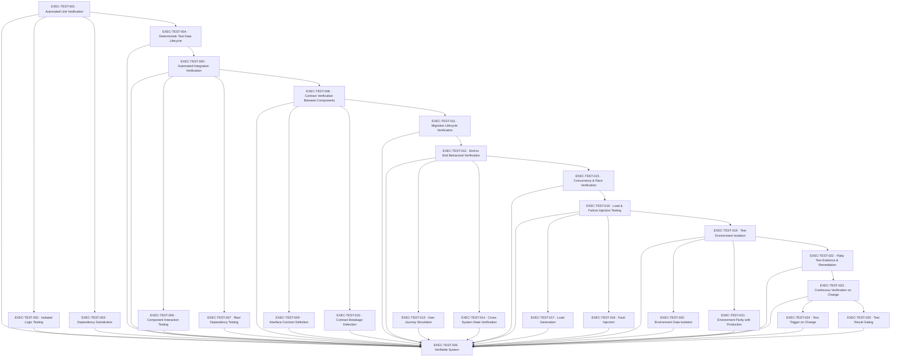

# TEST — Testing

> Node.js built-in test runner/assertions + disposable local dependencies (packages/testing-kit), wired into .github/workflows

**Activation trigger:** Manual Verification No Longer Scales

## Shape

## Execution specification

| Order | ID | Path | Purpose | Activation | Depends on | Exposes | Done when | Capability |
|---:|---|---|---|---|---|---|---|---|

| 282 | `EXEC-TEST-001` | `packages/testing-kit/src/unit/index.ts` | Automated Unit Verification | — | [`EXEC-OBS-031`](./obs.md#exec-obs-031) | `unitTest()` | Unit verification runs with Node.js built-in test/assert primitives through one repository-owned entry point; a deliberately failing assertion produces a non-zero result and no network/database dependency is required. | `TEST-001` |

| 283 | `EXEC-TEST-002` | `packages/testing-kit/src/unit/isolation.ts` | Isolated Logic Testing | — | [`EXEC-TEST-001`](#exec-test-001) | `testIsolated()` | A unit test can execute target logic with deterministic inputs, clock/randomness boundaries supplied by project-owned interfaces, and no filesystem/network/process-global leakage; repeated runs produce the same result. | `TEST-002` |

| 284 | `EXEC-TEST-003` | `packages/testing-kit/src/unit/test-double.ts` | Dependency Substitution | — | [`EXEC-TEST-001`](#exec-test-001) | `TestDouble<T>` | Dependency substitution is expressed through project-owned interfaces/functions rather than a mocking library; tests prove a substitute can force success, failure and timeout behavior without changing production code. | `TEST-003` |

| 285 | `EXEC-TEST-004` | `packages/testing-kit/data-lifecycle/index.ts` | Deterministic Test Data Lifecycle | — | [`EXEC-TEST-001`](#exec-test-001) | `deterministicTestDataLifecycle` | Each integration run creates known isolated data, can reset it deterministically, and repeated runs begin from equivalent state without depending on prior test order. | `TEST-004` |

| 286 | `EXEC-TEST-005` | `packages/testing-kit/src/integration/index.ts` | Automated Integration Verification | — | [`EXEC-TEST-004`](#exec-test-004) | `integrationTest()` | Integration verification starts declared real dependencies, executes component interactions through production boundaries, and tears them down deterministically; dependency startup or assertion failure makes the run fail. | `TEST-005` |

| 287 | `EXEC-TEST-006` | `packages/testing-kit/src/integration/component-fixture.ts` | Component Interaction Testing | — | [`EXEC-TEST-005`](#exec-test-005) | `IntegrationFixture` | A fixture composes multiple real project components and proves data/control flow across their boundary, including one forced downstream failure and cleanup. | `TEST-006` |

| 288 | `EXEC-TEST-007` | `packages/testing-kit/src/integration/real-dependency.ts` | Real Dependency Testing | — | [`EXEC-TEST-005`](#exec-test-005) | `RealDependencyFixture` | Integration verification uses the real declared dependency behavior where correctness depends on PostgreSQL, Redis, or repository-owned queue semantics; substitutes cannot prove those properties. | `TEST-007` |

| 289 | `EXEC-TEST-008` | `packages/testing-kit/src/contracts/index.ts` | Contract Verification Between Components | — | [`EXEC-TEST-005`](#exec-test-005) | `contractTest()` | Contract verification consumes the same versioned contracts exported to producers/consumers and fails when a fixture violates required fields, semantics or supported version. | `TEST-008` |

| 290 | `EXEC-TEST-009` | `packages/testing-kit/src/contracts/fixture.ts` | Interface Contract Definition | — | [`EXEC-TEST-008`](#exec-test-008) | `ContractFixture<T>` | Contract fixtures are versioned, deterministic and stored with the repository; both a valid fixture and an intentionally incompatible fixture demonstrate acceptance/rejection. | `TEST-009` |

| 291 | `EXEC-TEST-010` | `packages/testing-kit/src/contracts/compatibility.ts` | Contract Breakage Detection | — | [`EXEC-TEST-008`](#exec-test-008) | `assertContractCompatibility()` | Compatibility checking detects removal/renaming or incompatible semantic changes to supported contract surfaces and exits non-zero before deployment. | `TEST-010` |

| 292 | `EXEC-TEST-011` | `packages/testing-kit/migrations/index.ts` | Migration Lifecycle Verification | — | [`EXEC-TEST-008`](#exec-test-008), [`EXEC-DB-047`](./db.md#exec-db-047) | `verifyMigrationLifecycle()` | A disposable PostgreSQL database verifies clean apply, upgrade from the previous supported schema, concurrent-run protection, drift detection, and declared reversible/irreversible behavior. | `TEST-011` |

| 293 | `EXEC-TEST-012` | `packages/testing-kit/src/e2e/index.ts` | End-to-End Behavioral Verification | — | [`EXEC-TEST-011`](#exec-test-011) | `e2eTest()` | E2E verification starts the deployable application boundary and exercises it through externally observable interfaces; a failed journey or unexpected response/state fails the run. | `TEST-012` |

| 294 | `EXEC-TEST-013` | `packages/testing-kit/src/e2e/user-journey.ts` | User Journey Simulation | — | [`EXEC-TEST-012`](#exec-test-012) | `UserJourney` | At least one representative user journey covers request, authorization where applicable, persistence and returned result without bypassing application boundaries. | `TEST-013` |

| 295 | `EXEC-TEST-014` | `packages/testing-kit/src/e2e/state-verification.ts` | Cross-System State Verification | — | [`EXEC-TEST-012`](#exec-test-012) | `assertSystemState()` | E2E assertions verify externally visible state plus required durable side effects and prove failed operations do not leave partial/corrupt state. | `TEST-014` |

| 296 | `EXEC-TEST-015` | `packages/testing-kit/concurrency/index.ts` | Concurrency & Race Verification | — | [`EXEC-TEST-012`](#exec-test-012), [`EXEC-QUEUE-026`](./queue.md#exec-queue-026), [`EXEC-DB-034`](./db.md#exec-db-034) | `verifyConcurrencyRace()` | Controlled multi-client/worker tests reproduce declared database and queue races and assert the invariant rather than timing alone, including conflict/idempotency behavior. | `TEST-015` |

| 297 | `EXEC-TEST-016` | `packages/testing-kit/src/load-chaos/index.ts` | Load & Failure Injection Testing | — | [`EXEC-TEST-015`](#exec-test-015) | `loadAndFaultTest()` | A repository-owned harness can generate bounded concurrent load and invoke declared fault controls; it records latency/error/throughput evidence and always restores the environment. | `TEST-016` |

| 298 | `EXEC-TEST-017` | `packages/testing-kit/src/load-chaos/load.ts` | Load Generation | — | [`EXEC-TEST-016`](#exec-test-016) | `LoadProfile` | Load generation defines concurrency, duration/request count, payload and stop limits explicitly; a small deterministic profile proves measured request count and prevents unbounded execution. | `TEST-017` |

| 299 | `EXEC-TEST-018` | `packages/testing-kit/src/load-chaos/fault.ts` | Fault Injection | — | [`EXEC-TEST-016`](#exec-test-016) | `FaultInjector` | Fault injection is limited to explicit test-only process/network/dependency controls, can force at least one dependency failure, and proves cleanup restores normal operation. | `TEST-018` |

| 300 | `EXEC-TEST-019` | `infra/ci/test-environments/index.yml` | Test Environment Isolation | — | [`EXEC-TEST-016`](#exec-test-016) | `IsolatedTestEnvironment` | Each verification run receives isolated process/container resources and deterministic teardown; parallel runs cannot share mutable database/cache/test state accidentally. | `TEST-019` |

| 301 | `EXEC-TEST-020` | `infra/ci/test-environments/data-isolation.yml` | Environment Data Isolation | — | [`EXEC-TEST-019`](#exec-test-019) | `TestDataNamespace` | Test data uses a unique run namespace/schema/key prefix and cleanup verifies no run-owned records/keys remain after success or failure. | `TEST-020` |

| 302 | `EXEC-TEST-021` | `infra/ci/test-environments/parity.yml` | Environment Parity with Production | — | [`EXEC-TEST-019`](#exec-test-019) | `assertEnvironmentParity()` | A machine-readable parity check compares required runtime versions, services, configuration shape and migration state with the production contract and fails on a declared mismatch. | `TEST-021` |

| 303 | `EXEC-TEST-022` | `packages/testing-kit/flaky-tests/index.ts` | Flaky Test Evidence & Remediation | — | [`EXEC-TEST-019`](#exec-test-019) | `flakyTestEvidenceRemediation` | Repeated-test evidence identifies nondeterministic failures; a flaky test cannot silently become accepted by retries alone and must be fixed, quarantined with ownership, or removed with justification. | `TEST-022` |

| 304 | `EXEC-TEST-023` | `.github/workflows/test.yml` | Continuous Verification on Change | — | [`EXEC-TEST-022`](#exec-test-022) | `VerificationGate` | The verification workflow runs required checks for a change and fails closed: any missing, cancelled or failed mandatory check prevents a green gate. | `TEST-023` |

| 305 | `EXEC-TEST-024` | `packages/testing-kit/src/change-selection.ts` | Test Trigger on Change | — | [`EXEC-TEST-023`](#exec-test-023) | `selectVerificationForChange()` | Change selection is deterministic from repository paths/dependency metadata, always includes safety-critical/global checks when their inputs change, and has a full-suite fallback when impact cannot be resolved. | `TEST-024` |

| 306 | `EXEC-TEST-025` | `packages/testing-kit/src/result.ts` | Test Result Gating | — | [`EXEC-TEST-023`](#exec-test-023) | `VerificationResult` | Every check emits machine-readable name/status/duration/evidence location; the aggregate result is success only when every mandatory selected check succeeds. | `TEST-025` |

| 307 | `EXEC-TEST-026` | — | Verifiable System | — | [`EXEC-TEST-001`](#exec-test-001), [`EXEC-TEST-002`](#exec-test-002), [`EXEC-TEST-003`](#exec-test-003), [`EXEC-TEST-004`](#exec-test-004), [`EXEC-TEST-005`](#exec-test-005), [`EXEC-TEST-006`](#exec-test-006), [`EXEC-TEST-007`](#exec-test-007), [`EXEC-TEST-008`](#exec-test-008), [`EXEC-TEST-009`](#exec-test-009), [`EXEC-TEST-010`](#exec-test-010), [`EXEC-TEST-011`](#exec-test-011), [`EXEC-TEST-012`](#exec-test-012), [`EXEC-TEST-013`](#exec-test-013), [`EXEC-TEST-014`](#exec-test-014), [`EXEC-TEST-015`](#exec-test-015), [`EXEC-TEST-016`](#exec-test-016), [`EXEC-TEST-017`](#exec-test-017), [`EXEC-TEST-018`](#exec-test-018), [`EXEC-TEST-019`](#exec-test-019), [`EXEC-TEST-020`](#exec-test-020), [`EXEC-TEST-021`](#exec-test-021), [`EXEC-TEST-022`](#exec-test-022), [`EXEC-TEST-023`](#exec-test-023), [`EXEC-TEST-024`](#exec-test-024), [`EXEC-TEST-025`](#exec-test-025), [`EXEC-OBS-031`](./obs.md#exec-obs-031) | — | A clean checkout can run unit, integration, contract and representative E2E verification using only declared stack tooling; forced failures in each class propagate to a non-zero gate and evidence identifies the failed class. | `TEST-026` |
